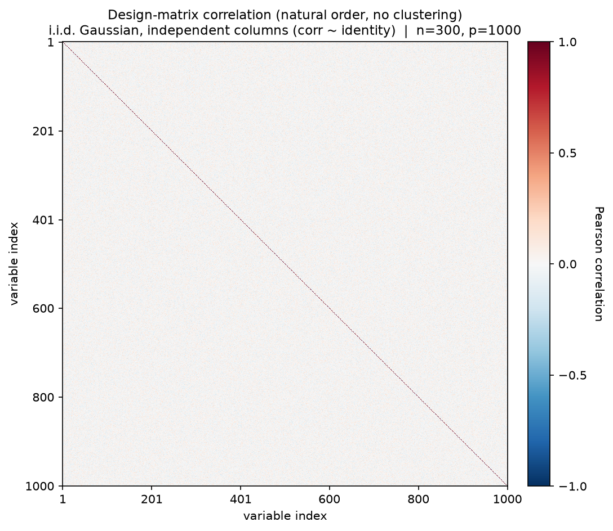
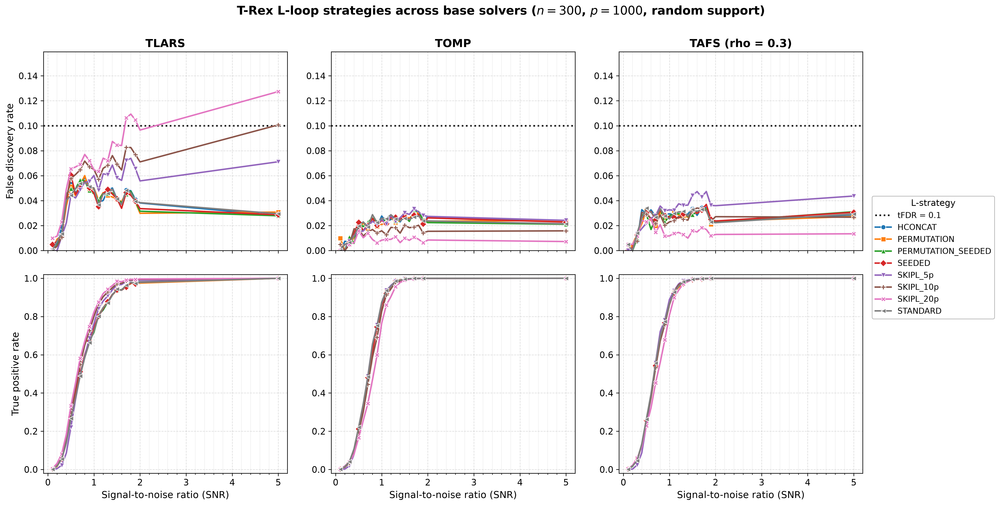
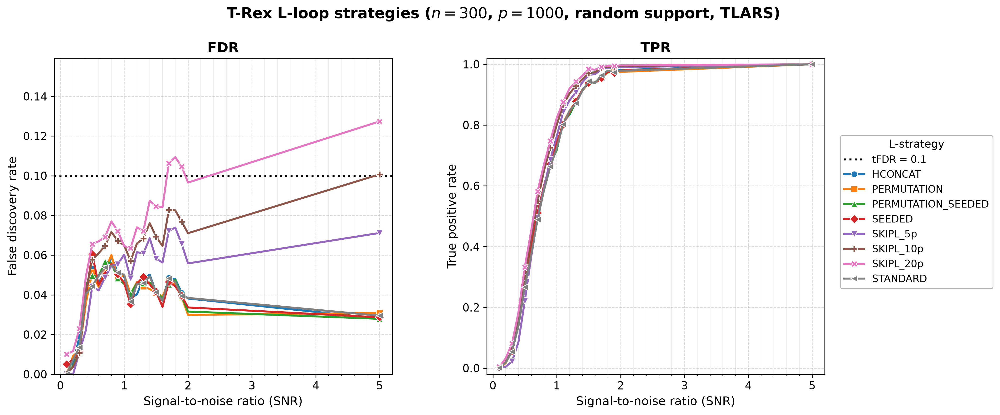

# Demo 04: L-Loop Strategy Comparison (Python)

## Purpose

Compare the T-Rex **L-loop strategies** — the different mechanisms by which the
dummy-variable structure is generated/expanded across L-loop iterations — and
repeat the whole comparison across **three base solver families** (TLARS, TOMP,
TAFS). This shows how the L-loop strategy affects FDR control, power (TPR), and
the calibrated dummy multiplier $L$ / stopping time $T$, and — crucially —
whether the fixed-budget `SKIPL` FDR overshoot seen under TLARS is specific to
the LARS path or persists under the greedy solvers. Python port of
[cpp/trex_selector_methods/ad/trex_core/demo_trex_04_mc_sim_lloop_strategies](../../../../../cpp/trex_selector_methods/ad/trex_core/demo_trex_04_mc_sim_lloop_strategies/)
(which extends the R version: R fixes the base solver at TLARS).

---

## Data Generation Parameters

The shared Gaussian generator `dgp_gauss_snr` draws an i.i.d. standard-normal
design $\boldsymbol{X}$ (independent columns), so the design carries **no
correlation structure** — the empirical column-correlation matrix is essentially
the identity:

```math
\boldsymbol{y} = \boldsymbol{X}\boldsymbol{\beta} + \boldsymbol{\epsilon},
\qquad \boldsymbol{\epsilon} \sim \mathcal{N}(\boldsymbol{0}, \sigma^2 \boldsymbol{I}_n).
```



- **Sample size**: $n = 300$, **features**: $p = 1000$ (high-dimensional), $s = 10$
- **True support**: random subset of size 10, **redrawn per trial**
  (`block_support=False`); a contiguous block support $\lbrace0, \ldots, s-1\rbrace$ is
  available via `block_support=True`
- **True coefficients**: fixed $\beta_j = 1$ (`rnd_coef = False`)
- **SNR grid**: 21 values — $\lbrace0.1, 0.2, \ldots, 2.0\rbrace$ plus $5.0$
- **Monte Carlo repetitions**: `num_MC = 200` trials per strategy × SNR
  (`_NUM_MC = 200`, mirroring the C++ reference — the full grid is 3 solvers ×
  8 strategies × 21 SNR)
- **Base solvers** (`_SOLVERS`, outer sweep, one result-file pair each): **TLARS**,
  **TOMP**, **TAFS** (`rho_afs = 0.3`)

---

## L-Loop Strategies Tested

`L_STRATEGIES` defines the **eight rows** (mirrors `make_lloop_strategies()`),
spanning two axes: **dummy source** (fresh i.i.d. draws vs a shared base matrix
permuted per experiment) and **storage** (*stored* vs seed-derived *on-demand*):

1. **STANDARD** — stored; fresh i.i.d. dummy matrices at each L-loop iteration
   (conservative default, matches the CRAN R reference).
2. **HCONCAT** — stored; horizontally expand (concatenate) dummy columns; prefix-stable.
3. **PERMUTATION** — stored base dummy matrix, re-used via deterministic row permutations.
4. **PERMUTATION_SEEDED** — seed-derived base + row permutations; nothing stored.
   Bit-identical to PERMUTATION for the same seed.
5. **SEEDED** — seed-derived independent dummies; nothing stored.
6. **SKIPL_5p / SKIPL_10p / SKIPL_20p** — skip the L-loop entirely and use the
   fixed $L = \text{max\_dummy\_multiplier} \in \lbrace5, 10, 20\rbrace \times p$.

(The former `DIRECT` / `PERMUTATION_DIRECT` names were renamed to `SEEDED` /
`PERMUTATION_SEEDED`; the old names are no longer accepted by the binding.)

---

## Control Parameters

```text
solver_name           = <varies>   # TLARS / TOMP / TAFS (outer sweep)
rho_afs               = 0.3        # TAFS regularization (ignored by TLARS/TOMP)
K                     = 20         # Random experiments per T-loop iteration
max_dummy_multiplier  = <varies>   # 10 for adaptive; 5 / 10 / 20 for SKIPL
use_max_T_stop        = True       # Cap T <= ceil(n/2)
dummy_distribution    = Normal     # Dummy predictors drawn from N(0,1)
lloop_strategy        = <varies>   # Inner sweep across the 6 strategy types (8 rows)
tFDR                  = 0.1        # Target FDR control level
```

---

## Output Files

Written to `simulation_results/data/`, one `.txt` + `.csv` pair **per base
solver**, stems
`demo_trex_04_lloop_strategies_results_n300_p1000_{tlars,tomp,tafs}_random_support`.
The CSV uses the tidy `solver,metric,snr,value` schema, but here the "solver"
column holds the **strategy** name (the base solver is encoded in the file name),
matching the C++ result files — so the suite's
[`../trex_plt_utils.py`](../trex_plt_utils.py) renders the same per-solver
figures and the cross-solver comparison grid. Figures (PNG + PDF + interactive
HTML) land in `simulation_results/plots/`.

---

## Results Visualization

`./generate_plots.sh` renders two complementary views into
`simulation_results/plots/`: a **cross-solver comparison grid** (the figure for
this demo's core question) and the standard **per-solver figure sets**. Both are
built only after the demo has been run for all three base solvers (so the three
per-solver CSVs exist).

### Cross-solver comparison grid

The headline figure — a 2×3 grid, rows = metric (FDR / TPR), columns = base
solver (TLARS / TOMP / TAFS), with all eight L-loop strategies drawn as lines in
every panel. Colours and markers are keyed to the strategy, so a given strategy
is the same colour in every panel and can be tracked across solvers; all FDR
panels share one y-scale and all TPR panels share `[0, 1]`, so the columns are
directly comparable:



This grid answers one question: **is the fixed-budget `SKIPL` FDR overshoot
specific to the LARS path?** It is produced by the suite plotter's `grid` mode
([`../trex_plt_utils.py`](../trex_plt_utils.py) `grid --labels TLARS TOMP TAFS
--csvs ...`), which reads all three solver CSVs at once and renders them on a
shared scale.

**Established finding — the overshoot is LARS-specific** (`num_MC = 200`, a
stable effect rather than Monte Carlo noise; numbers read off the fresh
`..._{tlars,tomp,tafs}_random_support.txt`):

- Under **TLARS** the adaptive strategies (STANDARD, HCONCAT, PERMUTATION,
  PERMUTATION_SEEDED, SEEDED) hold FDR near or below the target tFDR $= 0.1$
  across the grid — STANDARD even trends *down* to $\approx 0.030$ at SNR 5 —
  while the fixed-budget `SKIPL` levels break control in ascending order of
  budget: `SKIPL_5p` stays under (max FDR $\approx 0.074$ near SNR 1.8),
  `SKIPL_10p` grazes the line at SNR 5 ($\approx 0.101$), and `SKIPL_20p` climbs
  steadily past the line from SNR $\approx 1.7$ (0.106) to **≈ 0.127** at
  SNR 5 — a monotone overshoot that tracks a runaway stopping time (`SKIPL_20p`
  Avg T reaches $\approx 147$ vs the true support size $s = 10$; `SKIPL_10p`
  $\approx 89$, `SKIPL_5p` $\approx 23$). Freezing $L$ removes the calibration
  that places the relative-occurrence threshold and the T-loop stop, so an
  over-large fixed dummy pool biases the FDP estimate optimistic.
- The **TOMP** and **TAFS** columns run the test, and the fresh numbers settle
  it: **neither greedy solver overshoots**. Under **TOMP** every `SKIPL` level
  stays far below tFDR (`SKIPL_5p` @ 5.0 $= 0.024$, `SKIPL_10p` $= 0.016$,
  `SKIPL_20p` $= 0.007$); under **TAFS** likewise (`SKIPL_5p` @ 5.0 $= 0.044$,
  `SKIPL_10p` $= 0.027$, `SKIPL_20p` $= 0.014$). Strikingly, the budget ordering
  **reverses** for both greedy solvers — a *larger* fixed $L$ yields *lower* FDR,
  the opposite of TLARS — and their `Avg T` never runs away (TOMP/TAFS
  `SKIPL_20p` Avg T @ 5.0 $\approx 6.0$ vs TLARS's $\approx 147$). The greedy
  solvers' stagnation stop halts the T-loop before an over-large dummy pool can
  dilute the threshold, so the overshoot is a property of the equiangular LARS
  path, not of `SKIPL` in general. See the C++ demo's
  [discussion](../../../../../cpp/trex_selector_methods/ad/trex_core/demo_trex_04_mc_sim_lloop_strategies/README.md#results-visualization).

**Practical note**: the seed-based SEEDED / PERMUTATION_SEEDED strategies
hold no dummy matrix in memory — the preferred choice at scale; SKIPL is a
speed/convenience knob, not a drop-in replacement for the calibrated L-loop.

### Per-solver figure sets

For each base solver, [`../trex_plt_utils.py`](../trex_plt_utils.py) also renders
the usual overview (all eight strategies on one FDR | TPR pair), a de-cluttered
grouped 2×2 view, and a self-contained interactive Plotly HTML (the CSV's
"solver" column holds the strategy name, so the strategies are the legend). The
TLARS overview:



The `_grouped` PNG/PDF and the interactive `.html` (hover for values, **click a
strategy in the legend to isolate it** in both panels) sit alongside, one set per
solver (`tlars` / `tomp` / `tafs`). Open an HTML directly in a browser.
The `.html` figures are not committed to the repository (each embeds a full copy of
plotly.js); run `./generate_plots.sh` to produce them locally.

```bash
open simulation_results/plots/demo_trex_04_lloop_strategies_results_n300_p1000_tlars_random_support_fdr_tpr_vs_snr.html
```

### Regenerating the figures

Run the demo first (it writes the three per-solver CSVs), then the wrapper — it
picks up the repo's local `.venv` automatically and renders **all** three
per-solver sets plus the comparison grid:

```bash
# From this demo folder:
./generate_plots.sh                 # 3 per-solver sets (png+pdf+html) + the grid
```

---

## Running

```bash
python Python/trex_selector_methods/ad/trex_core/demo_trex_04_mc_sim_lloop_strategies/demo_trex_04_mc_sim_lloop_strategies.py
```

The MC loop is parallelized with `ProcessPoolExecutor` using `_NUM_WORKERS = 6`.
The full sweep is large — with `num_MC = 200` across 3 solvers × 8 strategies ×
21 SNR, expect a multi-hour/overnight run (the `SKIPL_20p` / `SKIPL_10p` points at
high SNR dominate under TLARS, where the T-loop runs to $T \approx 80\text{–}150$).
