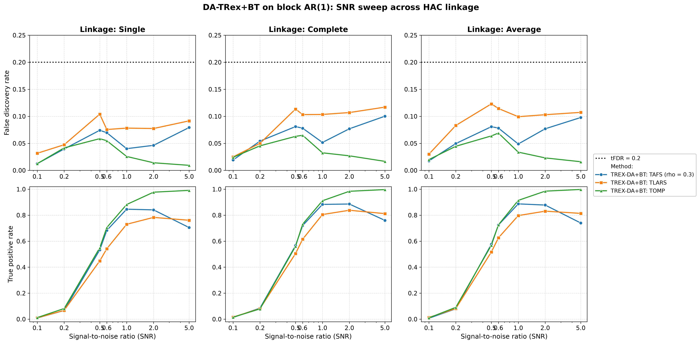
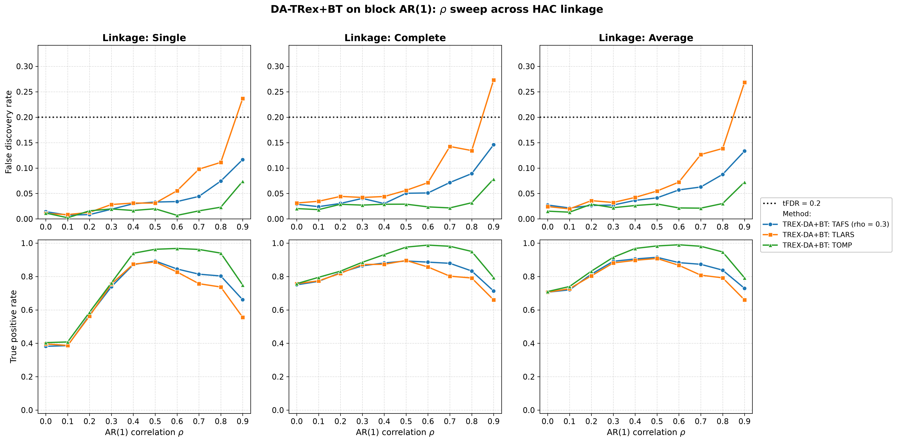
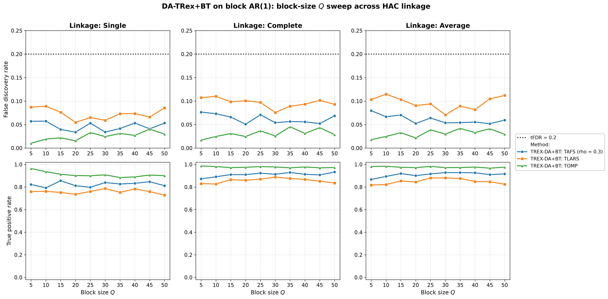
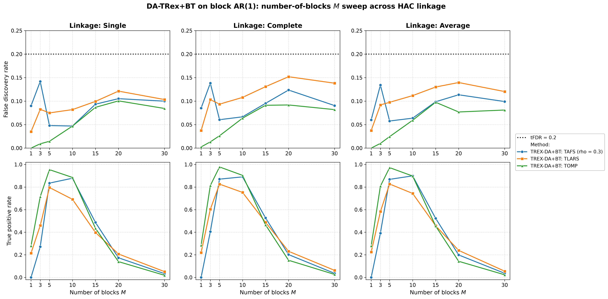

# Demo 03: DA-TRex+BT (Binary-Tree Dependency-Aware T-Rex) on Block-Diagonal AR(1) Data (Python)

Monte-Carlo results for **DA-TRex+BT** — the Binary-Tree Dependency-Aware T-Rex selector
(`DAMethod.BT`) — on a clean block-diagonal AR(1) design (no white-noise padding), sweeping SNR,
$\rho$, block size $Q$, and number of blocks $M$, each across the three HAC linkage methods
(Single / Complete / Average).
Common setup: $n=150$, amplitude $1.0$, $\mathrm{tFDR}=0.2$, $K=20$ random experiments,
$\mathrm{MC}=200$ per grid point; solvers TLARS / TAFS / TOMP.

Python port of the C++ demo
[cpp/trex_selector_methods/ad/trex_da/demo_trex_da_03_mc_sim_ar1_blocks](../../../../../cpp/trex_selector_methods/ad/trex_da/demo_trex_da_03_mc_sim_ar1_blocks/README.md)
— same DGP, control parameters, sweep axes, console summaries, and result-file naming. The numbers
below are this Python run's own results; they agree with the C++ reference up to Monte-Carlo noise
(independent RNG streams).

The greedy solvers use *exchangeable tie-breaking* (`exch_tie_alpha = 0.25` for TAFS/TOMP, `0` for
TLARS); see `Exchangeable_Tie_Breaking_DA_TRex.md` in the TRex_Research documentation.
TAFS additionally runs with its AFS correlation parameter `rho_afs = 0.3` (`0` for TLARS/TOMP), which
is why the figures label it `TAFS (rho = 0.3)`.

---

## Setup — the DA-TRex+BT selector

The selector deflates each variable's ordinary relative occurrence $\Phi_{T,L}(j)$ by the penalty
$`\Psi^{\mathrm{BT}}_{T,L}(j) \in [1/2, 1]`$ built from its most similar competitor within its
variable group,

```math
\Phi^{\mathrm{BT}}_{T,L}(j) := \Psi^{\mathrm{BT}}_{T,L}(j) \cdot \Phi_{T,L}(j),
```

where the **BT group design** obtains the groups $\mathrm{Gr}(j)$ from a **binary tree**: variables
are clustered by hierarchical agglomerative clustering (HAC) on the dissimilarity
$`1 - |\mathrm{corr}(\boldsymbol{x}_j, \boldsymbol{x}_{j'})|`$ and the dendrogram cut defines disjoint
groups (see [Demo 02](../demo_trex_da_02_mc_sim_ar1_blocks_plus_white/README.md) for the full penalty
formula). The **linkage method** sets the between-cluster distance during agglomeration —
**Single** ($\min$, prone to chaining), **Complete** ($\max$, compact clusters), **Average**
(mean, UPGMA) — and every sweep below runs once per linkage to probe its influence.

## Setup — data generating process (`dgp_ar1_block_snr`)

The design consists of $M$ statistically independent AR(1) blocks of size $Q$ — and nothing else:
unlike Demo 02 there is no white-noise padding, so *every* column belongs to a correlated block and
$p = M \cdot Q$. The within-block correlation follows the $Q \times Q$ Toeplitz matrix

```math
\left[\boldsymbol{\Sigma}_{m}(\rho)\right]_{j,k} = \rho^{|j-k|},
\qquad m = 1, \ldots, M,
```

generated per block via the recursion $z_{j} = \rho\, z_{j-1} + \sqrt{1-\rho^{2}}\,\varepsilon_{j}$
with $z_1, \varepsilon_j \sim \mathcal{N}(0,1)$, giving the block-diagonal covariance

```math
\boldsymbol{\Sigma} =
\begin{bmatrix}
\boldsymbol{\Sigma}_1(\rho) & & \\
& \ddots & \\
& & \boldsymbol{\Sigma}_M(\rho)
\end{bmatrix} \in \mathbb{R}^{p \times p},
\qquad p = M \cdot Q.
```

At the base point the problem is *low-dimensional* ($p = 25 \ll n = 150$); the $Q$ sweep pushes it
past $p > n$ ($p = 250$ at $Q = 50$), and the $M$ sweep reaches $p = n = 150$ at $M = 30$.

The block core is exactly the one shown in **Demo 02**'s design-correlation heatmap
([`../dgp_corr_plots/da_ar1_block_white.png`](../dgp_corr_plots/da_ar1_block_white.png)), minus the
white padding that follows it. The `da_ar1_block` figure in
[`../dgp_corr_plots/`](../dgp_corr_plots/) renders the same generator at an illustrative
$p = 1000$ / 5 blocks of 200, where the within-block $\rho^{|j-k|}$ decay makes the blocks all but
invisible — the $\text{small-}Q$ view of Demo 02 is the more informative picture for this demo's base point.

**Support (`OnePerBlock`).** Exactly one representative per AR(1) block,

```math
\mathcal{S} = \{s_1, \ldots, s_M\}, \qquad s_m \in \{(m-1)Q, \ldots, mQ - 1\},
```

(0-based Python indices; the R suite is 1-based) so $s = M$ and every block carries a signal.

**Linear model and SNR control.** Each trial draws $y = X\beta + \varepsilon$ with active amplitude
$\beta_{s_m} = 1.0$, $\varepsilon_i \stackrel{\text{iid}}{\sim} \mathcal{N}(0, \sigma^2)$, and
$\sigma^2 = \widehat{\mathrm{Var}}(X\beta)/\mathrm{SNR}$.

**Base parameters** (each sweep varies one dimension, ceteris paribus): $M=5$, $Q=5$ ($p=25$,
$s=5$), $\rho=0.7$, $\mathrm{SNR}=2.0$, seed $2026$.

---

## Running the Demo

```bash
python Python/trex_selector_methods/ad/trex_da/demo_trex_da_03_mc_sim_ar1_blocks/demo_trex_da_03_mc_sim_ar1_blocks.py
```

The four parts are toggled by the `RUN_PART_*` flags at the top of the file (all `True`, mirroring the
cpp `if (true)` toggles); reduce `NUM_MC` to preview. The file inserts both its own folder and the
parent suite directory onto `sys.path` so `dgp_generators` / `da_sim_common` resolve in the demo *and*
in the spawned workers — run it as a file, not piped via `python -`. Monte-Carlo trials run in
parallel through `concurrent.futures.ProcessPoolExecutor` (up to `min(6, os.cpu_count())` workers).

Afterwards, regenerate the figures from the CSVs with [`generate_plots.sh`](generate_plots.sh), which
drives the suite plotting module [`../trex_da_plt_utils.py`](../trex_da_plt_utils.py) through the
repo-root `.venv` (`pip install matplotlib pandas plotly`).

---

## Output Files

Data tables are written to `simulation_results/data/` (24 files = 12 scenario stems, one
`.txt`+`.csv` pair each):

- `da_trex_mc_da_ar1_blocks_snr_{Single,Complete,Average}.txt` / `.csv`
- `da_trex_mc_da_ar1_blocks_rho_{Single,Complete,Average}.txt` / `.csv`
- `da_trex_mc_da_ar1_blocks_Q_{Single,Complete,Average}.txt` / `.csv`
- `da_trex_mc_da_ar1_blocks_M_{Single,Complete,Average}.txt` / `.csv`

Figures go to `simulation_results/plots/`: one FDR/TPR overview (PNG/PDF + interactive Plotly HTML)
per sweep × linkage, plus one linkage-comparison grid (Single/Complete/Average columns) per sweep —
the four grids embedded below.

---

## Part 1 — SNR sweep ($\mathrm{SNR} \in \lbrace0.1, 0.2, 0.5, 0.6, 1, 2, 5\rbrace$)

- **FDR stays under the $\mathrm{tFDR}=0.2$ target at every SNR** (worst cell $0.123$, TLARS at
  $\mathrm{SNR}=0.5$ under Average linkage) — but visibly higher than the white-noise-diluted Demo 02
  ($\leq 0.032$ at the same base point): in an all-block design every false discovery candidate is a
  correlated shadow.
- TPR: TOMP is the strongest throughout ($0.98\text{–}1.0$ from $\mathrm{SNR}=2$); TLARS reaches
  $0.76\text{–}0.84$; TAFS peaks at $\mathrm{SNR}=1\text{–}2$ ($0.84\text{–}0.89$) and then *declines* to
  $\approx 0.71\text{–}0.76$ at $\mathrm{SNR}=5$ — the same non-monotonicity seen in Demo 02.
- Linkage has only a mild effect here; Complete/Average buy a few TPR points over Single.



---

## Part 2 — $\rho$ sweep ($\rho \in \lbrace0.0, 0.1, \ldots, 0.9\rbrace$)

- **FDR rises steadily with $\rho$ and TLARS breaks the target at $\rho=0.9$** under Complete and
  Average linkage ($0.273$ / $0.268$; Single stays just under at $0.237$); TAFS remains controlled
  ($0.12\text{–}0.15$) and TOMP comfortably so ($0.07\text{–}0.08$). Strong within-block correlation makes the
  block shadows progressively harder to deflate — the block-design counterpart of the $\text{high-}\rho$
  corner seen in Demos 01 and 07.
- **Single linkage again loses power at low $\rho$**: TPR $0.38\text{–}0.41$ at $\rho \leq 0.1$ vs.
  $0.71\text{–}0.80$ for Complete/Average — without a clear chain to follow, single-linkage mis-groups
  the weakly-correlated blocks. All linkages coincide from $\rho \approx 0.4$.
- TPR peaks $\text{mid-}\rho$ and falls toward $\rho=0.9$ (TOMP $0.75\text{–}0.79$, TAFS $0.66\text{–}0.73$,
  TLARS $0.56\text{–}0.66$).



---

## Part 3 — Block-size $Q$ sweep ($Q \in \lbrace5, 10, \ldots, 50\rbrace$; $p = 5Q$ grows to $250 > n$)

- FDR is comfortably controlled over the whole sweep (max $0.115$, TLARS under Average linkage at
  $Q=10$) even as the design crosses into the high-dimensional regime ($p = 250 > n = 150$ at $Q=50$).
- Complete/Average linkage handle growing blocks gracefully (TOMP $0.97\text{–}0.99$, TAFS $0.87\text{–}0.93$,
  TLARS $0.82\text{–}0.89$ throughout); **Single linkage sits a consistent $0.07\text{–}0.10$ TPR below them**
  across the sweep (TOMP $0.88\text{–}0.96$, TLARS $0.73\text{–}0.79$) — the same fragility as in Demo 02's $Q$
  sweep, though milder without the white pool to merge into.



---

## Part 4 — Number-of-blocks $M$ sweep ($M \in \lbrace1, 3, 5, 10, 15, 20, 30\rbrace$; $s = M$, $p = 5M$)

- The stress dimension: $s = M$ grows while $n = 150$ and the amplitude stay fixed. **TPR collapses
  for $M \gtrsim 20$** ($\approx 0.14\text{–}0.24$ at $M=20$, $\leq 0.06$ at $M=30$, where $p = n$),
  while FDR stays below target throughout (max $0.152$, TLARS at $M=20$) — the selector fails *safe*.
- The $M=1$ corner is degenerate ($p=5$, one active variable): all solvers are weak
  (TPR $\leq 0.29$) and TAFS selects nothing at all — with a single signal there is no occurrence
  spread for the DA deflation to work with.
- The sweet spot sits at $M \approx 5\text{–}10$, where TOMP holds $\approx 0.9$+ TPR with FDR
  $\approx 0.02\text{–}0.06$.



---

## Interpretation

- Read this demo against **Demo 02** (same block AR(1) core plus $975$ white-noise columns,
  $n=300$): the pure block design at half the sample size shows uniformly higher realized FDR —
  culminating in TLARS's $\rho=0.9$ violation — and lower TPR. Diluting the design with null columns
  *helps* the selector; concentrating it into correlated blocks is the harder problem.
- The linkage story is consistent across both demos: irrelevant at the well-correlated base point,
  but **Single linkage is the fragile choice** at low $\rho$ and large $Q$; Complete or Average are
  the safer defaults.
- Solver ranking on block designs: **TOMP is the most robust** (best TPR *and* lowest FDR in nearly
  every cell), TAFS in between with its high-SNR power decline, TLARS the most FDR-fragile at strong
  within-block correlation.
