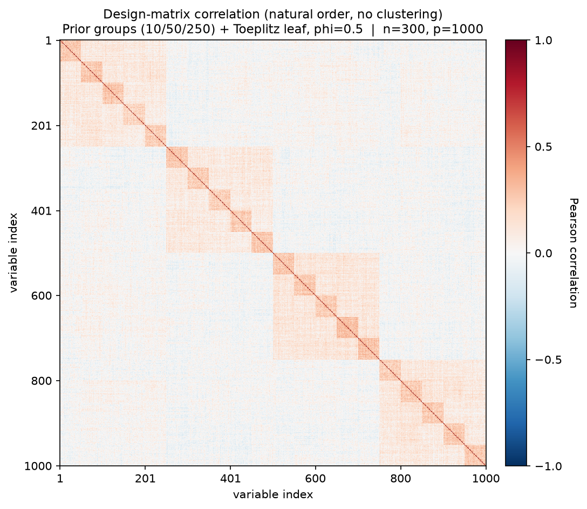
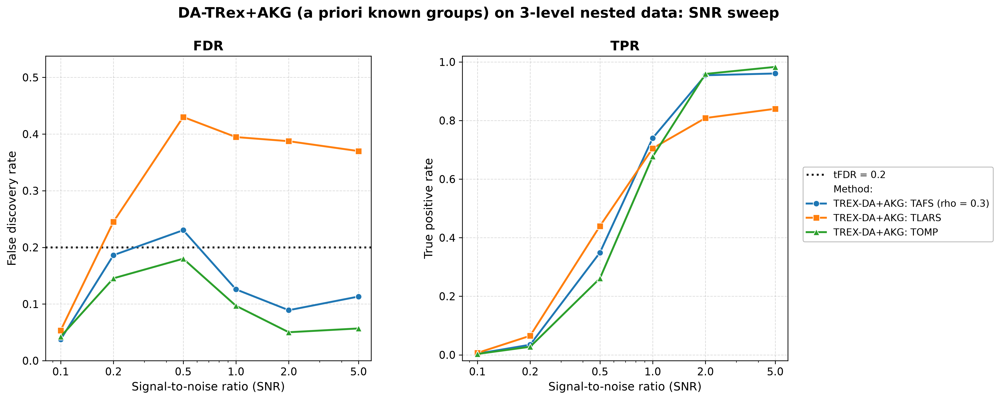

# Demo 06: DA-TRex+AKG (A Priori Known Groups) on Multi-Level Nested Data (Python)

Monte-Carlo results for **DA-TRex+AKG** — the dependency-aware T-Rex selector with **a priori known
groups**: the true group structure is supplied to the selector as a hard **constraint** on its
dependency tree (constrained sub-clustering), instead of letting hierarchical agglomerative
clustering (HAC) discover the structure from scratch.
The data-generating process is a three-level nested latent-factor model with a non-exchangeable
Toeplitz leaf layer.
Common setup: $n=300$, $p=1000$, $s=10$, `Random` support, amplitude $3.0$, $\mathrm{tFDR}=0.2$,
$K=20$ random experiments, $\mathrm{MC}=200$ per grid point; solvers TLARS / TAFS / TOMP; SNR sweep
$\mathrm{SNR} \in \lbrace0.1, 0.2, 0.5, 1, 2, 5\rbrace$.

Python port of the C++ demo
[cpp/trex_selector_methods/ad/trex_da/demo_trex_da_06_mc_sim_groups](../../../../../cpp/trex_selector_methods/ad/trex_da/demo_trex_da_06_mc_sim_groups/README.md)
— same DGP, control parameters, sweep axis, console summaries, and result-file naming. The numbers
below are this Python run's own results; they agree with the C++ reference up to Monte-Carlo noise
(independent RNG streams).

The greedy solvers use *exchangeable tie-breaking* (`exch_tie_alpha = 0.25` for TAFS/TOMP, `0` for
TLARS); see `Exchangeable_Tie_Breaking_DA_TRex.md` in the TRex_Research documentation.
TAFS additionally runs with its AFS correlation parameter `rho_afs = 0.3` (`0` for TLARS/TOMP), which
is why the figures label it `TAFS (rho = 0.3)`.

---

## Setup — the DA-TRex+AKG selector (constrained sub-clustering)

The known three-level hierarchy is passed via `da_control.prior_groups` (when non-empty, the
`method` field is ignored). Since 2026-07-17 the `PRIOR_GROUPS` method treats these labels as
**merge constraints**, not as deflation neighbourhoods:

1. the **finest common refinement** of the supplied levels (here: the groups of 10) partitions the
   variables — two variables can only ever share a deflation neighbourhood if they share a group
   on every level;
2. **HAC runs within each constraint group** (`hc_linkage`, correlation distance) — merges across
   group boundaries are structurally impossible;
3. the calibration **rho grid is data-driven**: the pooled within-group dendrogram heights are
   subsampled to `hc_grid_length` (default $\min(20, p) = 20$) grid points, terminated by the
   conservative $\rho = 1$ singleton anchor (every neighbourhood empty $\Rightarrow$ the paper's
   maximal penalty $\Psi = 1/2$ everywhere);
4. the BT-style occurrence deflation and 3D $(T, v, \rho)$ calibration (see
   [Demo 02](../demo_trex_da_02_mc_sim_ar1_blocks_plus_white/README.md) for the penalty formula)
   run unchanged on these tight within-group neighbourhoods.

Negative group labels are rejected by the Python binding.

**Why not use the raw groups as neighbourhoods?** That was the pre-2026-07-17 behaviour, and it
fails by design: the nearest-partner penalty
$\Psi_j = 1/(2 - \min_{j' \in \mathrm{Gr}(j)} |\Phi_j - \Phi_{j'}|)$ presumes tight, near-
exchangeable neighbourhoods; inside a 10/50/250-member group nearly every variable has *some*
member with an almost identical occurrence, so $\delta \to 2$ uniformly and the shadow/active
ranking is left invariant. The full analysis, including the archived results of the old behaviour,
is in `TRex_Research/documentation/Prior_Groups_Deflation_Mismatch_DA_TRex.md` (§1–§8 the
mismatch, §9 this resolution).

**Relation to BT.** The method is now exactly "BT, tightened by prior knowledge": same machinery,
but the tree can never merge across known group boundaries, so actives are never deflated against
unrelated variables — the constraints buy power, not a different failure mode. The figures label the
method `TREX-DA+AKG: <solver>` (applied at plot time via the plotter's `--relabel` flag, so the CSVs
keep the raw `TREX-DA:` labels the demo writes).

## Setup — data generating process (`dgp_groups_toeplitz_leaf`)

Each predictor is a sum of nested latent factors plus a correlated leaf term,

```math
X_{i,j} = \sum_{x=1}^{L-1} \sqrt{\rho_x - \rho_{x+1}}\; f_{g_x(j)}
        + \sqrt{\rho_0 - \rho_1}\; u_{g_0(j),\,j}
        + \sqrt{1-\rho_0}\;\eta_{i,j},
```

where the coarser levels $x \geq 1$ use one standard-normal latent factor per group, and the finest
level ($x = 0$) uses a **Toeplitz-correlated leaf block** — within each finest group the leaf
variables $u_r$ satisfy $\mathrm{Cov}(u_r, u_s) = \phi^{|r-s|}$ with $\phi_{\text{leaf}} = 0.5$ —
so even the members of a finest-level group are *not* exchangeable.

- **Three nested grouping levels** over $p = 1000$: level 1 = groups of $10$ ($100$ groups),
  level 2 = groups of $50$ ($20$ groups), level 3 = groups of $250$ ($4$ groups).
- **Cumulative correlation masses** (fine → coarse): $\rho = \lbrace0.55, 0.25, 0.10\rbrace$ — a variable
  shares $55\%$ of its variance with its group of 10, $25\%$ with its group of 50, $10\%$ with its
  group of 250.
- Support: $s = 10$ active variables drawn by the `Random` policy per trial (0-based indices),
  amplitude $3.0$; $y = X\beta + \varepsilon$ with
  $\sigma^2 = \widehat{\mathrm{Var}}(X\beta)/\mathrm{SNR}$.



Empirical Pearson correlation of an exemplary design drawn from this DGP (groups of 10/50/250,
$\rho = \lbrace0.55, 0.25, 0.10\rbrace$, $\phi = 0.5$, seed 2026), in **natural variable order — no
hierarchical clustering**: the nested block structure is visible as squares within squares.
Regenerate the per-DGP figures with [`../generate_corr_plots.sh`](../generate_corr_plots.sh)
(shared plotter [`../../../corr_plt_utils.py`](../../../corr_plt_utils.py)).

---

## Running the Demo

```bash
python Python/trex_selector_methods/ad/trex_da/demo_trex_da_06_mc_sim_groups/demo_trex_da_06_mc_sim_groups.py
```

Reduce `NUM_MC` to preview. The file inserts both its own folder and the parent suite directory onto
`sys.path` so `dgp_generators` / `da_sim_common` resolve in the demo *and* in the spawned workers —
run it as a file, not piped via `python -`. Monte-Carlo trials run in parallel through
`concurrent.futures.ProcessPoolExecutor` (up to `min(6, os.cpu_count())` workers).

Afterwards, regenerate the figure from the CSV with [`generate_plots.sh`](generate_plots.sh), which
drives the suite plotting module [`../trex_da_plt_utils.py`](../trex_da_plt_utils.py) through the
repo-root `.venv` (`pip install matplotlib pandas plotly`).

---

## Output Files

Data tables are written to `simulation_results/data/`:

- `da_trex_mc_da_groups_toeplitz_leaf.txt` / `.csv`

The figure (PNG/PDF + interactive Plotly HTML) goes to `simulation_results/plots/`.

---

## Results — SNR sweep

- **The greedy solvers win on power and are controlled wherever the signal is resolvable**: TOMP
  reaches TPR $0.983$ with FDR down to $\approx 0.05\text{–}0.06$ at high SNR; TAFS reaches TPR $0.961$
  with FDR $\approx 0.09\text{–}0.11$ from $\mathrm{SNR}=1$ on.
- Both greedy solvers have a **high-variance excursion in the low-SNR transition region**: at
  $\mathrm{SNR}=0.5$ TAFS realizes $0.230$ (above the $\mathrm{tFDR}=0.2$ target, sd $0.217$) and
  TOMP $0.180$, with TPR still only $0.26\text{–}0.35$ there. With so few selections per trial the FDP is
  near-binary, so these cells carry a large Monte-Carlo error (the C++ reference run lands at $0.181$
  / $0.128$ in the same cells).
- **TLARS remains the outlier of the suite**: FDR $\approx 0.37\text{–}0.43$ from $\mathrm{SNR}=0.5$ on
  (vs. the $\mathrm{tFDR}=0.2$ target) and **flat in SNR**, with TPR $\approx 0.84$ at
  $\mathrm{SNR}=5$.



---

## Interpretation — why does TLARS still fail although the groups are known?

With the constrained sub-clustering, the deflation operates on tight, data-driven neighbourhoods
inside the true groups — the structure the nearest-partner penalty

```math
\Psi_j = \frac{1}{2 - \min_{j' \in \mathrm{Gr}(j)} |\Phi_j - \Phi_{j'}|}
```

was designed for. What it *cannot* repair is the penalty's **pairwise symmetry**: it deflates a
shadow and its nearest neighbour (typically the true active) by the same factor, leaving their
*ranking* invariant. Whether the ranking is decided correctly is therefore up to the solver's
occurrence profile:

- **Greedy solvers thrive** at moderate within-group correlation ($\rho_1 = 0.55$, far from
  Demo 01's near-collinear $0.9$): winner-take-all in-group competition reliably crowns the *true*
  active once the signal is clear; shadows finish with $\Phi \approx 0$ and never reach the voting
  threshold.
- **The LARS path distributes credit**: after an active enters, its group siblings still carry
  residual correlation with $y$ and collect *intermediate* occurrences — distinct from both the
  active's high $\Phi$ and the bulk at $\approx 0$, exactly the profile a symmetric pairwise
  penalty cannot separate. The dummy-calibrated $\widehat{\mathrm{FDP}}$ cannot see them either
  (dummies are uncorrelated with $X$), so they are selected. The FDR plateau, *flat in SNR*,
  confirms the leak is structural: shadows inherit signal through the shared group factors and rise
  together with the actives.
- Together with Demo 01 this brackets the design space: *mutual deflation* handles the
  near-collinear regime (where LARS naturally produces ties — and the greedy solvers needed the
  `exch_tie_alpha` fix), while *winner-take-all* handles the moderate-correlation regime (where
  LARS's graded credit-sharing defeats the deflation). TLARS on moderate multi-level correlation
  falls into the gap between the two mechanisms — with or without prior knowledge.

**Follow-ups worth running**: (a) an *asymmetric* penalty (gap-to-leader instead of
nearest-partner) — the one §7 candidate the constrained sub-clustering does not subsume;
(b) sweep $\rho_1$ toward $0.9$ — TLARS should *recover* as the fine groups approach
exchangeability and mutual deflation kicks in; (c) log per-trial occurrence histograms per solver
to verify the "intermediate shadow occurrence" picture directly.
