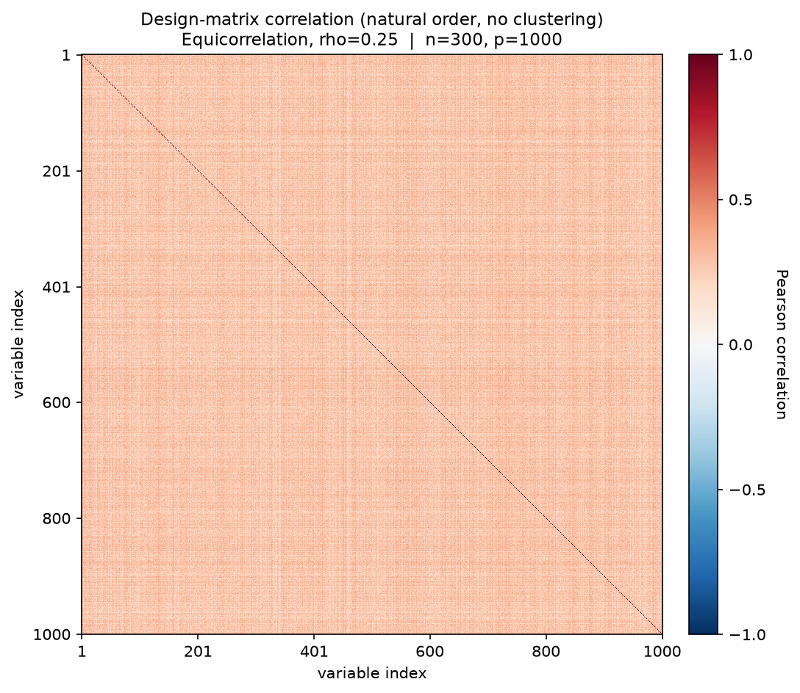
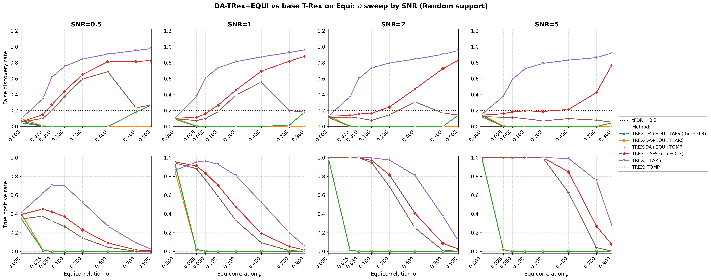

# Demo 08: DA-TRex+EQUI on Equicorrelated (EQUI) Data — 2D SNR × ρ Sweep (Python)

Monte-Carlo results for **DA-TRex+EQUI** vs. the **classical (no-DA) T-Rex selector**
on equicorrelated data. One 2D sweep: for each SNR column in $\lbrace0.5, 1, 2, 5\rbrace$, a full
$\rho$ sweep over $\lbrace0, 0.025, 0.05, 0.1, 0.2, 0.4, 0.7, 0.9\rbrace$ — dense near $0$ to locate the DA
suppression cliff. Common configuration: $n=300$, $p=1000$, $s=10$, amplitude $3.0$,
$\mathrm{tFDR}=0.2$, $K=20$ random experiments, $\mathrm{MC}=200$ per grid point, `Random` support
with a full redraw per trial; solvers TLARS / TAFS / TOMP with *exchangeable tie-breaking*
(`exch_tie_alpha = 0.25` for the greedy solvers TAFS/TOMP, `0` for the path solver TLARS), each
with its base (no-DA) T-Rex comparison row — 6 method rows per grid point. TAFS additionally runs
with its AFS correlation parameter `rho_afs = 0.3` (`0` for TLARS/TOMP), which is why the figures
label it `TAFS (rho = 0.3)`.

Python port of the C++ demo
[cpp/trex_selector_methods/ad/trex_da/demo_trex_da_08_mc_sim_equi_and_bt](../../../../../cpp/trex_selector_methods/ad/trex_da/demo_trex_da_08_mc_sim_equi_and_bt/README.md)
— same DGP, control parameters, sweep axes, console summaries, and result-file naming (the folder
keeps the cpp name "equi_and_bt": earlier revisions also carried BT sweeps on block-equicorrelated
data, dropped as redundant since the BT method is exercised on better-suited block designs in
Demos 02–05). The numbers below are this Python run's own results; they agree with the C++ reference
up to Monte-Carlo noise (independent RNG streams).

> **Purpose**: Equicorrelation is the stress case of the `trex_da` framework — every column loads
> on one shared factor, so there is no "distance" to exploit the way AR(1) has, and **individual
> variable selection is structurally infeasible for any method**. The 2D layout shows the three
> facts that make this demo worth keeping: (1) the DA suppression cliff sits at very small $\rho$,
> (2) it is SNR-independent — signal strength never rescues it, and (3) at $\rho = 0$ everything
> works, anchoring the comparison. DA-EQUI fails *safe* (selects nothing), base T-Rex fails
> *unsafe* (FDR far above target).

---

## Setup — data generating process

### Sparse linear model and SNR control

Each Monte-Carlo trial draws

```math
\boldsymbol{y} = \boldsymbol{X} \boldsymbol{\beta} + \boldsymbol{\varepsilon},
\qquad \boldsymbol{\varepsilon} \sim \mathcal{N}(0,\,\sigma^2 \boldsymbol{I}_n),
\quad \boldsymbol{\varepsilon} \perp \boldsymbol{X},
```

with a **sparse coefficient vector** $\boldsymbol{\beta} \in \mathbb{R}^p$ whose support and
sparsity level are

```math
\mathcal{S} = \operatorname{supp}(\boldsymbol{\beta}) = \{j : \beta_j \neq 0\},
\qquad s = |\mathcal{S}| = 10 \ll p,
```

all active coefficients set to amplitude $3.0$, support placed by the `Random` policy with a full
redraw per trial (0-based indices). The noise variance is calibrated to the target signal-to-noise
ratio,

```math
\mathrm{SNR} = \frac{\operatorname{Var}(\boldsymbol{X} \boldsymbol{\beta})}{\sigma^{2}},
\qquad \sigma^2 = \widehat{\operatorname{Var}}(\boldsymbol{X}\boldsymbol{\beta}) / \mathrm{SNR}.
```

### Equicorrelation (`dgp_equi_snr`)

$n$ observations on $p$ predictors are generated through a **single latent factor model**:

```math
X_{i,j} = \sqrt{\rho}\, f_i + \sqrt{1-\rho}\, \eta_{i,j},
\qquad f_i \overset{\text{i.i.d.}}{\sim} \mathcal{N}(0,1),
\quad \eta_{i,j} \overset{\text{i.i.d.}}{\sim} \mathcal{N}(0,1),
```

with all variables mutually independent. Each row

```math
\boldsymbol{x}_i = (X_{i,1},\ldots,X_{i,p})^\top
```

is then an i.i.d. draw from a zero-mean Gaussian with **compound symmetry** covariance

```math
\boldsymbol{\Sigma}_{\text{equi}} =
(1 - \rho) \, \boldsymbol{I}_p + \rho \, \mathbf{1}_p \mathbf{1}_p^{\top},
\qquad [\boldsymbol{\Sigma}_{\text{equi}}]_{jj} = 1 \;\forall j,
```

valid for $\rho \in \left(-\tfrac{1}{p-1},\, 1\right)$ (the demo uses $\rho \in [0, 0.9]$). The
eigenstructure is fully explicit:

```math
\begin{aligned}
\lambda_1 &= 1 + (p-1)\rho && \text{multiplicity 1 (eigenvector } \mathbf{1}_p/\sqrt{p}) \\
\lambda_2 &= 1 - \rho && \text{multiplicity } p-1
\end{aligned}
```

When $\rho \leq \rho_{\text{thr\_DA}}$ the single factor is negligible. As $\rho \to 1$ the $p-1$
minor eigenvalues collapse to zero, the predictor matrix becomes rank-1, and the regression is
unidentifiable — unlike AR(1), the correlation is *uniform* across all variable pairs, so there is
no isolation of actives by index distance: the shared factor puts every variable inside every
other variable's DA correction set, and the correction deflates all candidates at once.



Empirical Pearson correlation of an exemplary design drawn from this DGP ($\rho = 0.25$, $n=300$,
$p=1000$, seed 2026), in **natural variable order — no hierarchical clustering**: a uniform positive
wash over the *entire* matrix, with no structure to localize. Regenerate the per-DGP figures with
[`../generate_corr_plots.sh`](../generate_corr_plots.sh) (shared plotter
[`../../../corr_plt_utils.py`](../../../corr_plt_utils.py)).

### Sweep design

- **Outer loop (SNR columns)**: $\mathrm{SNR} \in \lbrace0.5, 1, 2, 5\rbrace$, one output file pair per
  column, disjoint seed blocks per column (statistically independent columns).
- **Inner sweep ($\rho$)**: $\rho \in \lbrace0, 0.025, 0.05, 0.1, 0.2, 0.4, 0.7, 0.9\rbrace$ — front-loaded
  at small $\rho$, where the suppression cliff is expected (the legacy 1D sweeps bracket it only
  as "somewhere in $(0, 0.1]$").

---

## Reference behavior (previous runs)

- **Legacy R CRAN** (`Results_trex_da_02_equi.md`, $n=150$, $p=500$, $s=5$): total suppression at
  every grid point except $\rho = 0$ — TPP $=$ FDP $= 0$ across all SNRs at $\rho = 0.25$, and
  power only at $\rho = 0.0$ in the $\rho$ sweep (TPP $\approx 1.0$, FDP $\approx 0.13$).
- **C++ 2D sweep** (the direct reference for this port): same cliff position and the same
  base-T-Rex failure pattern at $n=300$, $p=1000$.

---

## Running the Demo

```bash
python Python/trex_selector_methods/ad/trex_da/demo_trex_da_08_mc_sim_equi_and_bt/demo_trex_da_08_mc_sim_equi_and_bt.py
```

Reduce `NUM_MC` to preview. The file inserts both its own folder and the parent suite directory onto
`sys.path` so `dgp_generators` / `da_sim_common` resolve in the demo *and* in the spawned workers —
run it as a file, not piped via `python -`. Monte-Carlo trials run in parallel through
`concurrent.futures.ProcessPoolExecutor` (up to `min(6, os.cpu_count())` workers).

Afterwards, regenerate the figures from the CSVs with [`generate_plots.sh`](generate_plots.sh), which
drives the suite plotting module [`../trex_da_plt_utils.py`](../trex_da_plt_utils.py) through the
repo-root `.venv` (`pip install matplotlib pandas plotly`).

---

## Output Files

Data tables are written to `simulation_results/data/` (`.txt` pretty-printed, `.csv` tidy long
format), one pair per SNR column:

- `da_trex_mc_da_equi_rho_snr0p5.txt` / `.csv`
- `da_trex_mc_da_equi_rho_snr1.txt` / `.csv`
- `da_trex_mc_da_equi_rho_snr2.txt` / `.csv`
- `da_trex_mc_da_equi_rho_snr5.txt` / `.csv`

The single figure goes to `simulation_results/plots/`:

- `da_trex_mc_da_equi_rho_snr_grid.png` / `.pdf` — 2×4 grid: rows = FDR/TPR, columns = SNR,
  x-axis = $\rho$ on a square-root scale so the dense $\text{low-}\rho$ cliff region stays readable.
  (One-off per-CSV overviews can still be produced on demand via
  `./generate_plots.sh <csv>`.)

---

## Results (MC=200)



- **The DA suppression cliff sits at the first nonzero grid point, $\rho = 0.025$, in every SNR
  column.** At $\rho = 0$ all three DA solvers are controlled (FDR $0.047\text{–}0.152$) with the power
  the SNR allows (TPR $\approx 0.35\text{–}0.41$ at SNR $0.5$, $0.86\text{–}0.95$ at SNR $1$, $1.0$ at
  SNR $2/5$). At $\rho = 0.025$ they are already dead (TPR $\leq 0.024$, FDR $\leq 0.010$), and
  from $\rho = 0.05$ on the zeros are exact. **Signal strength never moves the cliff** — it only
  changes how much power is lost at it. DA-EQUI works only where no correction is needed.
- **Base T-Rex TLARS fails unsafe from the same grid point**: FDR $0.35\text{–}0.38$ at
  $\rho = 0.025$, climbing monotonically to $0.92\text{–}0.98$ at $\rho = 0.9$ in every column — at
  SNR $5$, $\rho = 0.4$ it finds essentially all actives (TPR $0.99$) buried in garbage
  (FDR $0.83$).
- **High-SNR nuance on the greedy base side**: at SNR $= 5$, base TOMP is FDR-controlled at
  *every* $\rho$ (FDR $\leq 0.12$) with full power through $\rho = 0.2$ (TPR $1.0$; $0.63$ at
  $\rho = 0.4$), and base TAFS is at/near the limit up to $\rho \approx 0.4$
  (FDR $0.16\text{–}0.21$). At SNR $\leq 1$ both violate from $\rho = 0.05\text{–}0.1$ on. So for
  moderate equicorrelation and strong signal, plain greedy T-Rex (TOMP) is the only usable
  selector — the DA-EQUI correction never is.
- **DA-TOMP lone-survivor FPs at high $\rho$** (here $0.18/0.27$ at SNR $0.5$, $\rho = 0.7/0.9$,
  and $0.18$ / $0.15$ / $0.05$ at $\rho = 0.9$ for SNR $1/2/5$, all with TPR $\approx 0$ and
  binary per-trial FDP): investigated on the C++ side (2026-07-16) with a one-off probe
  (MC $=1000$, fresh seeds). **Mechanism confirmed, not a bug**: every such selection is a
  singleton, and $628$ of $629$ selected variables were exactly the rank-1 column of the marginal
  $|\mathrm{corr}(x_j, y)|$ ordering — the extreme order statistic of $1000$ factor-loaded real
  columns beating the i.i.d. dummies through the DA deflation, then certified by TOMP's greedy
  winner-take-all (the equi analogue of the AR(1) shadow-FP mechanism; TLARS/TAFS spread or
  threshold it away). The mechanism hovers *at* the tFDR boundary in the zero-power regime, where
  FDR $\approx$ P(select anything at all), so individual cells vary widely between runs.

**Bottom line**: equicorrelation defeats individual variable selection for the DA framework —
DA-EQUI fails *safe* (selects nothing for any $\rho \geq 0.025$, regardless of SNR), base T-Rex
TLARS fails *unsafe* (FDR up to $0.98$). The demo's value is documenting this boundary of the
method precisely.
