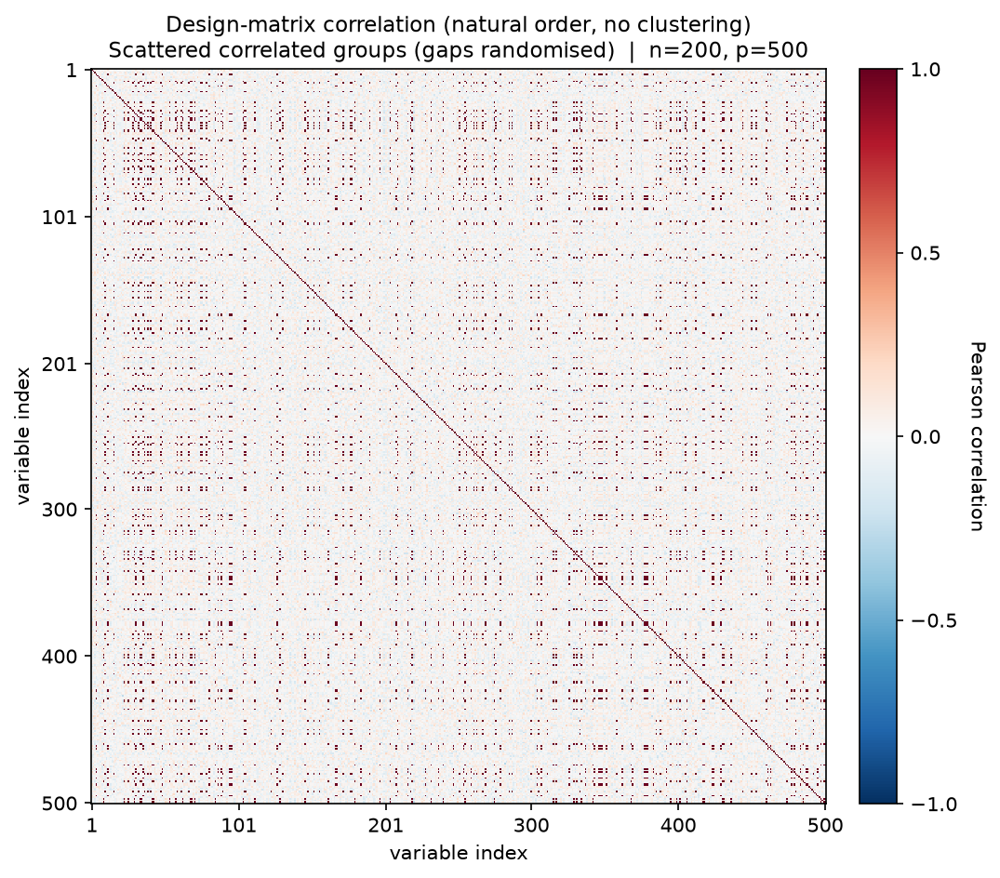
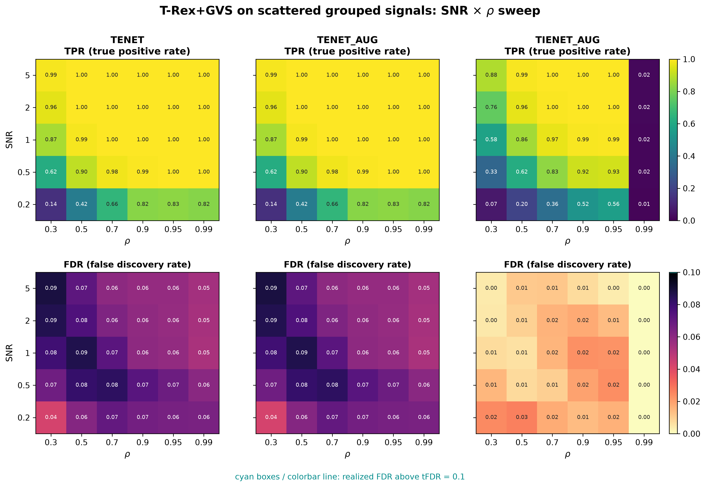

# Demo 02: T-Rex+GVS on Scattered Blocks (Python)

## Purpose

Test whether spatially **scattering** the members of a correlated group across the design matrix — rather than
 keeping them contiguous — affects T-Rex+GVS group recovery.
 This isolates the effect of column layout from the effect of correlation strength, since the underlying group
  structure is otherwise identical to Demo 01.
 Selection and evaluation are per variable (see
 [What is actually measured](../README.md#what-is-actually-measured-in-these-demos)).

This is the Python port of the C++ demo
[demo_trex_gvs_02_mc_sim_scattered_blocks](../../../../../cpp/trex_selector_methods/ad/trex_gvs/demo_trex_gvs_02_mc_sim_scattered_blocks/),
using `trex_selector_neo`'s `TRexGVSSelector`.

---

## Data Generation Parameters (`dgp_scattered_grouped_snr`)

We consider again the linear model:

```math
\boldsymbol{y} = \boldsymbol{X}\boldsymbol{\beta} + \boldsymbol{\epsilon},
\qquad \boldsymbol{\epsilon} \sim \mathcal{N}(\boldsymbol{0}, \sigma_{\varepsilon}^2 \boldsymbol{I}_n)
```

- $\boldsymbol{y} \in \mathbb{R}^n$ is the response vector.
- $\boldsymbol{X} \in \mathbb{R}^{n \times p}$ is the design matrix.
- $\boldsymbol{\beta} \in \mathbb{R}^p$ is the coefficient vector, with $s$ nonzero entries.
- $\boldsymbol{\epsilon}$ is the noise vector, i.i.d. standard normal.
- $\sigma_{\varepsilon}^2$ is the noise variance, calibrated to achieve a target linear signal-to-noise ratio (SNR).
- $n = 200$, $p = 500$, $s = 150$.

The design matrix $\boldsymbol{X}$ is generated from a latent-factor model with three active groups:

```math
X_{ij} = Z_{i,\,g(j)} + \sigma_x\, \xi_{ij}, \qquad \xi_{ij} \sim \mathcal{N}(0,1),
```

- `n_groups` correlated groups of `group_size` variables each; here 3 groups of 50 variables,
   matching Demo 01's Hastie design.
- Group membership is assigned via a **random column permutation** instead of contiguous
   blocks — group members can be spread arbitrarily across the $p$ columns.
- All grouped variables are active, $\beta_j = 3$; background columns are i.i.d.
   $\mathcal{N}(0,1)$, $\beta_j = 0$.
- Within-group correlation $\rho = 1/(1 + \sigma_x^2)$, same convention as Demo 01.



Empirical Pearson correlation of an exemplary design drawn from this DGP (`dgp_scattered_grouped_snr`, $n=200$,
$p=500$, seed 2026, default $\sigma_x = \sqrt{0.01}$), in **natural variable order — no hierarchical clustering**.
The same three 50-variable groups as Demo 01 are present, but the random column permutation scatters their members
across the design, so the contiguous diagonal blocks of Demo 01 dissolve into a speckle of isolated high-correlation
entries. One figure per DGP lives in [`../dgp_corr_plots/`](../dgp_corr_plots/); regenerate the whole suite with
[`../generate_corr_plots.sh`](../generate_corr_plots.sh) (shared plotter
[`../../../corr_plt_utils.py`](../../../corr_plt_utils.py)).

---

## Control Parameters

```text
K = 20                          # Random experiments per T-loop iteration
tFDR = 0.1                      # Target FDR
corr_max = 0.98                 # HAC auto-clustering correlation threshold
hc_linkage = Single             # Single-linkage HAC
lambda2_method = CV_1SE_CCD     # Elastic-net penalty selection
MC = 200                        # Monte Carlo repetitions per grid point
```

---

## Methods Compared

Three T-Rex+GVS solver variants: **TENET** (elastic net) [[3]](#references),
**TENET_AUG** (row-augmented elastic net) [[1]](#references), and **TIENET_AUG** (informed
elastic net) [[2]](#references). All use single-linkage HAC grouping
and `CV_1SE_CCD` for the $\lambda_2$ selection.

---

## The Sweep

A single **2-D SNR $\times$ $\rho$ grid**, over
$\mathrm{SNR} \in \lbrace0.2, 0.5, 1, 2, 5\rbrace$ and
$\rho \in \lbrace0.30, 0.50, 0.70, 0.90, 0.95, 0.99\rbrace$
(with $\sigma_x = \sqrt{(1-\rho)/\rho}$), 200 MC trials per cell.

---

## Output Files

Written to `simulation_results/data/`:

- `gvs_scattered_grouped_2d.txt` / `.csv` — mean FDP/TPP over the SNR $\times$ $\rho$ grid.

The file names and CSV schema match the C++ demo, and the suite plotter
[`../trex_gvs_plt_utils.py`](../trex_gvs_plt_utils.py) is the same module the C++ suite uses.

Figures (PNG + PDF) go to `simulation_results/plots/`, produced by `./generate_plots.sh`.

---

## Running the Demo

```bash
python demo_trex_gvs_02_mc_sim_scattered_blocks.py       # full run (hours)
python demo_trex_gvs_02_mc_sim_scattered_blocks.py 8     # with 8 worker processes
./generate_plots.sh                                      # render the figure below from the saved CSV
```

Monte Carlo trials are parallelized with `ProcessPoolExecutor`; the optional
first CLI argument sets the number of worker processes (default
`min(6, cpu_count)`). For a quick smoke test, temporarily reduce `num_MC` and
the sweep grids at the top of the script.

---

## Simulation Results

The numbers and figure below are this Python run's own results (200 MC trials per cell). They agree with the
[C++ reference](../../../../../cpp/trex_selector_methods/ad/trex_gvs/demo_trex_gvs_02_mc_sim_scattered_blocks/README.md#simulation-results)
up to Monte-Carlo noise — the two ports draw from independent RNG streams.

- **TENET** and **TENET_AUG** are numerically identical here and keep FDR below the $\mathrm{tFDR} = 0.1$ target
   in every cell ($0.042\text{–}0.088$, no cyan violation outlines), with TPR $\approx 1$ from $\mathrm{SNR} \ge 1$ for
   $\rho \ge 0.5$ and $0.87 \to 0.96 \to 0.99$ over $\mathrm{SNR} \in \lbrace1, 2, 5\rbrace$ in the weakest column
   $\rho = 0.30$.
- **TIENET_AUG** is markedly more conservative (FDR $\le 0.027$), and its power collapses in the extreme
   $\rho = 0.99$ column (TPR $\approx 0.02$, flat in SNR) where the within-group columns become nearly collinear.
- Because HAC-based grouping clusters columns by **correlation**, not by column adjacency, scattering group members
   across the design leaves the FDR/TPR pattern very close to Demo 01's contiguous-block results — the clustering
   step is insensitive to column order by construction. Cell by cell the two demos differ by at most a few
   hundredths of TPR (e.g. $0.87$ here vs. $0.88$ in Demo 01 at $\mathrm{SNR}=1$, $\rho=0.3$).
- Best read side-by-side with Demo 01: matching results confirm that group *discovery* depends on correlation
   structure rather than spatial layout, while a noticeable divergence would point to a layout-sensitive bug or
   clustering limitation.

TPR (top) and FDR (bottom) heatmaps over the SNR $\times$ $\rho$ grid, one column per solver;
FDR cells above the $\mathrm{tFDR} = 0.1$ target would be outlined in cyan.



---

## References

1. Machkour, J., Muma, M., & Palomar, D. P., "False Discovery Rate Control for Grouped Variable Selection
   in High-Dimensional Linear Models using the T-Knock Filter.", European Signal Processing Conference (EUSIPCO), 2022,
    pp. 892–896, EURASIP.
    [DOI-Link](https://doi.org/10.23919/EUSIPCO55093.2022.9909883)
2. Machkour, J., Muma, M., & Palomar, D. P., "The Informed Elastic Net for Fast Grouped Variable Selection and
   FDR Control in Genomics Research.", Workshop on Computational Advances in Multi-Sensor Adaptive Processing (CAMSAP),
    2023, pp. 466–470, IEEE.
    [DOI-Link](https://doi.org/10.1109/CAMSAP58249.2023.10403489)
3. Zou, H., & Hastie, T. (2005). "Regularization and variable selection via the elastic net." *Journal of the Royal
   Statistical Society: Series B (Statistical Methodology)*, 67(2), pp. 301–320.
   [DOI-Link](https://doi.org/10.1111/j.1467-9868.2005.00503.x)
