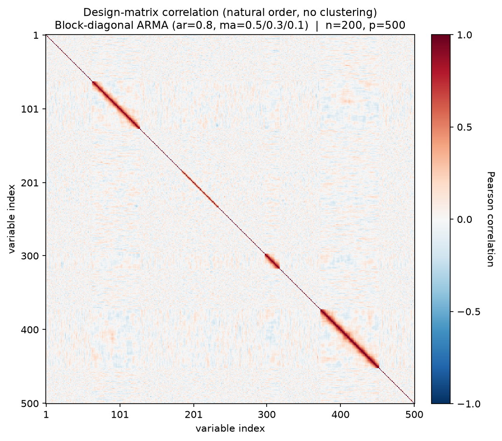
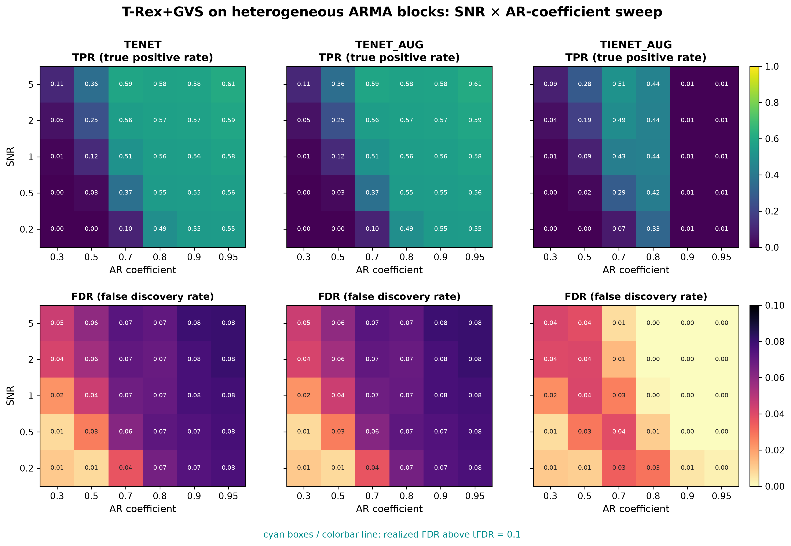

# Demo 07: T-Rex+GVS on Heterogeneous ARMA Blocks (Python)

## Purpose

Stress-test the Terminating Random Experiments (T-Rex) selector with Grouped Variable Selection (T-Rex+GVS) when
different blocks follow
 **different time-series structures** rather than a single uniform correlation model.
 This is the most heterogeneous of the four-block scenarios.
 Each block has its own autoregressive moving-average (ARMA) specification, testing
 whether the selector can still recover grouped signal when "the group correlation model" is not one fixed thing.
 Selection and evaluation are per variable (see
 [What is actually measured](../README.md#what-is-actually-measured-in-these-demos)).

This is the Python port of the C++ demo
[demo_trex_gvs_07_mc_sim_arma_blocks](../../../../../cpp/trex_selector_methods/ad/trex_gvs/demo_trex_gvs_07_mc_sim_arma_blocks/),
using `trex_selector_neo`'s `TRexGVSSelector`.

---

## Data Generation Parameters (`dgp_arma_blocks_snr`)

We consider again the linear model:

```math
\boldsymbol{y} = \boldsymbol{X}\boldsymbol{\beta} + \boldsymbol{\epsilon},
\qquad \boldsymbol{\epsilon} \sim \mathcal{N}(\boldsymbol{0}, \sigma_{\varepsilon}^2 \boldsymbol{I}_n)
```

- $\boldsymbol{y} \in \mathbb{R}^n$ is the response vector.
- $\boldsymbol{X} \in \mathbb{R}^{n \times p}$ is the design matrix.
- $\boldsymbol{\beta} \in \mathbb{R}^p$ is the coefficient vector, with $s$ nonzero entries.
- $\boldsymbol{\epsilon}$ is the noise vector, independent and identically distributed (i.i.d.) standard normal.
- $\sigma_{\varepsilon}^2$ is the noise variance, calibrated to achieve a target linear signal-to-noise ratio (SNR).
- $n = 200$, $p = 500$, $s = 150$ (the sum of the three active blocks).

The design matrix keeps the 4-block geometry of Demos 03/05/06 (sizes $\lbrace20, 50, 80, 65\rbrace$, 215 grouped
 columns in total), but **each block follows a distinct ARMA process**. Every block column is simulated with a 100-step
 burn-in and then standardized to unit empirical variance, matching R's `arima.sim` approach:

- **Block 0** (20 vars, active, $\beta_j = 3$): first-order autoregressive (AR(1)), $\phi_1 = \texttt{ar\_coef}$.
- **Block 1** (50 vars, active): moving-average (MA(3)), $\theta = (0.5, 0.3, 0.1)$.
- **Block 2** (80 vars, active): ARMA(2,1), $\phi = (\texttt{ar\_coef}, \texttt{ar\_coef}/5)$, $\theta = 0.5$.
- **Block 3** (65 vars, inactive trap): AR(1), $\phi_1 = \texttt{ar\_coef}$ — structurally identical to Block 0.
- Gap columns (between and around the blocks) are i.i.d. $\mathcal{N}(0,1)$.

Unlike Demo 06, the sweep parameter here is `ar_coef` (shared by the AR(1) and ARMA(2,1) blocks), **not** $\rho$ —
 the MA(3) block has no AR component at all, so it does not respond to the sweep.



Empirical Pearson correlation of an exemplary design drawn from the data-generating process (DGP)
`dgp_arma_blocks_snr` ($n=200$, $p=500$, `ar_coef` $=0.8$, seed 2026), in **natural variable order — no hierarchical
clustering**. The heterogeneity is visible directly. The ARMA(2,1) block (80 vars) carries a broad, slowly decaying
band, the two AR(1) blocks (20 and 65 vars — active and trap) look structurally alike, and the MA(3) block (50 vars)
is nearly a bare diagonal, since its correlation dies after 3 lags. One figure per DGP lives in
[`../dgp_corr_plots/`](../dgp_corr_plots/). Regenerate the whole suite with
[`../generate_corr_plots.sh`](../generate_corr_plots.sh) (shared plotter
[`../../../corr_plt_utils.py`](../../../corr_plt_utils.py)).

---

## Control Parameters

```text
K = 20                          # Random experiments per T-loop iteration
tFDR = 0.1                      # Target FDR
corr_max = 0.98                 # HAC auto-clustering correlation threshold
hc_linkage = Single             # Single-linkage HAC
lambda2_method = CV_1SE_CCD     # Elastic-net penalty selection
MC = 200                        # Monte Carlo repetitions per grid point
```

---

## Methods Compared

Three T-Rex+GVS solver variants: **TENET** (elastic net) [[3]](#references),
**TENET_AUG** (row-augmented elastic net) [[1]](#references), and **TIENET_AUG** (informed
elastic net) [[2]](#references). All use single-linkage hierarchical agglomerative clustering
(HAC) grouping and `CV_1SE_CCD` for the $\lambda_2$ selection.

---

## The Sweep

A single **2-D SNR $\times$ `ar_coef` grid**, over
$\mathrm{SNR} \in \lbrace0.2, 0.5, 1, 2, 5\rbrace$ and
`ar_coef` $\in \lbrace0.30, 0.50, 0.70, 0.80, 0.90, 0.95\rbrace$
(the AR coefficient shared by the AR(1) and ARMA(2,1) blocks), 200 Monte Carlo (MC) trials per cell. Because the
MA(3) block carries no AR component, only three of the four blocks respond to the `ar_coef` axis.

---

## Output Files

Written to `simulation_results/data/`:

- `gvs_arma_blocks_2d.txt` / `.csv` — mean false discovery proportion (FDP) / true positive proportion (TPP) over the
  SNR $\times$ `ar_coef` grid.

The file names and comma-separated values (CSV) schema match the C++ demo, and the suite plotter
[`../trex_gvs_plt_utils.py`](../trex_gvs_plt_utils.py) is the same module the C++ suite uses.

Figures in Portable Network Graphics (PNG) and Portable Document Format (PDF) go to `simulation_results/plots/`,
produced by `./generate_plots.sh`.

---

## Running the Demo

```bash
python demo_trex_gvs_07_mc_sim_arma_blocks.py       # full run (hours)
python demo_trex_gvs_07_mc_sim_arma_blocks.py 8     # with 8 worker processes
./generate_plots.sh                                 # render the figure below from the saved CSV
```

Monte Carlo trials are parallelized with `ProcessPoolExecutor` on `TREX_NUM_WORKERS` worker processes (default 8,
and `0` uses every usable core, see `resolve_workers()` in [`../gvs_sim_common.py`](../gvs_sim_common.py)). The
optional first command-line interface (CLI) argument overrides this count. A full run takes about 2.2 hours on
8 workers. For a quick smoke test, temporarily reduce `num_MC` and the sweep grids at the top of the script.

---

## Simulation Results

The numbers and figure below are this Python run's own results (200 MC trials per cell). They agree with the
[C++ reference](../../../../../cpp/trex_selector_methods/ad/trex_gvs/demo_trex_gvs_07_mc_sim_arma_blocks/README.md#simulation-results)
up to Monte-Carlo noise — the two ports draw from independent random number generator (RNG) streams.

- Because the three active blocks carry genuinely different correlation structures (AR(1), MA(3), ARMA(2,1)),
   recovery is **uneven across blocks** — the MA(3) block (short-range, decaying-but-bounded correlation) and the
   ARMA(2,1) block behave differently from the pure AR(1) block, so the aggregate true positive rate (TPR) blends
   these per-block difficulties and saturates around $0.6$. At $\mathrm{SNR}=5$, TENET's TPR rises steeply over
   `ar_coef` $\in \lbrace0.3, 0.5, 0.7\rbrace$ ($0.11 \to 0.36 \to 0.59$) and then plateaus, since the MA(3) block
   never responds to the sweep.
- **TENET** and **TENET_AUG** are numerically identical here and keep the false discovery rate (FDR) below the
   $\mathrm{tFDR} = 0.1$ target in every cell (max $0.080$, no cyan outlines). The trap block (AR(1), same
   `ar_coef` as the active AR(1) block) is structurally similar to an active block and is the main test of
   false-group exclusion here — it does not inflate FDR.
- **TIENET_AUG** is markedly more conservative (FDR $\le 0.041$), and its TPR collapses in the high-`ar_coef`
   columns — below $0.01$ from `ar_coef` $\ge 0.9$, after up to $0.44$ at `ar_coef` $=0.8$ — whereas TENET keeps
   improving there. All 2,638 `collinear; dropped` messages on the console of this run come from TIENET_AUG, 2,591
   of them at `ar_coef` $= 0.95$ and the rest at $0.9$, where its inner terminating lasso meets nearly collinear
   augmented columns.
- Compared against Demo 06 (uniform AR(1) blocks), heterogeneity does cost power. TENET tops out near $0.61$ here
   versus $0.96$ there, because the MA(3) block's 3-lag correlation gives the grouping step almost nothing to
   aggregate.

TPR (top) and FDR (bottom) heatmaps over the SNR $\times$ `ar_coef` grid, one column per solver
(row axis = SNR, column axis = AR coefficient). FDR cells above the $\mathrm{tFDR} = 0.1$ target
would be outlined in cyan.



---

## References

1. Machkour, J., Muma, M., & Palomar, D. P., "False Discovery Rate Control for Grouped Variable Selection
   in High-Dimensional Linear Models using the T-Knock Filter.", European Signal Processing Conference (EUSIPCO), 2022,
    pp. 892–896, EURASIP.
    [DOI-Link](https://doi.org/10.23919/EUSIPCO55093.2022.9909883)
2. Machkour, J., Muma, M., & Palomar, D. P., "The Informed Elastic Net for Fast Grouped Variable Selection and
   FDR Control in Genomics Research.", Workshop on Computational Advances in Multi-Sensor Adaptive Processing (CAMSAP),
    2023, pp. 466–470, IEEE.
    [DOI-Link](https://doi.org/10.1109/CAMSAP58249.2023.10403489)
3. Zou, H., & Hastie, T. (2005). "Regularization and variable selection via the elastic net." *Journal of the Royal
   Statistical Society: Series B (Statistical Methodology)*, 67(2), pp. 301–320.
   [DOI-Link](https://doi.org/10.1111/j.1467-9868.2005.00503.x)
