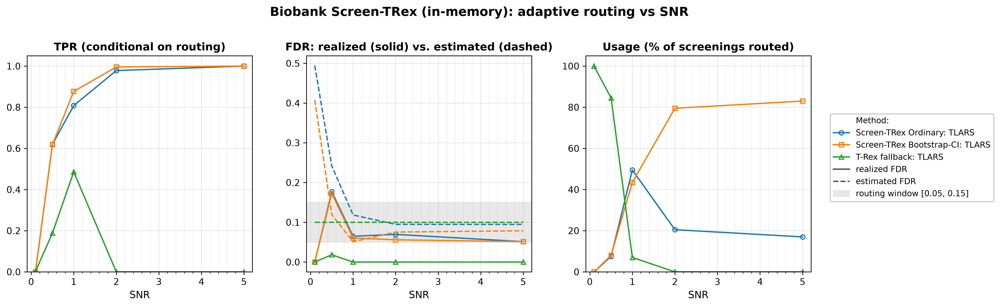
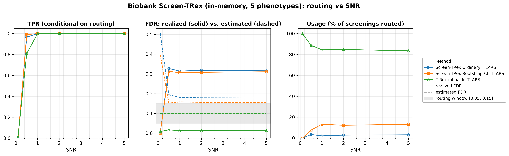

# Demo 04: Biobank Screen-TRex (Algorithm 1) — In-Memory (Python)

## Purpose

The demo illustrates the **Biobank Screen-TRex workflow** ("Algorithm 1") of [[1]](#references),
 which screens *many phenotypes* against a single shared design matrix $\boldsymbol{X}$.
Per phenotype the algorithm tries **Screen-TRex Ordinary** first. If the estimated false discovery rate (FDR) falls
 outside the acceptable window $\lbrack 0.05, 0.15\rbrack$ it retries with **Screen-TRex Bootstrap-CI**, and if that
 also lands outside the window it falls back to the **classical Terminating Random Experiments (T-Rex) selector** at a
 target FDR of $0.10$.
The interesting quantity is therefore not a single error rate but the *routing behaviour*: which method
 handles which phenotype, and how well each performs on the subset it was given.
This demo keeps the dummy matrices **in memory** (`use_memory_mapping = False`), while demo 05 runs the identical
 study with memory-mapped, disk-backed dummy matrices.
Screening returns a *candidate set*, and the FDR and the true positive rate (TPR) are evaluated on the individual
 selected variables
 (see [What is actually measured](../README.md#what-is-actually-measured-in-these-demos)).

This is the Python port of the C++ demo
[demo_trex_scr_04_mc_sim_biobank](../../../../../cpp/trex_selector_methods/ad/trex_screening/demo_trex_scr_04_mc_sim_biobank/README.md),
using `trex_selector_neo`'s `TRexBiobankScreeningSelector`.

---

## Data Generation Parameters (`dgp_iid_snr`)

We consider the linear model:

```math
\boldsymbol{y} = \boldsymbol{X}\boldsymbol{\beta} + \boldsymbol{\epsilon},
\qquad \boldsymbol{\epsilon} \sim \mathcal{N}(\boldsymbol{0}, \sigma_{\varepsilon}^2 \boldsymbol{I}_n)
```

- $\boldsymbol{y} \in \mathbb{R}^n$ is the response vector.
- $\boldsymbol{X} \in \mathbb{R}^{n \times p}$ is the design matrix.
- $\boldsymbol{\beta} \in \mathbb{R}^p$ is the coefficient vector, with $s$ nonzero entries.
- $\boldsymbol{\epsilon}$ is the noise vector, independent and identically distributed (i.i.d.) standard normal.
- $\sigma_{\varepsilon}^2$ is the noise variance, calibrated to achieve a target linear signal-to-noise ratio (SNR).
- $n = 300$, $p = 1{,}000$, with $s = 10$ in Part 1 and $s = 5$ in Part 2 (high-dimensional, $p > n$).

The design matrix has **no correlation structure**:

```math
X_{ij} \sim \mathcal{N}(0,1) \quad \text{i.i.d.}
```

- The active support is drawn uniformly at random *per Monte Carlo (MC) trial*, so the results are not tied to
   one support pattern.
- All active coefficients are $\beta_j = 1$, and the support-selection random number generator (RNG) is offset
   from the trial seed so it stays independent of the design and noise draws.
- In Part 2 all $q = 5$ phenotypes of a trial share **one design matrix** $\boldsymbol{X}$ (a fixed
   `x_seed` per trial), while each phenotype receives its **own random support** (`sup_seed_base + k`) and
   its own noise draw — the biobank setting, where a single genotype matrix is screened against many traits.


Empirical Pearson correlation of an exemplary design drawn from this data-generating process (DGP)
`dgp_iid_snr` ($n=300$, $p=1{,}000$, seed 2026), in **natural variable order — no hierarchical clustering**.
This is the same i.i.d. design as in Demos 01–02. Only the unit diagonal stands out, so any routing behaviour
seen below is a property of Algorithm 1 and not of the correlation structure. One figure per DGP lives in
[`../dgp_corr_plots/`](../dgp_corr_plots/). Regenerate the whole suite with
[`../generate_corr_plots.sh`](../generate_corr_plots.sh) (shared plotter
[`../../../corr_plt_utils.py`](../../../corr_plt_utils.py)).

---

## Control Parameters

```text
K = 20                       # Random experiments per T-loop iteration
lower_bound_FDR = 0.05       # Lower edge of the acceptable estimated-FDR window
upper_bound_FDR = 0.15       # Upper edge of the acceptable estimated-FDR window
target_FDR_trex = 0.10       # Target FDR of the classical T-Rex fallback
R_boot = 1000                # Bootstrap replicates (Bootstrap-CI rule only)
ci_grid_step = 0.001         # Bootstrap-CI threshold grid granularity
solver = TLARS               # T-Rex solver backend
use_memory_mapping = False   # Dummy matrices held in memory
MC = 200                     # Monte Carlo repetitions per grid point
```

The window $\lbrack 0.05, 0.15\rbrack$ is the routing criterion. A screening result is *accepted* only if the
 procedure's own estimated FDR lands inside it. In Python these are fields of
 `trex.BiobankScreenTRexControl`, which nests a `ScreenTRexControlParameter` and a
 `TRexControlParameter`.

---

## Methods Compared

The three routing outcomes of Algorithm 1 [[1]](#references), all using `ScreenTRexMethod.TREX`:

- **Screen-TRex Ordinary: TLARS** — the majority-vote rule ($\Phi_j > 0.5$), tried first for every
   phenotype.
- **Screen-TRex Bootstrap-CI: TLARS** — the bootstrap confidence-band rule (`R_boot = 1000` replicates),
   tried only when the Ordinary estimate falls outside the window.
- **T-Rex fallback: TLARS** — the classical T-Rex selector at `target_FDR_trex = 0.10`, used when neither
   screening rule produces an acceptable estimate.

The routing decision of each phenotype is read back from `result.method_used`.

All reported FDR and TPR values are **conditional on routing**. They average only over the phenotypes that
 were actually handled by the respective method. The additional **Usage %** row is unconditional and states
 what fraction of all screenings each method took. A metric row for a method with $0\%$ usage is therefore
 an average over an empty set, not a performance statement.

---

## The Two Parts

- **Part 1 — single phenotype.** One response per trial, $s = 10$ active variables, SNR sweep over
   $\lbrace0.1, 0.5, 1, 2, 5\rbrace$, 200 MC trials per grid point (trial seed `1000 * snr_idx + mc`, mirroring the
   C++ source).
- **Part 2 — $q = 5$ phenotypes sharing one $\boldsymbol{X}$.** $s = 5$ active variables per phenotype, the
   same SNR grid and 200 MC trials, hence $5 \times 200 = 1{,}000$ phenotype screenings per SNR level.

---

## Output Files

Written to `simulation_results/data/`:

- `scr_biobank_snr_n300_p1000_s10.txt` / `.csv` — Part 1: Usage %, FDR, TPR, and estimated FDR
   per method and SNR level.
- `scr_biobank_multi_n300_p1000_q5_s5.txt` / `.csv` — Part 2: the same metrics for the
   multi-phenotype study.

The file names and comma-separated values (CSV) schemas match the C++ demo, and the suite plotter
[`../trex_scr_plt_utils.py`](../trex_scr_plt_utils.py) is the same module the C++ suite uses — it renders
the three-panel biobank figure (TPR / FDR / Usage) whenever a `Usage` metric is present.

Figures go to `simulation_results/plots/` as Portable Network Graphics (PNG) and Portable Document Format (PDF)
files, produced by `./generate_plots.sh`.

---

## Running the Demo

```bash
python demo_trex_scr_04_mc_sim_biobank.py   # full run (~20 min with 8 workers)
./generate_plots.sh                         # render the figures below from the saved CSVs
```

Monte Carlo trials are parallelized with `ProcessPoolExecutor` over `TREX_NUM_WORKERS` worker processes
(default 8, capped at the usable cores, and `0` uses all of them). The suite's older `SCR_NUM_WORKERS` still
works and takes precedence. This is one of the two **heavy** demos of the suite — every routed phenotype may
run up to three selectors — and the suite runner
[`../run_overnight.sh`](../run_overnight.sh) skips it under `SKIP_HEAVY=1`.

---

## Simulation Results

The numbers and figures below are this Python run's own results (200 MC trials per grid point).
They agree with the
[C++ reference](../../../../../cpp/trex_selector_methods/ad/trex_screening/demo_trex_scr_04_mc_sim_biobank/README.md#simulation-results)
up to Monte-Carlo noise — the two ports draw from independent RNG streams (NumPy here, the C++ engine
there).

### Part 1 — Single Phenotype ($s = 10$)

- **The routing does what it is designed to do.** At $\mathrm{SNR} = 0.1$ every phenotype ($100.0\%$) ends
   up at the classical T-Rex fallback — with no recoverable signal both screening rules estimate an FDR far
   above the window ($0.494$ Ordinary, $0.408$ Bootstrap-CI). As SNR grows the traffic shifts to the
   screening routes. At $\mathrm{SNR} = 1$ the split is $49.5\%$ Ordinary / $43.5\%$ Bootstrap-CI /
   $7.0\%$ fallback, and at $\mathrm{SNR} = 5$ Bootstrap-CI handles $83.0\%$ of all screenings while the
   fallback is never invoked.
- **Conditional error control on the screening routes is good once signal is present.** From
   $\mathrm{SNR} \ge 1$ the realized FDR runs $0.051\text{–}0.070$ for Ordinary and $0.061 \to 0.051$ for
   Bootstrap-CI — around $0.05\text{–}0.07$ — while TPR reaches $1.000$ for both at $\mathrm{SNR} = 5$. The one
   badly behaved point is $\mathrm{SNR} = 0.5$, where the few phenotypes that do pass the window still
   realize an FDR of $0.177$ (Ordinary) and $0.173$ (Bootstrap-CI).
- **The fallback's TPR of $0.000$ at $\mathrm{SNR} = 2$ and $5$ is not a failure.** Its usage is $0.0\%$ at
   those points — nothing is routed to it, so the conditional average is taken over an empty set and prints
   as zero. Where the fallback *is* used it behaves as expected. At $\mathrm{SNR} = 1$ it realizes an FDR of
   $0.000$ against its target of $0.10$ with a TPR of $0.486$, i.e. it is the conservative option that
   trades away power for safety.
- **The estimates track the realized rates reasonably here.** Bootstrap-CI's estimate falls from $0.408$ to
   $0.051\text{–}0.079$ for $\mathrm{SNR} \ge 1$ and sits close to the realized $0.051\text{–}0.061$, above it at
   $\mathrm{SNR} = 2$ and $5$ and below it at $\mathrm{SNR} = 1$. Ordinary's estimate settles near
   $0.095\text{–}0.118$ against a realized $0.051\text{–}0.070$, erring on the safe side.

TPR (conditional on routing), FDR (solid = realized, dashed = the procedure's own estimate, with the
$\lbrack 0.05, 0.15\rbrack$ routing window shaded), and per-method Usage % vs. SNR.



### Part 2 — Five Phenotypes Sharing One Design ($q = 5$, $s = 5$)

- **The fallback dominates.** Across the whole sweep the classical T-Rex selector handles $83.5\%\text{–}100\%$
   of all screenings ($100\%$ at $\mathrm{SNR} = 0.1$, $83.5\%$ at $\mathrm{SNR} = 5$). The screening rules
   take only a few percent each (Ordinary $2.2\%\text{–}3.5\%$, Bootstrap-CI $7.7\%\text{–}13.3\%$ for
   $\mathrm{SNR} \ge 0.5$). Unlike Part 1, more signal does **not** shift the traffic to the screening
   routes.
- **Where the screening routes are used, they are poorly calibrated.** For $\mathrm{SNR} \ge 0.5$ the
   realized FDR of the accepted screening results is $0.314\text{–}0.328$ (Ordinary) and $0.306\text{–}0.313$
   (Bootstrap-CI) — roughly twice the upper edge of the routing window — while the corresponding estimates
   are only $0.178\text{–}0.195$ and $0.152\text{–}0.158$. The estimate does not track the truth in this regime.
- **This is a sparsity effect, and the cautionary result of the pair.** With only $s = 5$ active variables
   per phenotype, a single false selection moves the false discovery proportion (FDP) by a large increment, so
   the realized FDR is coarse and high even when every true variable is found (TPR is $1.000$ for both
   screening rules from $\mathrm{SNR} = 1$ onward). Screening admits the phenotype on an estimate that is
   systematically too optimistic.
- **The fallback stays well behaved on the bulk of the traffic.** Its realized FDR is $0.008\text{–}0.017$
   against a target of $0.10$, with TPR rising $0.015 \to 1.000$ over the sweep. In this configuration the
   conservative route is both the most-used and the most reliable one.

TPR (conditional on routing), FDR (solid = realized, dashed = the procedure's own estimate, with the
$\lbrack 0.05, 0.15\rbrack$ routing window shaded), and per-method Usage % vs. SNR.



---

## References

1. Machkour, J., Muma, M., & Palomar, D. P., "False Discovery Rate Control for Fast Screening of
   Large-Scale Genomics Biobanks.", IEEE Statistical Signal Processing Workshop (SSP), 2023,
    pp. 666–670, IEEE.
    [DOI-Link](https://doi.org/10.1109/SSP53291.2023.10207957)
