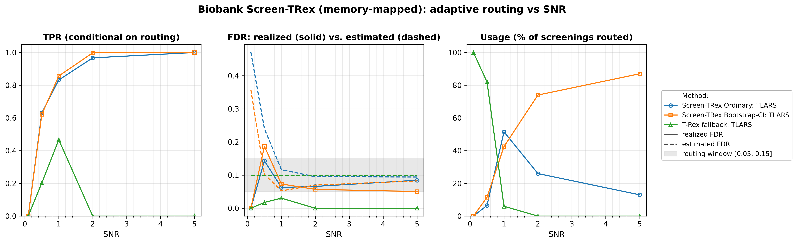
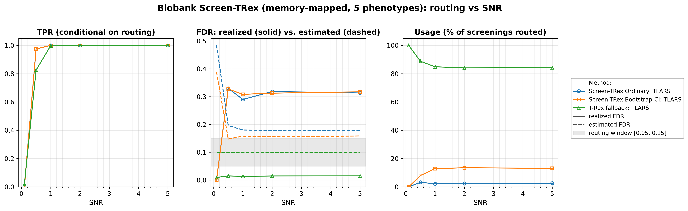

# Demo 05: Biobank Screen-TRex (Algorithm 1) — Memory-Mapped (Python)

## Purpose

The demo repeats the **Biobank Screen-TRex workflow** ("Algorithm 1") of [[1]](#references) — see
 [Demo 04](../demo_trex_scr_04_mc_sim_biobank/README.md) — with **memory-mapped dummy matrices**
 (`use_memory_mapping = True`), the storage mode intended for biobank-scale problems where holding the
 dummy matrices in RAM is infeasible.
Per phenotype the algorithm tries **Screen-TRex Ordinary** first; if the estimated FDR falls outside the
 acceptable window $\lbrack 0.05, 0.15\rbrack$ it retries with **Screen-TRex Bootstrap-CI**; if that also lands outside
 the window it falls back to the **classical T-Rex selector** at a target FDR of $0.10$.
The algorithm is unchanged; the point of this demo is that moving the dummy matrices to disk changes the
 memory footprint and **not** the statistics.
Screening returns a *candidate set*, and FDR/TPR are evaluated on the individual selected variables
 (see [What is actually measured](../README.md#what-is-actually-measured-in-these-demos)).

This is the Python port of the C++ demo
[demo_trex_scr_05_mc_sim_biobank_mmap](../../../../../cpp/trex_selector_methods/ad/trex_screening/demo_trex_scr_05_mc_sim_biobank_mmap/README.md),
using `trex_selector_neo`'s `TRexBiobankScreeningSelector`.

---

## Data Generation Parameters (`dgp_iid_snr`)

We consider the linear model:

```math
\boldsymbol{y} = \boldsymbol{X}\boldsymbol{\beta} + \boldsymbol{\epsilon},
\qquad \boldsymbol{\epsilon} \sim \mathcal{N}(\boldsymbol{0}, \sigma_{\varepsilon}^2 \boldsymbol{I}_n)
```

- $\boldsymbol{y} \in \mathbb{R}^n$ is the response vector.
- $\boldsymbol{X} \in \mathbb{R}^{n \times p}$ is the design matrix.
- $\boldsymbol{\beta} \in \mathbb{R}^p$ is the coefficient vector, with $s$ nonzero entries.
- $\boldsymbol{\epsilon}$ is the noise vector, i.i.d. standard normal.
- $\sigma_{\varepsilon}^2$ is the noise variance, calibrated to achieve a target linear signal-to-noise ratio (SNR).
- $n = 300$, $p = 1000$, with $s = 10$ in Part 1 and $s = 5$ in Part 2 (high-dimensional, $p > n$).

The design matrix has **no correlation structure**:

```math
X_{ij} \sim \mathcal{N}(0,1) \quad \text{i.i.d.}
```

- The active support is drawn uniformly at random *per Monte Carlo trial*, so the results are not tied to
   one support pattern.
- All active coefficients are $\beta_j = 1$; the support-selection RNG is offset from the trial seed so it
   stays independent of the design and noise draws.
- In Part 2 all $q = 5$ phenotypes of a trial share **one design matrix** $\boldsymbol{X}$ (a fixed
   `x_seed` per trial), while each phenotype receives its **own random support** (`sup_seed_base + k`) and
   its own noise draw — the biobank setting, where a single genotype matrix is screened against many traits.


Empirical Pearson correlation of an exemplary design drawn from this DGP (`dgp_iid_snr`, $n=300$,
$p=1000$, seed 2026), in **natural variable order — no hierarchical clustering**. Identical to Demo 04's
design; only the dummy-matrix storage differs between the two demos. One figure per DGP lives in
[`../dgp_corr_plots/`](../dgp_corr_plots/); regenerate the whole suite with
[`../generate_corr_plots.sh`](../generate_corr_plots.sh) (shared plotter
[`../../../corr_plt_utils.py`](../../../corr_plt_utils.py)).

---

## Control Parameters

```text
K = 20                       # Random experiments per T-loop iteration
lower_bound_FDR = 0.05       # Lower edge of the acceptable estimated-FDR window
upper_bound_FDR = 0.15       # Upper edge of the acceptable estimated-FDR window
target_FDR_trex = 0.10       # Target FDR of the classical T-Rex fallback
R_boot = 1000                # Bootstrap replicates (Bootstrap-CI rule only)
ci_grid_step = 0.001         # Bootstrap-CI threshold grid granularity
solver = TLARS               # T-Rex solver backend
use_memory_mapping = True    # Dummy (D) matrices backed by on-disk files, not RAM
MC = 200                     # Monte Carlo repetitions per grid point
```

The window $\lbrack 0.05, 0.15\rbrack$ is the routing criterion: a screening result is *accepted* only if the
 procedure's own estimated FDR lands inside it. In Python these are fields of
 `trex.BiobankScreenTRexControl`, which nests a `ScreenTRexControlParameter` and a
 `TRexControlParameter`. As in Demo 02, the design matrix `X` stays in RAM; only the dummy matrices move
 to disk, into library-managed scratch files.

---

## Methods Compared

The three routing outcomes of Algorithm 1 [[1]](#references), all using `ScreenTRexMethod.TREX`:

- **Screen-TRex Ordinary: TLARS** — the majority-vote rule ($\Phi_j > 0.5$); tried first for every
   phenotype.
- **Screen-TRex Bootstrap-CI: TLARS** — the bootstrap confidence-band rule (`R_boot = 1000` replicates);
   tried only when the Ordinary estimate falls outside the window.
- **T-Rex fallback: TLARS** — the classical T-Rex selector at `target_FDR_trex = 0.10`, used when neither
   screening rule produces an acceptable estimate.

The routing decision of each phenotype is read back from `result.method_used`.

All reported FDR and TPR values are **conditional on routing**: they average only over the phenotypes that
 were actually handled by the respective method. The additional **Usage %** row is unconditional and states
 what fraction of all screenings each method took. A metric row for a method with $0\%$ usage is therefore
 an average over an empty set, not a performance statement.

---

## The Two Parts

- **Part 1 — single phenotype.** One response per trial, $s = 10$ active variables, SNR sweep over
   $\lbrace0.1, 0.5, 1, 2, 5\rbrace$, 200 MC trials per grid point (trial seed `1000 * snr_idx + mc`, mirroring the
   C++ source).
- **Part 2 — $q = 5$ phenotypes sharing one $\boldsymbol{X}$.** $s = 5$ active variables per phenotype, the
   same SNR grid and 200 MC trials, hence $5 \times 200 = 1000$ phenotype screenings per SNR level.

---

## Output Files

Written to `simulation_results/data/`:

- `scr_biobank_mmap_snr_n300_p1000_s10.txt` / `.csv` — Part 1: Usage %, FDR, TPR, and estimated FDR
   per method and SNR level.
- `scr_biobank_mmap_multi_n300_p1000_q5_s5.txt` / `.csv` — Part 2: the same metrics for the
   multi-phenotype study.

The file names and CSV schemas match the C++ demo, and the suite plotter
[`../trex_scr_plt_utils.py`](../trex_scr_plt_utils.py) is the same module the C++ suite uses.

Figures (PNG + PDF) go to `simulation_results/plots/`, produced by `./generate_plots.sh`.

---

## Running the Demo

```bash
python demo_trex_scr_05_mc_sim_biobank_mmap.py   # full run (~42 min with 6 workers)
./generate_plots.sh                              # render the figures below from the saved CSVs
```

Monte Carlo trials are parallelized with `ProcessPoolExecutor`; the worker count defaults to
`min(6, usable CPUs)` and is overridden with `SCR_NUM_WORKERS` (or the suite-wide `TREX_NUM_WORKERS`).
This is the **heaviest** demo of the suite — up to three selectors per routed phenotype, all of them
driving memory-mapped dummy files — and the suite runner
[`../run_overnight.sh`](../run_overnight.sh) skips it under `SKIP_HEAVY=1`.

---

## Simulation Results

The numbers and figures below are this Python run's own results (200 MC trials per grid point). They agree
with the [C++ reference](../../../../../cpp/trex_selector_methods/ad/trex_screening/demo_trex_scr_05_mc_sim_biobank_mmap/README.md#simulation-results)
up to Monte-Carlo noise — the two ports draw from independent RNG streams (NumPy here, the C++ engine
there).

### Part 1 — Single Phenotype ($s = 10$)

- **Routing behaves exactly as in the in-memory run.** At $\mathrm{SNR} = 0.1$ all phenotypes ($100.0\%$)
   go to the classical T-Rex fallback, both screening estimates being far above the window ($0.471$
   Ordinary, $0.358$ Bootstrap-CI). At $\mathrm{SNR} = 1$ the split is $51.5\%$ Ordinary / $42.5\%$
   Bootstrap-CI / $6.0\%$ fallback, and at $\mathrm{SNR} = 5$ Bootstrap-CI handles $87.0\%$ of all
   screenings with the fallback never invoked.
- **Conditional error control on the screening routes is good once signal is present.** For
   $\mathrm{SNR} \ge 1$ the realized FDR is $0.063 \to 0.085$ for Ordinary and $0.073 \to 0.051$ for
   Bootstrap-CI, with TPR reaching $1.000$ for both at $\mathrm{SNR} = 5$. As in Demo 04,
   $\mathrm{SNR} = 0.5$ is the weak point: the accepted screenings realize an FDR of $0.143$ (Ordinary) and
   $0.187$ (Bootstrap-CI).
- **The fallback's TPR of $0.000$ at $\mathrm{SNR} = 2$ and $5$ is not a failure.** Its usage is $0.0\%$ at
   those points — nothing is routed to it, so the conditional average is over an empty set and prints as
   zero. Where it is used it is the conservative option: at $\mathrm{SNR} = 1$ its realized FDR is $0.031$
   against a target of $0.10$, with a TPR of $0.467$.
- **The estimates err on the safe side.** Ordinary's estimate settles at $0.094\text{–}0.117$ against a realized
   $0.063\text{–}0.085$ for $\mathrm{SNR} \ge 1$, and Bootstrap-CI's at $0.053\text{–}0.083$ against a realized
   $0.051\text{–}0.073$.

TPR (conditional on routing), FDR (solid = realized, dashed = the procedure's own estimate, with the
$\lbrack 0.05, 0.15\rbrack$ routing window shaded), and per-method Usage % vs. SNR.



### Part 2 — Five Phenotypes Sharing One Design ($q = 5$, $s = 5$)

- **The fallback dominates, and more signal does not change that.** The classical T-Rex selector handles
   $83.2\%\text{–}100.0\%$ of all screenings ($100.0\%$ at $\mathrm{SNR} = 0.1$, $84.3\%$ at
   $\mathrm{SNR} = 5$), with Ordinary at $2.2\%\text{–}3.2\%$ and Bootstrap-CI at $8.0\%\text{–}13.5\%$ for
   $\mathrm{SNR} \ge 0.5$.
- **The rarely-used screening routes are poorly calibrated.** For $\mathrm{SNR} \ge 0.5$ the realized FDR of
   the accepted screening results is $0.290\text{–}0.330$ (Ordinary) and $0.308\text{–}0.327$ (Bootstrap-CI), roughly
   twice the upper edge of the routing window, against estimates of only $0.180\text{–}0.196$ and
   $0.148\text{–}0.159$. With just $s = 5$ active variables per phenotype a single false selection moves the FDP
   a long way, and the estimate does not track it — even though TPR is $1.000$ for both rules from
   $\mathrm{SNR} = 1$ onward.
- **The fallback remains reliable on the bulk of the traffic.** Its realized FDR is $0.009\text{–}0.015$ against
   a target of $0.10$, with TPR rising $0.019 \to 1.000$ across the sweep.
- **Memory mapping changes the footprint, not the statistics.** The Part 2 Ordinary route here reads
   Usage $0.0/3.2/2.2/2.4/2.6\%$, FDR $0.000/0.330/0.290/0.318/0.313$ and estimate
   $0.485/0.196/0.180/0.179/0.178$, against Demo 04's $0.0/2.9/3.0/2.6/4.0\%$,
   $0.000/0.340/0.309/0.323/0.312$ and $0.478/0.196/0.180/0.179/0.178$ — agreement within Monte Carlo
   noise, with the estimate columns matching to three decimals. Exact equality is not expected: the
   selector is constructed with `seed = -1`, which the library resolves from hardware entropy, so the two
   runs use different random experiments.

TPR (conditional on routing), FDR (solid = realized, dashed = the procedure's own estimate, with the
$\lbrack 0.05, 0.15\rbrack$ routing window shaded), and per-method Usage % vs. SNR.



---

## References

1. Machkour, J., Muma, M., & Palomar, D. P., "False Discovery Rate Control for Fast Screening of
   Large-Scale Genomics Biobanks.", IEEE Statistical Signal Processing Workshop (SSP), 2023,
    pp. 666–670, IEEE.
    [DOI-Link](https://doi.org/10.1109/SSP53291.2023.10207957)
