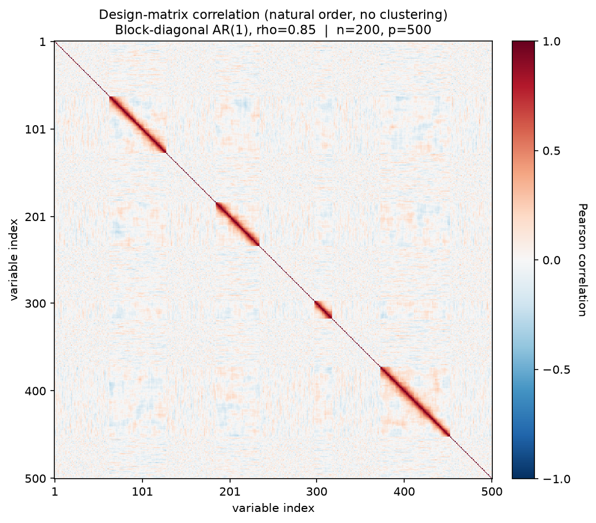
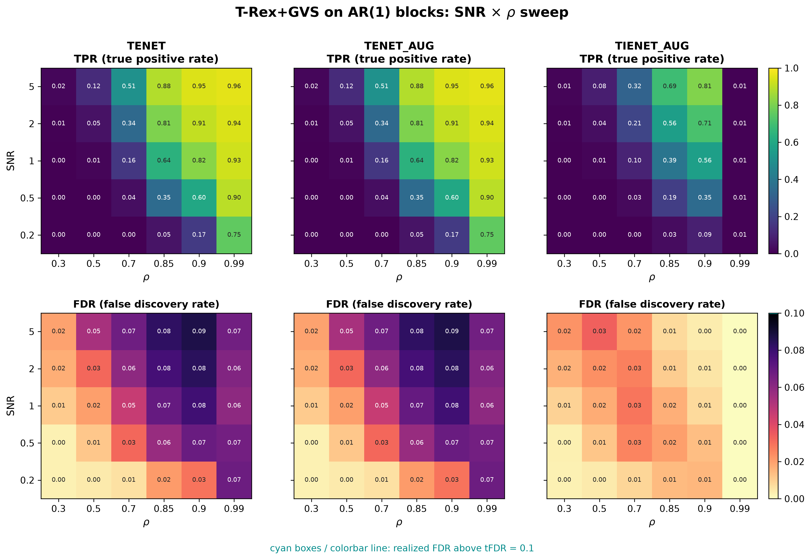

# Demo 06: T-Rex+GVS on AR(1) Blocks (Python)

## Purpose

Evaluate T-Rex+GVS when within-block correlation follows an **AR(1) time-series structure** instead of
 equicorrelation.
 This uses the same four-block active/trap geometry as Demo 03, but replaces the shared-latent-factor
 equicorrelated model with an AR(1) Toeplitz covariance within each block, testing robustness to more realistic,
 decaying correlation patterns.
 Selection and evaluation are per variable (see
 [What is actually measured](../README.md#what-is-actually-measured-in-these-demos)).

This is the Python port of the C++ demo
[demo_trex_gvs_06_mc_sim_ar1_blocks](../../../../cpp/trex_selector_methods/trex_gvs/demo_trex_gvs_06_mc_sim_ar1_blocks/),
using `trex_selector_neo`'s `TRexGVSSelector`.

---

## Data Generation Parameters (`dgp_ar1_blocks_snr`)

We consider again the linear model:

```math
\boldsymbol{y} = \boldsymbol{X}\boldsymbol{\beta} + \boldsymbol{\epsilon},
\qquad \boldsymbol{\epsilon} \sim \mathcal{N}(\boldsymbol{0}, \sigma_{\varepsilon}^2 \boldsymbol{I}_n)
```

- $\boldsymbol{y} \in \mathbb{R}^n$ is the response vector.
- $\boldsymbol{X} \in \mathbb{R}^{n \times p}$ is the design matrix.
- $\boldsymbol{\beta} \in \mathbb{R}^p$ is the coefficient vector, with $s$ nonzero entries.
- $\boldsymbol{\epsilon}$ is the noise vector, i.i.d. standard normal.
- $\sigma_{\varepsilon}^2$ is the noise variance, calibrated to achieve a target linear signal-to-noise ratio (SNR).
- $n = 200$, $p = 500$, $s = 150$ (the sum of the three active blocks).

Unlike Demos 01–05, the within-block structure is **not** equicorrelated: each block $k$ follows an AR(1) Toeplitz
 covariance,

```math
\Sigma_k(i,j) = \rho^{\lvert i-j \rvert},
```

generated as $X_{\text{block}} = Z L^\top$, where $Z \sim \mathcal{N}(0, I_{n \times b_k})$ and $L$ is the
 Cholesky factor of $\Sigma_k$.

- Same 4-block geometry as Demo 03: sizes $\lbrace20, 50, 80, 65\rbrace$ (215 grouped columns in total).
- **Blocks 0–2 are active** ($\beta_j = 3$); **block 3 is an inactive AR(1) trap** ($\beta_j = 0$).
- Gap columns (between and around the blocks) are i.i.d. $\mathcal{N}(0,1)$.
- Correlation between two variables in the same block decays with their column distance, so a block no longer
   behaves like a single tight cluster — variables at opposite ends of a large block can be nearly uncorrelated.



Empirical Pearson correlation of an exemplary design drawn from this DGP (`dgp_ar1_blocks_snr`, $n=200$, $p=500$,
$\rho = 0.85$, seed 2026), in **natural variable order — no hierarchical clustering**. Instead of the solid squares
of the equicorrelated demos, each block shows as a **band fading off the diagonal** — the $\rho^{|i-j|}$ decay. In
the two large blocks the band dies out well before the block ends, which is precisely why HAC-based evidence
aggregation has less to work with here. One figure per DGP lives in
[`../dgp_corr_plots/`](../dgp_corr_plots/); regenerate the whole suite with
[`../generate_corr_plots.sh`](../generate_corr_plots.sh) (shared plotter
[`../../corr_plt_utils.py`](../../corr_plt_utils.py)).

---

## Control Parameters

```text
K = 20                          # Random experiments per T-loop iteration
tFDR = 0.1                      # Target FDR
corr_max = 0.98                 # HAC auto-clustering correlation threshold
hc_linkage = Single             # Single-linkage HAC
lambda2_method = CV_1SE_CCD     # Elastic-net penalty selection
MC = 200                        # Monte Carlo repetitions per grid point
```

---

## Methods Compared

Three T-Rex+GVS solver variants: **TENET** (elastic net) [[3]](#references),
**TENET_AUG** (row-augmented elastic net) [[1]](#references), and **TIENET_AUG** (informed
elastic net) [[2]](#references). All use single-linkage HAC grouping
and `CV_1SE_CCD` for the $\lambda_2$ selection.

---

## The Sweep

A single **2-D SNR $\times$ $\rho$ grid**, over
$\mathrm{SNR} \in \lbrace0.2, 0.5, 1, 2, 5\rbrace$ and
$\rho \in \lbrace0.30, 0.50, 0.70, 0.85, 0.90, 0.99\rbrace$, 200 MC trials per cell. Here $\rho$ is the AR(1)
coefficient of the within-block Toeplitz covariance, so it controls how fast correlation decays
with column distance rather than a uniform within-block correlation level.

---

## Output Files

Written to `simulation_results/data/`:

- `gvs_ar1_blocks_2d.txt` / `.csv` — mean FDP/TPP over the SNR $\times$ $\rho$ grid.

The file names and CSV schema match the C++ demo, and the suite plotter
[`../trex_gvs_plt_utils.py`](../trex_gvs_plt_utils.py) is the same module the C++ suite uses.

Figures (PNG + PDF) go to `simulation_results/plots/`, produced by `./generate_plots.sh`.

---

## Running the Demo

```bash
python demo_trex_gvs_06_mc_sim_ar1_blocks.py       # full run (hours)
python demo_trex_gvs_06_mc_sim_ar1_blocks.py 8     # with 8 worker processes
./generate_plots.sh                                # render the figure below from the saved CSV
```

Monte Carlo trials are parallelized with `ProcessPoolExecutor`; the optional
first CLI argument sets the number of worker processes (default
`min(6, cpu_count)`). For a quick smoke test, temporarily reduce `num_MC` and
the sweep grids at the top of the script.

---

## Simulation Results

The numbers and figure below are this Python run's own results (200 MC trials per cell). They agree with the
[C++ reference](../../../../cpp/trex_selector_methods/trex_gvs/demo_trex_gvs_06_mc_sim_ar1_blocks/README.md#simulation-results)
up to Monte-Carlo noise — the two ports draw from independent RNG streams.

- FDR stays under control everywhere (no cyan cells): **TENET** and **TENET_AUG** are numerically identical and
   peak at $0.087$, just below the $\mathrm{tFDR} = 0.1$ target, while **TIENET_AUG** is markedly more
   conservative (FDR $\le 0.033$).
- **TPR recovers much more slowly with SNR than in the equicorrelated Hastie/Mixed-Blocks demos.** AR(1) decay
   means only nearby columns within a block stay strongly correlated, weakening the group-level evidence
   aggregation that HAC clustering relies on — full recovery needs both high $\rho$ and high SNR. At
   $\mathrm{SNR} = 5$, TENET's TPR runs $0.02 / 0.12 / 0.51 / 0.88 / 0.95 / 0.96$ across
   $\rho \in \lbrace0.3, 0.5, 0.7, 0.85, 0.9, 0.99\rbrace$: the $\text{low-}\rho$ columns barely lift off zero.
- **TIENET_AUG** sits between the near-zero TPR of the equicorrelated Gaussian demos and the TENET-based methods:
   it shows real (though smaller) power gains as SNR increases rather than staying flat (TPR $0.81$ at
   $\rho = 0.9$, $\mathrm{SNR} = 5$) — except in the $\rho = 0.99$ near-collinear column, where its TPR collapses
   to $\approx 0.01$.
- The $\rho$ axis is the most informative view of this demo: recovery degrades sharply as $\rho$ decreases and the
   AR(1) decay becomes steeper (correlation vanishing faster with column distance).

TPR (top) and FDR (bottom) heatmaps over the SNR $\times$ $\rho$ grid, one column per solver;
FDR cells above the $\mathrm{tFDR} = 0.1$ target would be outlined in cyan.



---

## References

1. Machkour, J., Muma, M., & Palomar, D. P., "False Discovery Rate Control for Grouped Variable Selection
   in High-Dimensional Linear Models using the T-Knock Filter.", European Signal Processing Conference (EUSIPCO), 2022,
    pp. 892–896, EURASIP.
    [DOI-Link](https://doi.org/10.23919/EUSIPCO55093.2022.9909883)
2. Machkour, J., Muma, M., & Palomar, D. P., "The Informed Elastic Net for Fast Grouped Variable Selection and
   FDR Control in Genomics Research.", Workshop on Computational Advances in Multi-Sensor Adaptive Processing (CAMSAP),
    2023, pp. 466–470, IEEE.
    [DOI-Link](https://doi.org/10.1109/CAMSAP58249.2023.10403489)
3. Zou, H., & Hastie, T. (2005). "Regularization and variable selection via the elastic net." *Journal of the Royal
   Statistical Society: Series B (Statistical Methodology)*, 67(2), pp. 301–320.
   [DOI-Link](https://doi.org/10.1111/j.1467-9868.2005.00503.x)
