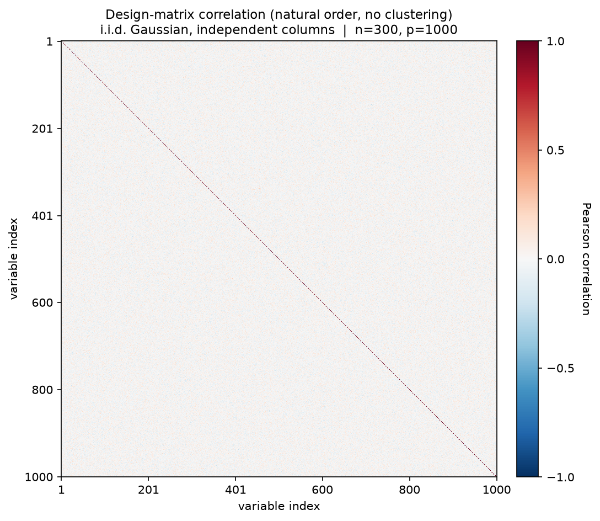
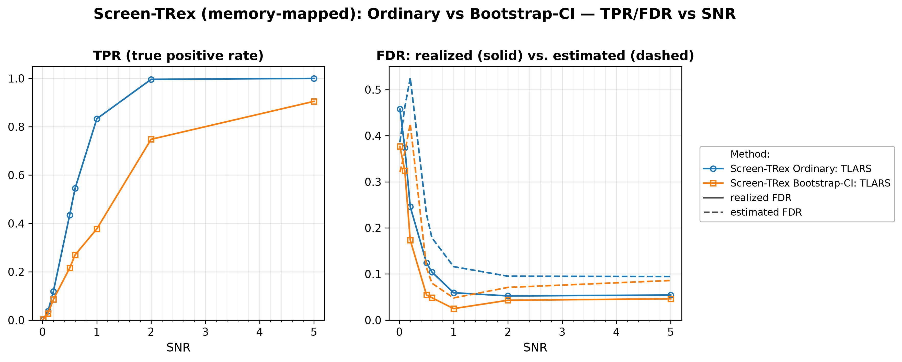

# Demo 02: Screen-TRex with Memory-Mapped Dummy Matrices (Python)

## Purpose

The demo shows that the **memory-mapped Screen-TRex workflow** reproduces the in-memory baseline while keeping the
 dummy (D) matrices on disk instead of in RAM.
The study is the same experiment as [Demo 01](../demo_trex_scr_01_mc_sim_screen_trex/README.md) — same
 i.i.d. Gaussian design, same SNR sweep, same two thresholding rules (**Ordinary** and **Bootstrap-CI**) —
 with the single change `TRexControlParameter.use_memory_mapping = True`.
The point of this demo is therefore *equivalence at a lower memory footprint*, not a different statistical
 regime: memory mapping is what makes very large $p$ feasible on machines that cannot hold the dummy
 matrices in RAM.
Screening returns a *candidate set*, and FDR/TPR are evaluated on the individual selected variables
 (see [What is actually measured](../README.md#what-is-actually-measured-in-these-demos)).

This is the Python port of the C++ demo
[demo_trex_scr_02_mc_sim_screen_trex_mmap](../../../../cpp/trex_selector_methods/trex_screening/demo_trex_scr_02_mc_sim_screen_trex_mmap/README.md),
using `trex_selector_neo`'s `TRexScreeningSelector`. As in the C++ source, the design matrix `X` still
lives in RAM; only the dummy matrices move to disk, and the library manages those temporary files in its
own scratch directories (nothing to clean up in the script).

---

## Data Generation Parameters (`dgp_iid_snr`)

We consider the linear model:

$$
\boldsymbol{y} = \boldsymbol{X}\boldsymbol{\beta} + \boldsymbol{\epsilon},
\qquad \boldsymbol{\epsilon} \sim \mathcal{N}(\boldsymbol{0}, \sigma_{\varepsilon}^2 \boldsymbol{I}_n)
$$

- $\boldsymbol{y} \in \mathbb{R}^n$ is the response vector.
- $\boldsymbol{X} \in \mathbb{R}^{n \times p}$ is the design matrix.
- $\boldsymbol{\beta} \in \mathbb{R}^p$ is the coefficient vector, with $s$ nonzero entries.
- $\boldsymbol{\epsilon}$ is the noise vector, i.i.d. standard normal.
- $\sigma_{\varepsilon}^2$ is the noise variance, calibrated to achieve a target linear signal-to-noise ratio (SNR).
- $n = 300$, $p = 1000$, $s = 10$ (high-dimensional, $p > n$).

The design matrix has **no correlation structure**:

$$
X_{ij} \sim \mathcal{N}(0,1) \quad \text{i.i.d.}
$$

- The active support is drawn uniformly at random *per Monte Carlo trial*, so the results are not tied to
   one support pattern.
- All active coefficients are $\beta_j = 1$; the support-selection and coefficient RNGs are offset from the
   trial seed (by $500000$ / $600000$) so they stay independent of the design and noise draws.



Empirical Pearson correlation of an exemplary design drawn from this DGP (`dgp_iid_snr`, $n=300$,
$p=1000$, seed 2026), in **natural variable order — no hierarchical clustering**. Identical to Demo 01's
design: only the unit diagonal stands out. One figure per DGP lives in
[`../dgp_corr_plots/`](../dgp_corr_plots/); regenerate the whole suite with
[`../generate_corr_plots.sh`](../generate_corr_plots.sh) (shared plotter
[`../../corr_plt_utils.py`](../../corr_plt_utils.py)).

---

## Control Parameters

```text
K = 20                       # Random experiments per T-loop iteration
use_memory_mapping = True    # Dummy (D) matrices backed by on-disk files, not RAM
R_boot = 1000                # Bootstrap replicates (Bootstrap-CI rule only)
ci_grid_step = 0.001         # Bootstrap-CI threshold grid granularity
solver = TLARS               # T-Rex solver backend
MC = 200                     # Monte Carlo repetitions per grid point
```

Note that Screen-TRex has **no target-FDR parameter**: unlike the classical T-Rex selector, screening
 thresholds the voting statistic instead of calibrating to a user-specified level.

---

## Methods Compared

Two Screen-TRex thresholding rules [[1]](#references), both using `ScreenTRexMethod.TREX`:

- **Screen-TRex Ordinary: TLARS** — selects $\{ j : \Phi_j > 0.5 \}$, a simple majority vote of the
   random experiments (`use_bootstrap_CI = False`).
- **Screen-TRex Bootstrap-CI: TLARS** — builds a bootstrap confidence band around the estimated FDR
   curve (`R_boot = 1000` replicates) and picks its threshold from that band
   (`use_bootstrap_CI = True`).

Both report an **estimated FDR** alongside the realized FDR/TPR.

---

## The Sweep

A single **SNR sweep** over $\mathrm{SNR} \in \{0.01, 0.1, 0.2, 0.5, 0.6, 1, 2, 5\}$, 200 MC trials per
point, with a fresh design, support, and noise draw in every trial — identical to Demo 01 apart from the
memory-mapped dummy storage. Per-cell trial seeds follow the C++ source
(`base_seed = 24 + snr_idx * 1000`).

---

## Output Files

Written to `simulation_results/data/`:

- `scr_screen_trex_mmap_snr_n300_p1000.txt` / `.csv` — FDR, TPR, and estimated FDR per method and SNR
  level (tidy long CSV: `method, metric, SNR, value`).

The file names and CSV schemas match the C++ demo, and the suite plotter
[`../trex_scr_plt_utils.py`](../trex_scr_plt_utils.py) is the same module the C++ suite uses.

Figures (PNG + PDF) go to `simulation_results/plots/`, produced by `./generate_plots.sh`.

---

## Running the Demo

```bash
python demo_trex_scr_02_mc_sim_screen_trex_mmap.py   # full run (~2.5 min with 6 workers)
./generate_plots.sh                                  # render the figure below from the saved CSV
```

Monte Carlo trials are parallelized with `ProcessPoolExecutor`; the worker count defaults to
`min(6, usable CPUs)` and is overridden with `SCR_NUM_WORKERS` (or the suite-wide `TREX_NUM_WORKERS`).
Each worker pins its inner OpenMP pool to one thread, so the demo never exceeds the worker count in total
cores. Note that every worker process drives its own memory-mapped dummy files, so disk I/O — not RAM —
is what scales with the worker count here.

---

## Simulation Results

The numbers and figure below are this Python run's own results (200 MC trials per grid point). They agree
with the [C++ reference](../../../../cpp/trex_selector_methods/trex_screening/demo_trex_scr_02_mc_sim_screen_trex_mmap/README.md#simulation-results)
up to Monte-Carlo noise — the two ports draw from independent RNG streams (NumPy here, the C++ engine
there).

- **Memory mapping changes the memory footprint, not the statistical behaviour.** Across the sweep the
   memory-mapped curves track this port's own in-memory Demo 01 curves closely: for $\mathrm{SNR} \ge 0.5$
   the largest FDR difference is about $0.008$, and the Ordinary rule's TPR curves coincide to within
   $0.01$ ($0.833$ vs. $0.841$ at $\mathrm{SNR} = 1$; $1.000$ in both at $\mathrm{SNR} = 5$). It is the
   same procedure on the same statistics — only the D matrices live on disk.
- **Exact equality is not expected.** Both demos use nondeterministic selector seeds (the library resolves
   `seed = -1` from hardware entropy), so the two runs draw different random experiments. The residual gaps
   are Monte Carlo noise, not a discrepancy in the memory-mapped path. The Bootstrap-CI rule shows the
   widest of them (TPR $0.748$ here vs. $0.813$ in Demo 01 at $\mathrm{SNR} = 2$), because its threshold is
   itself a bootstrap estimate and therefore carries a second layer of sampling variability.
- **The baseline conclusions carry over unchanged.** Screening is not FDR-controlling at low SNR — at
   $\mathrm{SNR} \le 0.2$ the realized FDR runs between $0.17$ and $0.46$ with TPR $\le 0.12$ — and both
   rules become reliable from $\mathrm{SNR} \ge 0.5$, where the Ordinary rule's FDR falls to $0.124$ and
   settles around $0.05$–$0.06$ while its TPR climbs $0.435 \to 1.000$.
- **Bootstrap-CI remains the conservative rule: lower FDR, clearly less power.** Its FDR stays at or below
   $0.055$ for $\mathrm{SNR} \ge 0.5$, roughly half the Ordinary rule's, paid for with TPR $0.905$ vs.
   $1.000$ at $\mathrm{SNR} = 5$ and a wide mid-sweep gap ($0.378$ vs. $0.833$ at $\mathrm{SNR} = 1$).
- **The internal FDR estimate is conservative here.** For $\mathrm{SNR} \ge 0.5$ it sits *above* the
   realized FDR for both rules (e.g. $0.116$ vs. $0.059$ for Ordinary at $\mathrm{SNR} = 1$), over-stating
   the error rate rather than hiding it. At the lowest SNR points it becomes unreliable in both directions.

TPR (left) and FDR (right) vs. SNR, one line per thresholding rule; on the FDR panel the solid
line is the realized FDR and the dashed line the procedure's own estimated FDR.



---

## References

1. Machkour, J., Muma, M., & Palomar, D. P., "False Discovery Rate Control for Fast Screening of
   Large-Scale Genomics Biobanks.", IEEE Statistical Signal Processing Workshop (SSP), 2023,
    pp. 666–670, IEEE.
    [DOI-Link](https://doi.org/10.1109/SSP53291.2023.10207957)

---

**Last updated**: 2026-07-27
