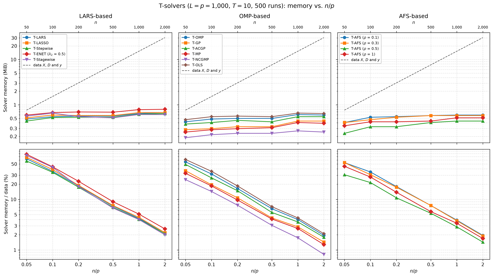

# Demo: Memory of the T-Solvers vs. the Ratio n/p (Python)

## Purpose

This demo measures the solver memory of the demo T-solvers, the memory a solver allocates beyond the data it works on,
for a fixed number $p$ of variables and a growing number $n$ of observations, so the ratio $n/p$ runs from 0.05 to 2.
It compares the solver memory with the size of the data and reports the number of steps to $T$, which sets the length
of the stored path. It mirrors the [C++ demo](../../../cpp/tsolvers/demo_ts_perf_03_memory_vs_np/README.md) with the
same settings, seeds and console format, while NumPy draws the data, so the numbers differ from the C++ run. In Python
the solver memory also holds what the binding allocates around the C++ solver.

---

## Setup

- $p = 1{,}000$ variables and $n \in \lbrace 50, 100, 200, 500, 1{,}000, 2{,}000 \rbrace$ observations with
  independent standard normal entries,
- ten true coefficients equal to 3 on a fixed random support, noise standard deviation about 1 (`snr = 90`),
- $L = p$ standard normal dummies and $T = 10$,
- 500 Monte Carlo runs, with medians over the runs.

The support is drawn once with `default_rng(12345)`. For every run `mc` and every $n$ the demo draws the data with
`gen_synthetic_data()` and the seed `1000 + mc`, as the C++ demo does, but with NumPy's `default_rng`, a permuted
congruential generator (PCG64). The noise variance is the variance of the drawn signal divided by `snr`, so the ten
coefficients equal to 3 give a noise standard deviation of about 1. The demo centers and scales $\mathbf{X}$ and
$\mathbf{D}$ in place with `LpNormScaler` and centers $\mathbf{y}$ once, and all 15 solver configurations of
[demo_ts_perf_01](../demo_ts_perf_01_fdr_tpr_vs_T/README.md) run on these arrays as precentered readers to $T = 10$.
Each solver runs in a child process forked from the demo, which reports its solver memory (see the technical notes).
The data take

```math
8\,n\,(p + L + 1)\ \text{bytes} = 16{,}008\,n\ \text{bytes},
```

which is 0.76 mebibytes (MiB, $2^{20}$ bytes) at $n = 50$ and 30.5 MiB at $n = 2{,}000$.

---

## Running the demo

From the repository root, with the package installed in the repository's virtual environment:

```bash
.venv/bin/python Python/tsolvers/demo_ts_perf_03_memory_vs_np/demo_ts_perf_03_memory_vs_np.py        # 500 runs, 6 children
.venv/bin/python Python/tsolvers/demo_ts_perf_03_memory_vs_np/demo_ts_perf_03_memory_vs_np.py 5 3    # 5 runs, 3 children
Python/tsolvers/demo_ts_perf_03_memory_vs_np/generate_plots.sh                                        # figure
```

The two optional arguments are the number of runs and the number of solver processes that run at the same time. The
500 runs take about 6 minutes (366.4 s) on an Apple Silicon machine with 6 processes at a time, while the C++ demo
needs about 4 minutes. The result files carry the number of runs in their name (`memory_vs_np_mc500.csv` and `.txt`),
so a short test run does not overwrite the full one, and `generate_plots.sh` takes the `.csv` file of such a run as an
optional argument. It draws the figure with `Python/tsolvers/ts_plt_utils.py`, a byte-identical copy of the C++
plotting module. The output below is a run against library b95b984 (TRexSelectorNeo 1.0.0).

---

## Console walk-through

### Solver memory

```text
============================================================
T-Solver Performance: Memory vs. n/p
============================================================
p = 1000, L = p, n in {50, 100, 200, 500, 1000, 2000}, T = 10, true coefficients: 10 x 3, SNR = 90
15 solvers, 500 runs, 6 children at a time (one forked child per solver)

  runs done: 50 of 500
  runs done: 100 of 500
  runs done: 150 of 500
  runs done: 200 of 500
  runs done: 250 of 500
  runs done: 300 of 500
  runs done: 350 of 500
  runs done: 400 of 500
  runs done: 450 of 500
  runs done: 500 of 500

Data X, D and y (MiB)
solver                     n=50    n=100    n=200    n=500   n=1000   n=2000
----------------------------------------------------------------------------
all solvers                0.76     1.53     3.05     7.63    15.27    30.53

Median solver memory (MiB)
solver                     n=50    n=100    n=200    n=500   n=1000   n=2000
----------------------------------------------------------------------------
T-LARS                     0.48     0.55     0.56     0.56     0.64     0.67
T-LASSO                    0.52     0.59     0.58     0.58     0.67     0.67
T-Stepwise                 0.44     0.52     0.53     0.53     0.62     0.64
T-ENET (lambda2 0.5)       0.59     0.67     0.70     0.69     0.78     0.80
T-Stagewise                0.56     0.66     0.55     0.52     0.61     0.61
T-OMP                      0.42     0.48     0.50     0.50     0.61     0.59
T-GP                       0.28     0.30     0.33     0.33     0.44     0.44
T-ACGP                     0.38     0.41     0.45     0.42     0.55     0.55
T-MP                       0.25     0.28     0.30     0.31     0.41     0.39
T-NCGMP                    0.19     0.22     0.23     0.23     0.27     0.25
T-OLS                      0.47     0.55     0.56     0.55     0.66     0.64
T-AFS (rho 0.1)            0.41     0.53     0.55     0.58     0.59     0.59
T-AFS (rho 0.3)            0.41     0.47     0.53     0.58     0.58     0.58
T-AFS (rho 0.5)            0.23     0.33     0.33     0.41     0.44     0.44
T-AFS (rho 1)              0.34     0.42     0.42     0.44     0.52     0.52

Largest solver memory over the runs (MiB)
solver                     n=50    n=100    n=200    n=500   n=1000   n=2000
----------------------------------------------------------------------------
T-LARS                     0.67     0.84     0.77     0.80     0.97     0.97
T-LASSO                    0.84     0.86     0.84     0.77     1.00     0.97
T-Stepwise                 0.64     0.73     0.84     0.75     0.89     0.91
T-ENET (lambda2 0.5)       0.86     0.92     0.92     0.92     1.06     1.03
T-Stagewise                0.89     1.09     0.84     0.77     0.92     0.92
T-OMP                      0.62     0.72     0.81     0.75     0.92     0.84
T-GP                       0.42     0.41     0.45     0.42     0.55     0.52
T-ACGP                     0.53     0.56     0.66     0.59     0.73     0.70
T-MP                       0.33     0.39     0.41     0.42     0.50     0.48
T-NCGMP                    0.27     0.30     0.30     0.31     0.34     0.31
T-OLS                      0.75     0.78     0.83     0.80     0.92     0.86
T-AFS (rho 0.1)            0.62     0.81     0.81     0.81     0.80     0.81
T-AFS (rho 0.3)            0.59     0.69     0.78     0.89     0.77     0.78
T-AFS (rho 0.5)            0.42     0.55     0.56     0.67     0.70     0.69
T-AFS (rho 1)              0.50     0.61     0.69     0.66     0.72     0.77
```

The data grow 40-fold from $n = 50$ to $n = 2{,}000$, while the solver memory stays at 0.80 MiB or less in the median
and at 1.09 MiB or less in every single run. T-LARS needs 0.48 MiB at $n = 50$ and 0.67 MiB at $n = 2{,}000$, 1.4 times
as much for 40 times as many observations. At $n = 2{,}000$ the LARS family needs 0.61 to 0.80 MiB with T-ENET on top,
and T-OMP, T-OLS and T-AFS need 0.44 to 0.64 MiB. T-GP, T-ACGP and T-MP need 0.39 to 0.55 MiB, and T-NCGMP needs the
least with 0.25 MiB.

The solver memory hardly depends on $n$ because the solvers work on the caller's $\mathbf{X}$ and $\mathbf{D}$ without a
copy. They keep a centered copy of $\mathbf{y}$, vectors of length $n$ and $p + L$ such as the residual and the
correlations, the Cholesky factor of the active set with $k \times k$ entries, and the sparse path. At $n = 2{,}000$
such a vector takes 16,000 bytes, so the 0.67 MiB of T-LARS amount to about 44 vectors.

Compared with the C++ run, 83 of the 90 medians are higher, and the excess is 0.125 MiB or eight pages of 16 kibibytes
in the median over all 90 cells. This excess stays between 0.11 and 0.14 MiB in the median at every $n$, so it is no
copy of the data and fits objects of a fixed size that the binding and the interpreter allocate around the C++ solver.
It is largest for T-ACGP (0.22 to 0.27 MiB) and T-ENET (0.17 to 0.22 MiB). T-AFS ($\rho = 1$) stays within four pages
of its C++ value, and T-AFS ($\rho = 0.5$) is the exception, 0.05 to 0.09 MiB below its C++ value at every $n$. The
largest values over the runs reach 1 MiB in four cells, while every C++ run stays below 1 MiB.

### Share of the data

```text
Median solver memory relative to the data (%)
solver                     n=50    n=100    n=200    n=500   n=1000   n=2000
----------------------------------------------------------------------------
T-LARS                     63.5     35.8     18.4      7.4      4.2      2.2
T-LASSO                    67.6     38.9     18.9      7.6      4.4      2.2
T-Stepwise                 57.3     34.3     17.4      7.0      4.0      2.1
T-ENET (lambda2 0.5)       77.8     44.0     22.8      9.0      5.1      2.6
T-Stagewise                73.7     43.0     17.9      6.8      4.0      2.0
T-OMP                      55.3     31.7     16.4      6.6      4.0      1.9
T-GP                       36.8     19.4     10.7      4.3      2.9      1.4
T-ACGP                     49.1     26.6     14.8      5.5      3.6      1.8
T-MP                       32.8     18.4      9.7      4.1      2.7      1.3
T-NCGMP                    24.6     14.3      7.7      3.1      1.7      0.8
T-OLS                      61.4     35.8     18.4      7.2      4.3      2.1
T-AFS (rho 0.1)            53.2     34.8     17.9      7.6      3.9      1.9
T-AFS (rho 0.3)            53.2     30.7     17.4      7.6      3.8      1.9
T-AFS (rho 0.5)            30.7     21.5     10.7      5.3      2.9      1.4
T-AFS (rho 1)              45.0     27.6     13.8      5.7      3.4      1.7
```

Since the solver memory is nearly constant, its share of the data falls roughly like $1/n$. At $n/p = 0.05$
the solvers add 25% to 78% to the data, and from $n/p = 0.5$ on they add 9% or less. At $n/p = 2$ the share is 0.8% to
2.6%, so the data set the memory of a terminated path in all but the smallest problems, the share of the binding
included.

### Steps to $T = 10$

```text
Median steps to T = 10
solver                     n=50    n=100    n=200    n=500   n=1000   n=2000
----------------------------------------------------------------------------
T-LARS                     24.0     30.0     29.0     30.0     29.0     29.0
T-LASSO                    24.0     32.0     29.0     30.0     29.0     29.0
T-Stepwise                 21.0     29.0     29.0     29.0     29.0     29.0
T-ENET (lambda2 0.5)       24.0     29.0     30.0     30.0     30.0     30.0
T-Stagewise                33.0     41.0     30.0     30.0     29.0     29.0
T-OMP                      21.0     29.0     29.0     29.0     29.0     29.0
T-GP                       21.0     30.0     30.0     30.0     30.0     30.0
T-ACGP                     21.0     30.0     30.0     30.0     30.0     30.0
T-MP                       21.0     34.0     36.0     36.0     36.0     36.0
T-NCGMP                    21.0     34.0     36.0     36.0     36.0     36.0
T-OLS                      21.0     29.0     29.0     29.0     29.0     29.0
T-AFS (rho 0.1)            23.0     30.0     29.0     29.5     29.0     30.0
T-AFS (rho 0.3)            21.0     30.0     29.0     29.0     29.0     29.0
T-AFS (rho 0.5)            21.0     30.0     29.0     29.0     29.0     29.0
T-AFS (rho 1)              21.0     29.0     29.0     29.0     29.0     29.0

Failed solver runs: 0
Wall time: 366.4 s
```

From $n = 200$ on most solvers need 29 to 30 steps, and T-MP and T-NCGMP need 36, as at $L = p$ in
[demo_ts_perf_02](../demo_ts_perf_02_runtime_vs_dummies/README.md). By the exchangeability count of that demo, a path
to the tenth dummy holds the ten dummies and about ten null variables. The 21 to 24 steps at $n = 50$ therefore leave
room for only one to four of the ten true variables, and the shorter paths fit the lower memory there. T-Stagewise is
the exception, with 33 and 41 steps at $n = 50$ and $n = 100$, and its memory there exceeds the one at $n = 200$. The
median steps agree with the C++ run within one step in every cell, and no solver run fails.

---

## Figures

The figure shows the solver memory against $n/p$ on log axes, one column per library family, with $n$ on
the top axis. The dashed line in the top row is the size of the data, and the bottom row shows the solver memory as a
share of the data.



---

## Technical notes

- Every solver runs in a child forked with `os.fork()`, up to 6 at a time. The child first reads every page of
  $\mathbf{X}$, $\mathbf{D}$ and $\mathbf{y}$ and solves a small warm-up problem with 20 observations, 30 variables and
  30 dummies, which loads the code of the solver and sets up the allocator. It then takes the peak resident memory
  from `resource.getrusage()` (`ru_maxrss`) as the baseline, runs the solver to $T = 10$ and sends the new peak minus
  the baseline to the parent through a pipe. A child starts its own peak count, so neither the parent nor the other
  children enter.
- The baseline therefore holds the data, the solver code, the Python interpreter and the loaded modules. The solver
  memory holds what the C++ solver and the binding allocate for the measured run, such as the Python solver object.
- The demo calls `set_num_threads(1)` before the first fork, so the parent and the solvers run single-threaded and
  `os.fork()` stays safe with the thread pools of the library. `os.fork()` exists on macOS and Linux only, and
  `peak_rss_mib()` reads `ru_maxrss` in bytes on macOS and in kibibytes on Linux.
- Resident memory grows in pages of 16 kibibytes on Apple Silicon, and the allocator keeps freed blocks for reuse. The
  medians therefore move in steps of a few pages, such as the rise of 0.08 to 0.13 MiB between $n = 500$ and
  $n = 1{,}000$ in the LARS and OMP families apart from T-NCGMP.
- A writer, a solver with `normalize=True` or `intercept=True`, centers and scales the caller's $\mathbf{X}$ and
  $\mathbf{D}$ in place and restores them when it is released, so it does not copy the data either. This demo runs
  the precentered readers only.
