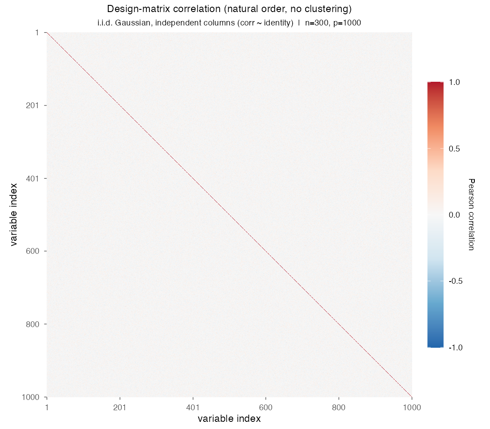

# Demo 08: Scalability Benchmark

## Purpose

Characterize T-Rex selector **runtime and memory usage** as `n` and `p` scale to
large sizes, and demonstrate that the selector goes **high-dimensional and
out-of-core** — into design volumes that exceed physical RAM. Everything runs on
the **fully memory-mapped pipeline**: every Monte Carlo trial generates `X`
directly into an mmap backing file (`dgp_chunked_gauss_snr` with
`chunk_cols = 1000`, so `X` is never materialized in RAM), and
`use_memory_mapping = TRUE` additionally memory-maps the internal dummy matrices
`D` and serializes solver warm-start state to disk. R port of the C++/Python
reference study (`demo_trex_08_mc_sim_scalability.{cpp,py}`).

## Data-generating process

The DGP mirrors **Demo 03** (variable support): i.i.d. standard-normal design,
`s = 10` support indices **redrawn per trial** via `make_support_random`, fixed
coefficients `beta_j = 1`, `SNR = 1.0` fixed (SNR is deliberately not a scaling
axis here), `tFDR = 0.1`. Trials run **sequentially** (no `mclapply`) so
wall-clock and RSS readings are undistorted; the selector runs with
`seed = -1` (hardware entropy) as in all MC demos.

Per-trial seeds are a stable function of `(n, p, mc)` —
`(24 + n*100003 + p*13 + mc) mod (2^31 - 1)` — independent of grid position and
identical to the C++/Python demos, so cache reuse and reproducibility survive
reordering or extending the grid.

The design family is the suite's shared one — independent columns, so the
empirical column-correlation matrix is essentially the identity at every grid
point; `n` and `p` scale, the correlation structure does not:



Note (thread pinning): the C++/Python demos pin the selector's inner OpenMP pool
to 6 threads; the R package exports no equivalent, so the library defaults apply
— a documented divergence.

## The grid

2-D sweep, `num_MC = 10` sequential trials per `(n, p, solver)`:

- `n in {1000, 1500, 2000, 5000}`
- `p in {1000, 5000, 10000, 20000, 50000, 100000, 150000, 200000}`

32 grid points x 3 solvers (**TLARS**, **TOMP**, **TAFS** with `rho_afs = 0.3`;
`lambda2 = 0` everywhere). The top-right corner (`n = 5000`, `p = 200000`) is the
**out-of-core barrier point**: its logical design `[X|D] ~ 82 GiB` exceeds 64 GiB
of physical RAM, feasible only because the pipeline is fully memory-mapped.
Barrier points (design > physical RAM) are flagged with `*` in the output table.

## Control

Every option explicit, identical to the C++ reference: `K = 20`,
`max_dummy_multiplier = 10`, `use_max_T_stop = TRUE`, `opt_threshold = 0.75`,
`dummy_distribution = Normal`, `lloop_strategy = "STANDARD"`,
`tloop_stagnation_stop = TRUE`, `tloop_max_stagnant_steps = 5`,
`use_openmp = FALSE` (sequential random experiments — one experiment working set
in RAM at a time, essential for the out-of-core corner),
`use_memory_mapping = TRUE`.

## Measurements

Per `(n, p)` x solver, aggregated over the cached trials: `DesignGiB`,
`SelMed_s`/`SelMin_s`/`SelMax_s` (median/min/max `select()` wall-clock), `DGP_s`,
`s/Titer`, `PeakRSS_MiB`, `RSS_MiB`, `Foot_MiB`, `X+y_MiB`, and
`FDR`/`TPR`/`Avg_L`/`Avg_T` as selection-quality sanity checks.

Memory metrics in R (documented divergences from the Python/C++ instrumentation):

- `RSS_MiB` — `ps -o rss= -p <pid>` (macOS) / `/proc/self/statm` (Linux).
- `PeakRSS_MiB` — Linux: exact `VmHWM`. macOS: running maximum of the RSS
  **samples** taken at the instrumentation points — a lower bound of the true
  kernel high-water mark (base R exposes no `getrusage()`).
- `Foot_MiB` — Linux: `VmRSS + VmSwap`. macOS: **NA** (the `phys_footprint`
  counter needs mach `task_info()`, unreachable from base R; NA is recorded
  rather than a fake number).

## Output files and expandability

Written to `simulation_results/data/` with stem `demo_trex_08_scalability_results`
(smoke mode: `demo_trex_08_scalability_smoke`), re-derived from the trial cache
and re-saved after each completed grid point:

- `<stem>_trials.csv` — the **raw per-trial cache** (source of truth): one row per
  `(n, p, solver, mc)` with columns
  `n,p,solver,mc,trial_seed,dgp_s,select_s,rss_mib,fp_mib,peak_rss_mib,data_mib,fdp,tpp,L,T`.
  Appended to as each trial finishes.
- `<stem>.txt` — per-solver aligned table, one row per `(n, p)` grid point;
  barrier points marked `*`.
- `<stem>.csv` — tidy long summary, header `n,p,is_barrier,solver,num_mc,snr,metric,value`
  (`num_mc` is the actual cached trial count per cell).

A run computes **only the trials it is missing** from the cache: `num_MC` top-up,
grid growth, and trial-level resume all reuse finished trials. The script sweeps
orphaned `demo08_scalability_*` backing files and `trex_memmap_*` dummy dirs from
the temp dir at startup and on exit.

## Running

```bash
demo=R/trex_selector_methods/ad/trex_core/demo_trex_08_mc_sim_scalability/demo_trex_08_mc_sim_scalability.R

Rscript "$demo"            # full grid, num_MC = 10 (long-running)
Rscript "$demo" 2          # full grid, num_MC = 2  (first pass; top up to 10 later)
Rscript "$demo" smoke      # tiny end-to-end smoke check (num_MC = 2)
Rscript "$demo" smoke 3    # smoke grid, num_MC = 3
```

The `smoke` / integer arguments are order-independent; the smoke grid is
`(n, p) in {(150, 500), (200, 1000)}`. The script sources
`../../support_generators.R` and `../trex_sim_utils.R`.

Unlike the other demos in this suite, this one is **run manually** (it is not part
of the overnight runner) — no data or figures are committed here. Run the script
first, then `./generate_plots.sh` to render the scalability dashboard (runtime /
memory / FDR versus problem size) from the wide summary CSV via the shared
[`../trex_plt_utils.R`](../trex_plt_utils.R) into `simulation_results/plots/`.
