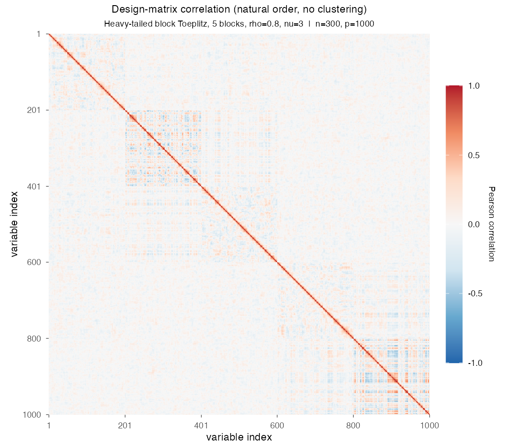
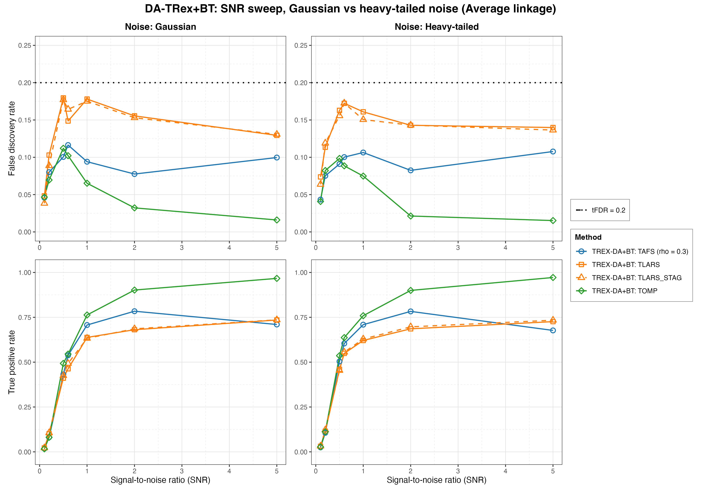
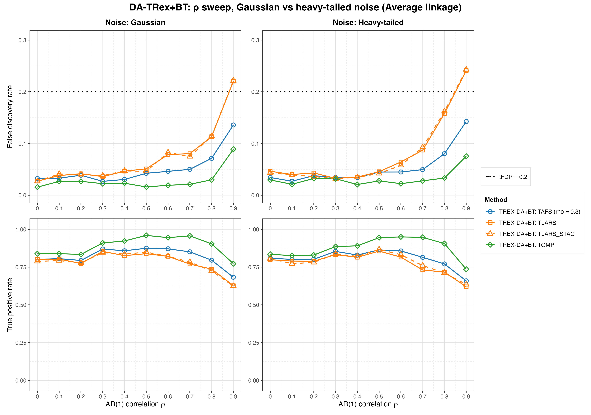
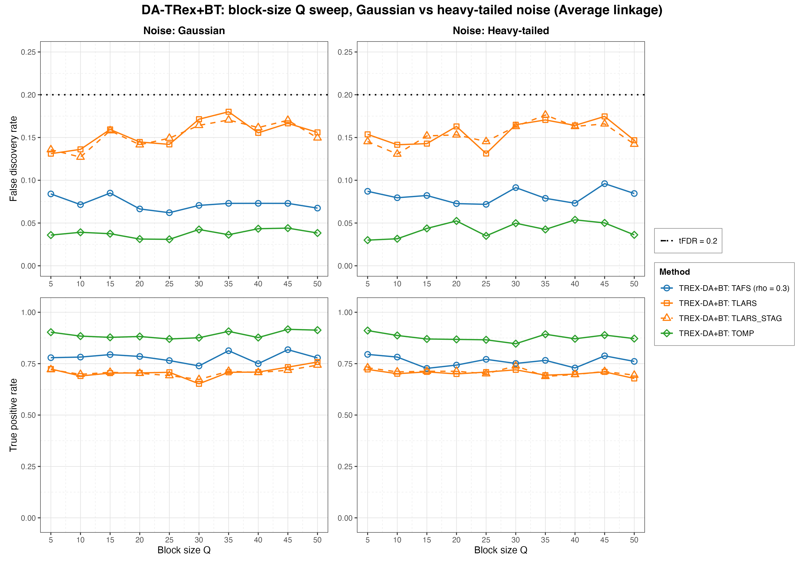
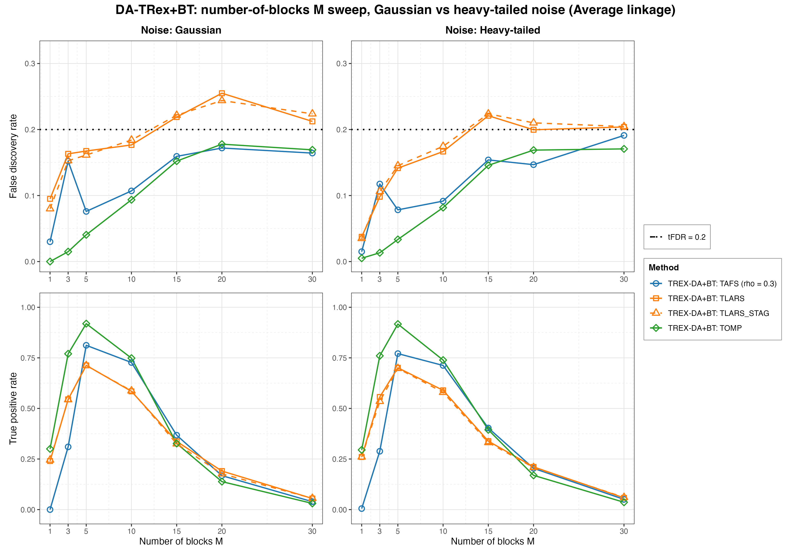
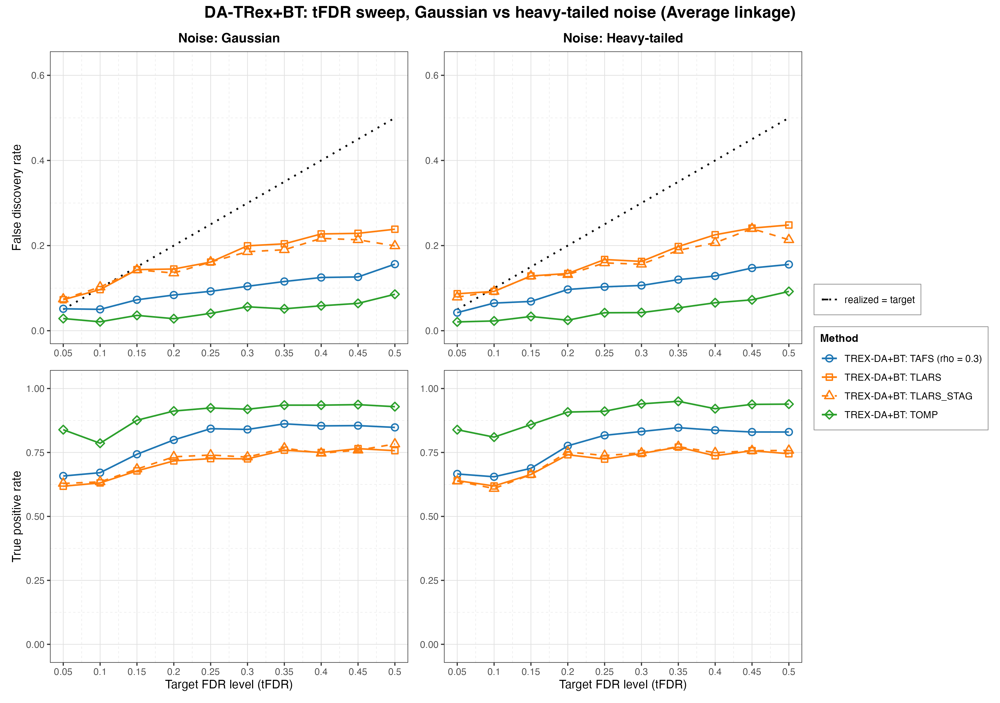
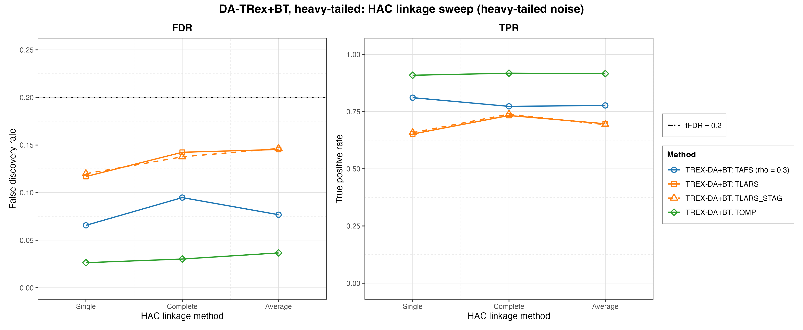

# Demo 04: DA-TRex+BT (Binary-Tree Dependency-Aware T-Rex) on Heavy-Tailed Block Data

Monte Carlo (MC) results for **DA-TRex+BT**, the Dependency-Aware (DA) Terminating Random Experiments (T-Rex)
selector (DA-TRex) with the Binary-Tree (BT) group design (`da_method = "BT"`), on a **heavy-tailed** block-diagonal
Toeplitz design. The predictors always follow a multivariate $\text{Student-}t(\nu{=}3)$ law, and the response noise
is either Gaussian (**s1_Gauss**) or $t(\nu{=}3)$ (**s2_Heavy**). Five ceteris-paribus sweeps (signal-to-noise ratio
(SNR), $\rho$, block size $Q$, number of blocks $M$, target false discovery rate (FDR)) plus a dedicated linkage sweep
are each run under both noise scenarios and the three hierarchical agglomerative clustering (HAC) linkage methods
(Single / Complete / Average).
Common setup: $n=150$, amplitude $1.0$, $\rho=0.8$, $\nu=3$, $\mathrm{tFDR}=0.2$, $K=20$ random
experiments, $\mathrm{MC}=200$ per grid point, and solvers TLARS / TAFS / TOMP, plus TLARS_STAG (TLARS with the
T-loop stagnation stop on, window 7, see the
[C++ suite README](../../../../../cpp/trex_selector_methods/ad/trex_da/README.md)).

R port of the C++ demo
[cpp/trex_selector_methods/ad/trex_da/demo_trex_da_04_mc_sim_ht_blocks](../../../../../cpp/trex_selector_methods/ad/trex_da/demo_trex_da_04_mc_sim_ht_blocks/README.md)
with the same data-generating process (DGP), control parameters, sweep axes, console summaries, and result-file
naming. Indices are 1-based (R convention). The numbers below are this R run's own results. R draws its own random
numbers, so they differ from the C++ and Python runs within Monte Carlo noise, not exactly. A cell-by-cell comparison
with the C++ run, with $z$ the difference divided by the combined Monte Carlo standard error of the two 200-trial
means, finds $4$ cells with $|z| > 3$ among the 2,160 cells of this demo (FDR and TPR of every solver at every grid
point). Over the whole DA-TRex suite 25 of 9,344 cells (0.27 %) exceed $|z| > 3$, the rate that noise alone produces.

The greedy solvers use *exchangeable tie-breaking* (`exch_tie_alpha = 0.25` for TAFS/TOMP, `0` for
TLARS and TLARS_STAG) in every part, as in C++. TAFS runs with its adaptive forward-selection (AFS) correlation
parameter `rho_afs = 0.3` throughout (`0` for TLARS, TLARS_STAG and TOMP), which is why the figures label it
`TAFS (rho = 0.3)`.

---

## Setup — the DA-TRex+BT selector

The selector deflates each variable's ordinary relative occurrence $\Phi_{T,L}(j)$ by the penalty
$\Psi_{T,L}^{\mathrm{BT}}(j) \in [1/2, 1]$ built from its most similar competitor within its
variable group,

```math
\Phi^{\mathrm{BT}}_{T,L}(j) := \Psi^{\mathrm{BT}}_{T,L}(j) \cdot \Phi_{T,L}(j),
```

where the **BT group design** obtains the groups $\mathrm{Gr}(j)$ from a **binary tree**. Variables
are clustered by HAC on the dissimilarity $1 - |\mathrm{corr}(\boldsymbol x_j, \boldsymbol x_{j'})|$ and the
dendrogram cut defines disjoint groups (see the
[Demo 02](../demo_trex_da_02_mc_sim_ar1_blocks_plus_white/README.md)
for the full penalty formula). The **linkage method** sets the between-cluster distance during agglomeration.
**Single** ($\min$) is prone to chaining, **Complete** ($\max$) builds compact clusters, and **Average** uses the mean,
the unweighted pair group method with arithmetic mean (UPGMA). Because heavy-tailed data make the sample correlations
that drive HAC noisier, every sweep is run once per linkage and Part 6 probes linkage directly.

Each Monte Carlo trial builds the selector through the TRexSelectorNeo class interface, here for TOMP at Average
linkage:

```r
library(TRexSelectorNeo)

ctrl <- trex_control(
  solver = "TOMP", K = 20L, max_dummy_multiplier = 10, use_max_T_stop = TRUE,
  lloop_strategy = "STANDARD", tloop_stagnation_stop = TRUE,
  tloop_max_stagnant_steps = 7, rho_afs = 0, exch_tie_alpha = 0.25
)
sel <- TRexDASelector$new(
  X, y, tFDR = 0.2, seed = -1L, verbose = FALSE,
  da_control = trex_da_control(da_method = "BT", hc_linkage = "Average"),
  control = ctrl
)
sel$select()
fdp <- trex_fdp(sel$selected_indices, true_support)
tpp <- trex_tpp(sel$selected_indices, true_support)
```

`default_solvers("+BT")` in [`../da_sim_common.R`](../da_sim_common.R) sets the per-solver fields. TLARS runs
without the stagnation stop and with `exch_tie_alpha = 0`, TAFS and TOMP run with the stop and
`exch_tie_alpha = 0.25`, and TLARS_STAG is TLARS with the stop on. The selector seed `-1L` draws the dummies from
hardware entropy in every trial.

## Setup — data generating process (`dgp_block_toeplitz_hvt_snr`)

The design consists of $M$ statistically independent blocks of size $Q$ and nothing else. Each block follows the
first-order autoregressive (AR) model AR(1). As in Demo 03 there is no white-noise padding, so *every* column belongs
to a correlated block and $p = M \cdot Q$. The within-block correlation follows the $Q \times Q$ Toeplitz matrix

```math
\left[\boldsymbol{\Sigma}_{m}(\rho)\right]_{j,k} = \rho^{|j-k|},
\qquad m = 1, \ldots, M,
```

giving the block-diagonal scale matrix

```math
\boldsymbol{\Sigma} =
\begin{bmatrix}
\boldsymbol{\Sigma}_1(\rho) & & \\
& \ddots & \\
& & \boldsymbol{\Sigma}_M(\rho)
\end{bmatrix} \in \mathbb{R}^{p \times p},
\qquad p = M \cdot Q.
```

**Heavy-tailed predictors.** Each block is drawn as a **multivariate $\text{Student-}t$** with $\nu$ degrees
of freedom and scale matrix $\boldsymbol\Sigma_m$, via the Gaussian scale-mixture

```math
\boldsymbol{X}_i^{(m)} = \sqrt{\tfrac{\nu}{u_{i,m}}}\; \boldsymbol{L}_m \boldsymbol{z}, \qquad
\boldsymbol{z} \sim \mathcal{N}(\boldsymbol{0}, \boldsymbol{I}_Q),\;\;
u_{i,m} \sim \chi^2_{\nu},
```

where $\boldsymbol L_m$ is the Cholesky factor of $\boldsymbol\Sigma_m$ and the mixing variable
$u_{i,m}$ is drawn independently per row $i$ and block $m$, so extreme events are block-local. The R generator builds
$\boldsymbol L_m \boldsymbol z$ with the AR(1) column recursion of Demo 03, which has the same law. The correlation
structure $\rho^{|j-k|}$ is preserved. The marginals are $t(\nu)$ (finite variance $\tfrac{\nu}{\nu-2}$ for $\nu=3$),
so the tails are much heavier than Gaussian.



Empirical Pearson correlation of an exemplary design drawn from this DGP (illustrative instance:
$n=300$, $p=1{,}000$, 5 blocks of 200, $\rho=0.8$, $\nu=3$), in **natural variable order with no
hierarchical clustering**. Several of the five blocks show up as *noisy* squares. The within-block Toeplitz
decay concentrates near the diagonal. The heavy tails make the off-diagonal sample correlations themselves
erratic, and the HAC clustering behind the BT groups has to work with exactly these correlations.
Regenerate the per-DGP figures with [`../generate_corr_plots.sh`](../generate_corr_plots.sh) (shared plotter
[`../../../corr_plt_utils.R`](../../../corr_plt_utils.R)).

**Support (`OnePerBlock`).** Exactly one representative per AR(1) block, the block's first column
(`make_support_one_per_block()`),

```math
\mathcal{S} = \{s_1, \ldots, s_M\}, \qquad s_m = (m-1)Q + 1,
```

so $s = M$ and every block carries a signal.

**Linear model, noise scenarios, and SNR control.** Each trial draws $y = X\beta + \varepsilon$ with
active amplitude $\beta_{s_m} = 1.0$ and SNR-calibrated noise variance
$\sigma^2 = \widehat{\mathrm{Var}}(X\beta)/\mathrm{SNR}$. The two scenarios differ only in the noise
law:

- **s1_Gauss:** $\varepsilon_i \stackrel{\text{iid}}{\sim} \mathcal{N}(0, \sigma^2)$,
- **s2_Heavy:** $\varepsilon_i \propto t(\nu)$, variance-matched to $\sigma^2$ (scaled by
  $\sqrt{\sigma^2 (\nu-2)/\nu}$).

Note that the **predictors are heavy-tailed in *both* scenarios**. The s1/s2 switch isolates the
additional effect of heavy-tailed *noise* on top of an already heavy-tailed design.

**Base parameters** (each sweep varies one dimension, ceteris paribus): $M=5$, $Q=5$ ($p=25$,
$s=5$), $\rho=0.8$, $\nu=3$, $\mathrm{SNR}=2.0$, seed $2026$.

---

## Running the Demo

```bash
demo=R/trex_selector_methods/ad/trex_da/demo_trex_da_04_mc_sim_ht_blocks/demo_trex_da_04_mc_sim_ht_blocks.R

Rscript "$demo"      # full run, TREX_NUM_WORKERS workers (default 8)
Rscript "$demo" 8    # 8 worker cores
```

The six parts are toggled by the `RUN_PART_*` flags at the top of the script (all `TRUE`), and every non-linkage
part loops scenario × linkage. Reduce `NUM_MC` to preview. Monte Carlo trials run in parallel on a parallel socket
(PSOCK) cluster of spawned R worker processes ([`../../../mc_runtime.R`](../../../mc_runtime.R)). The worker count is
the first command-line argument, else `TREX_NUM_WORKERS`, else 8, and `0` uses every core. Every finished grid cell is
appended to a cache in `simulation_results/cache/`, so a stopped run resumes where it left off, and a completed run
removes the cache. The script also sources [`../trex_da_dgps.R`](../trex_da_dgps.R),
[`../da_sim_common.R`](../da_sim_common.R), and [`../../../support_generators.R`](../../../support_generators.R). The
recorded run (5 sweeps × 2 scenarios × 3 linkages plus the linkage sweep, library commit `44cf1ab`, 8 workers) took
about 48 minutes.

Afterwards, regenerate the figures from the comma-separated values (CSV) files with
[`generate_plots.sh`](generate_plots.sh), which drives the suite's ggplot2 plotting module
[`../trex_da_plt_utils.R`](../trex_da_plt_utils.R) through `Rscript` (set `RSCRIPT` to use another R installation).

---

## Output Files

Data tables are written to `simulation_results/data/` (64 files, the largest output set of any demo
here, 32 scenario stems with one `.txt`+`.csv` pair each). Five sweeps
(`snr`, `rho`, `Q`, `M`, `tFDR`) × 2 noise scenarios × 3 linkages give 30 stems following the pattern
`da_trex_mc_da_ht_blocks_{snr|rho|Q|M|tFDR}_{s1_Gauss|s2_Heavy}_{Single|Complete|Average}.{txt,csv}`, plus
the dedicated linkage sweep's 2 stems
`da_trex_mc_da_ht_blocks_linkage_{s1_Gauss|s2_Heavy}.{txt,csv}` (which omit the trailing linkage suffix
since linkage itself is the swept variable).

Figures go to `simulation_results/plots/` as Portable Network Graphics (PNG) and Portable Document Format (PDF) files
(the R port renders no interactive `.html` page). Each CSV gets an overview of the FDR and the true positive rate
(TPR), each (sweep × scenario) gets a linkage-comparison grid, and each sweep gets one **Gaussian-vs-heavy scenario
grid** at Average linkage, embedded below. The scenario grid is the figure for this demo's core question, namely how
much heavy tails cost in FDR control and power. The numbers quoted in Parts 1 to 5 are read at Average linkage unless
stated otherwise.

---

## Part 1 — SNR sweep ($\mathrm{SNR} \in \lbrace0.1, 0.2, 0.5, 0.6, 1, 2, 5\rbrace$)

- **TOMP is the clear winner from $\mathrm{SNR}=1$ on**. Its FDR falls to $0.015\text{–}0.032$ at
  $\mathrm{SNR}=2\text{–}5$ while its TPR climbs to $0.90\text{–}0.97$. TAFS peaks at $\mathrm{SNR}=2$ (TPR $0.78$
  under both noise laws, FDR $0.078$ / $0.083$) and then *declines* toward $\mathrm{SNR}=5$ ($0.710$ / $0.677$), the
  same non-monotonicity as in Demo 03.
- **TLARS and TLARS_STAG carry the highest FDR from $\mathrm{SNR}=0.2$ on and come closest to the
  $\mathrm{tFDR}=0.2$ target at $\mathrm{SNR}=0.5\text{–}0.6$** (TLARS $0.180$ under Gaussian noise / $0.172$ under
  heavy noise, TLARS_STAG $0.177$ / $0.173$) without crossing it, and they stay at $0.13\text{–}0.18$ for higher SNR.
  No cell of the sweep crosses the target under any linkage. Their power is the lowest from $\mathrm{SNR}=0.5$ to
  $2$, and at $\mathrm{SNR}=5$ TAFS falls below them ($0.68\text{–}0.71$ against $0.73\text{–}0.74$).
- **The two noise laws track each other closely from $\mathrm{SNR}=1$ on** (TPR within $0.05$ for every solver and
  linkage). At $\mathrm{SNR}=0.5\text{–}0.6$ the heavy-tailed noise gives every solver under every linkage the higher
  TPR, by $0.03\text{–}0.09$.



---

## Part 2 — $\rho$ sweep ($\rho \in \lbrace0.0, 0.1, \ldots, 0.9\rbrace$)

- **FDR rises with $\rho$ and TLARS breaks the target at $\rho = 0.9$** ($0.221$ under Gaussian noise and
  $0.241$ under heavy noise, $0.234$ / $0.253$ under Complete linkage, TLARS_STAG $0.222$ / $0.243$). Under Single
  linkage it stays below ($0.162$ / $0.188$). TAFS stays controlled ($0.136$ / $0.143$) and **TOMP comfortably so**
  ($0.089$ / $0.075$). The block shadows of the signal variables get harder to deflate as the within-block
  correlation grows.
- TPR peaks at $\rho = 0.3\text{–}0.6$ and falls at $\rho=0.9$, where TOMP keeps $0.77$ / $0.74$ (peak $0.96$ /
  $0.95$), TAFS $0.68$ / $0.66$ (peak $0.875$ / $0.864$), and TLARS $0.63$ / $0.62$ (peak $0.85$ / $0.86$). TLARS
  and TLARS_STAG have the lowest TPR at almost every $\rho$. At $\rho \le 0.2$ Single linkage costs power (TPR
  $0.51\text{–}0.63$ against $0.77\text{–}0.89$ for Complete/Average), as in Demo 03.
- Again the two noise scenarios track each other closely (mean absolute change $0.017$ in TPR and $0.010$ in FDR).



---

## Part 3 — Block-size $Q$ sweep ($Q \in \lbrace5, 10, \ldots, 50\rbrace$, $p = 5Q$ grows to $250 > n$)

- Performance is **remarkably flat across the whole sweep**, even as the design crosses well into the
  high-dimensional regime ($p = 250 > n = 150$ at $Q=50$). TOMP holds TPR $0.85\text{–}0.92$ with
  FDR $\leq 0.054$, and TAFS reaches $0.73\text{–}0.82$ TPR at FDR $0.06\text{–}0.10$.
- **TLARS and TLARS_STAG are the FDR-loosest solvers at every $Q$** ($0.13\text{–}0.18$, still under the
  $0.2$ target, and at most $0.182$ under any linkage) with TPR $0.65\text{–}0.76$. That is looser than the fully
  Gaussian Demo 03, whose $Q$-sweep TLARS FDR stays at $0.08\text{–}0.11$, but Demo 03 runs at $\rho = 0.7$ against
  $\rho = 0.8$ here (see the Interpretation).
- Single linkage trails Complete/Average by $0.04\text{–}0.19$ TPR from $Q = 10$ on (TOMP $0.76\text{–}0.85$), as in
  Demo 03.



---

## Part 4 — Number-of-blocks $M$ sweep ($M \in \lbrace1, 3, 5, 10, 15, 20, 30\rbrace$, $s = M$, $p = 5M$)

- This is the stress dimension. Here $s = M$ grows while $n=150$ and the amplitude stay fixed. **TPR collapses for
  $M \gtrsim 15\text{–}20$** ($0.325\text{–}0.403$ at $M=15$, $0.14\text{–}0.21$ at $M=20$, at most $0.060$ at
  $M=30$, where $p = n$). From $M = 15$ on TLARS and TLARS_STAG run at or above the target
  ($0.200\text{–}0.255$), and TLARS exceeds it by more than two standard errors in four of the scenario × linkage
  cells at $M = 15\text{–}20$. TAFS and TOMP stay below it ($0.15\text{–}0.19$).
- The $M=1$ corner is degenerate ($p=5$, a single active variable). TAFS almost never selects the active variable
  (TPR $0.000$ / $0.005$, FDR $0.015\text{–}0.030$ over all linkages), while TOMP finds it in $30\,\%$ of the runs
  (TPR $0.295\text{–}0.300$) and TLARS in about a quarter ($0.235\text{–}0.265$).
- The best cell is $M = 5$, where TOMP holds $0.92$ TPR at FDR $0.03\text{–}0.04$. Its TPR drops on both sides
  ($0.76\text{–}0.77$ at $M = 3$, $0.74\text{–}0.75$ at $M = 10$).



---

## Part 5 — Target-FDR sweep ($\mathrm{tFDR} \in \lbrace0.05, 0.10, \ldots, 0.50\rbrace$)

Unique to Demos 04–05, this part sweeps the *target* FDR to check calibration of the realized FDR.

- **Realized FDR increases with the target**, as it should, and from $\mathrm{tFDR}=0.15$ on every solver runs
  *below* the identity line under every linkage. Only TLARS and TLARS_STAG clearly overshoot the strictest target
  ($0.073\text{–}0.087$ at $\mathrm{tFDR}=0.05$, TLARS by more than two standard errors in five of the six
  scenario × linkage cells) and sit at the target for $\mathrm{tFDR}=0.1$ ($0.092\text{–}0.103$), so they cannot
  deliver very low FDR. TAFS stays at or near the strictest target ($0.052$ / $0.043$).
  **TLARS is the least conservative** ($0.13\text{–}0.14$ at $\mathrm{tFDR}=0.2$, $0.24\text{–}0.25$
  at $\mathrm{tFDR}=0.5$), **TAFS** sits in between ($0.08\text{–}0.10$ at $\mathrm{tFDR}=0.2$, $0.16$ at $0.5$),
  and **TOMP is markedly conservative** ($0.025\text{–}0.028$ at $\mathrm{tFDR}=0.2$, still only
  $0.086\text{–}0.092$ at $\mathrm{tFDR}=0.5$).
- Power rises with the target and levels off from $\mathrm{tFDR} \approx 0.25\text{–}0.35$, and TOMP stays high
  throughout ($0.79\text{–}0.95$).



---

## Part 6 — HAC linkage sweep (Single / Complete / Average, base parameters)

At the well-correlated base point ($\rho=0.8$) **linkage choice barely matters for TOMP** (FDR $0.026\text{–}0.041$,
TPR $0.89\text{–}0.92$ under both noise scenarios). TAFS lands at FDR $0.066\text{–}0.095$ / TPR $0.755\text{–}0.811$,
TLARS at FDR $0.109\text{–}0.163$ / TPR $0.65\text{–}0.73$, and TLARS_STAG at FDR $0.106\text{–}0.164$ / TPR
$0.66\text{–}0.74$. Single linkage gives TLARS both the lowest FDR ($0.109$ / $0.117$) and the lowest TPR
($0.675$ / $0.652$). Linkage differences open up mainly at *low* $\rho$ and *large* $Q$, in this demo as in Demo 03,
where Single trails by $0.20\text{–}0.35$ TPR at $\rho \le 0.2$ and by up to $0.19$ at large $Q$.



---

## TLARS_STAG

TLARS_STAG (TLARS with the T-loop stagnation stop) matches TLARS in every sweep. Averaged over a sweep's cells, TPR
changes by at most $0.004$ and FDR by at most $0.007$, and no single cell loses more than $0.028$ TPR. The one
systematic shift sits at the loosest targets of the tFDR sweep. At $\mathrm{tFDR} = 0.4\text{–}0.5$ under Complete
and Average linkage TLARS_STAG realizes up to $0.044$ less FDR, while its TPR drops by at most $0.006$ or rises. Its
mean T-loop length is at most $7.3$ steps, while TLARS runs to a median of $32$ and up to $46$ steps. It exceeds the
target by more than two standard errors in $10$ cells, against $12$ for TLARS, all in the same regions
($\rho = 0.9$, $M = 15\text{–}20$ and $\mathrm{tFDR} = 0.05$). TAFS and TOMP never exceed it by that margin. The
figures draw TLARS_STAG dashed in the TLARS colour.

---

## Interpretation

- **The noise law matters little.** Since $X$ is $t(3)$ in both scenarios, adding a variance-matched $t(3)$ noise on
  top changes the results only slightly. Per sweep the mean absolute change is $0.016\text{–}0.026$ in TPR and at
  most $0.017$ in FDR. The one systematic shift sits at $\mathrm{SNR}=0.5\text{–}0.6$, where the heavy-tailed noise
  gives every solver $0.03\text{–}0.09$ more TPR.
- **Heavy-tailed predictors cost power more than FDR control.** The $\rho$ sweeps of Demo 03 and of this demo share
  $n$, $p$, $M$, $Q$, $s$, SNR, tFDR, the support placement, the seeds and the solver pool, and differ only in the
  $t(3)$ mixing of $X$ (plus the $t(3)$ noise of the heavy-noise scenario). From $\rho = 0.4$ on the TPR here is
  $0.02\text{–}0.12$ lower than in Demo 03 (Average linkage, every solver and both noise laws), while at
  $\rho \le 0.2$ it is up to $0.12$ higher. TLARS's FDR is not systematically looser at the same $\rho$ ($0.113$
  with Gaussian and $0.158$ with heavy noise against $0.147$ at $\rho = 0.8$, $0.221$ / $0.241$ against $0.241$ at
  $\rho = 0.9$). The C++ and Python runs show the same pattern. The looser TLARS FDR on this demo's $Q$ sweep
  ($0.13\text{–}0.18$ against $0.08\text{–}0.11$ in Demo 03) is consistent with the higher base correlation,
  $\rho = 0.8$ against $0.7$ (Demo 03 gives $0.147$ at $\rho = 0.8$, inside this range), while its further rise at
  large $Q$ has no Gaussian counterpart in the data.
- **Solver ranking is consistent** with the other block demos. **TOMP is the most robust**, with the highest TPR
  *and* the lowest FDR in $231$ of the $270$ grid cells (the exceptions lie at $\mathrm{SNR} \le 0.5$,
  $\rho \le 0.3$ and $M \ge 10$). TAFS sits in between with its high-SNR power decline, and **TLARS is the most
  FDR-fragile**. It exceeds the target by more than two standard errors at $\rho = 0.9$, at $M = 15\text{–}20$ and
  at $\mathrm{tFDR} = 0.05$, and it is the least conservative on the tFDR sweep. TLARS_STAG behaves like TLARS
  throughout.
- The failure modes are *safe*. Where the problem becomes too hard ($M \to 30$, $p \to n$), power
  collapses toward zero (TPR at most $0.065$ at $M = 30$) while FDR stays at $0.14\text{–}0.22$ instead of
  exploding.
- **Linkage** is a minor knob for TOMP at this correlation level, while Single linkage costs TLARS and TAFS up to
  $0.08$ TPR at the base point and much more at low $\rho$ and large $Q$. Complete or Average remain the safe
  defaults.

---

## References

- R legacy simulation (Gaussian block baseline this demo extends with heavy tails):
  `TRex Legacy CRAN Simulations/trex_da/simulation_results/Results_trex_da_05_bt_ar1_block_sweeps.md`.
- R legacy simulation for the white-padded block variant (extended with heavy tails in
  [Demo 05](../demo_trex_da_05_mc_sim_ht_blocks_plus_white/README.md)):
  `.../Results_trex_da_06_bt_ar1_pwhiteblock_sweeps.md`.
- Machkour, J., Muma, M., & Palomar, D. P., "The Terminating-Random Experiments Selector: Fast
  High-Dimensional Variable Selection with False Discovery Rate Control," 2024.
