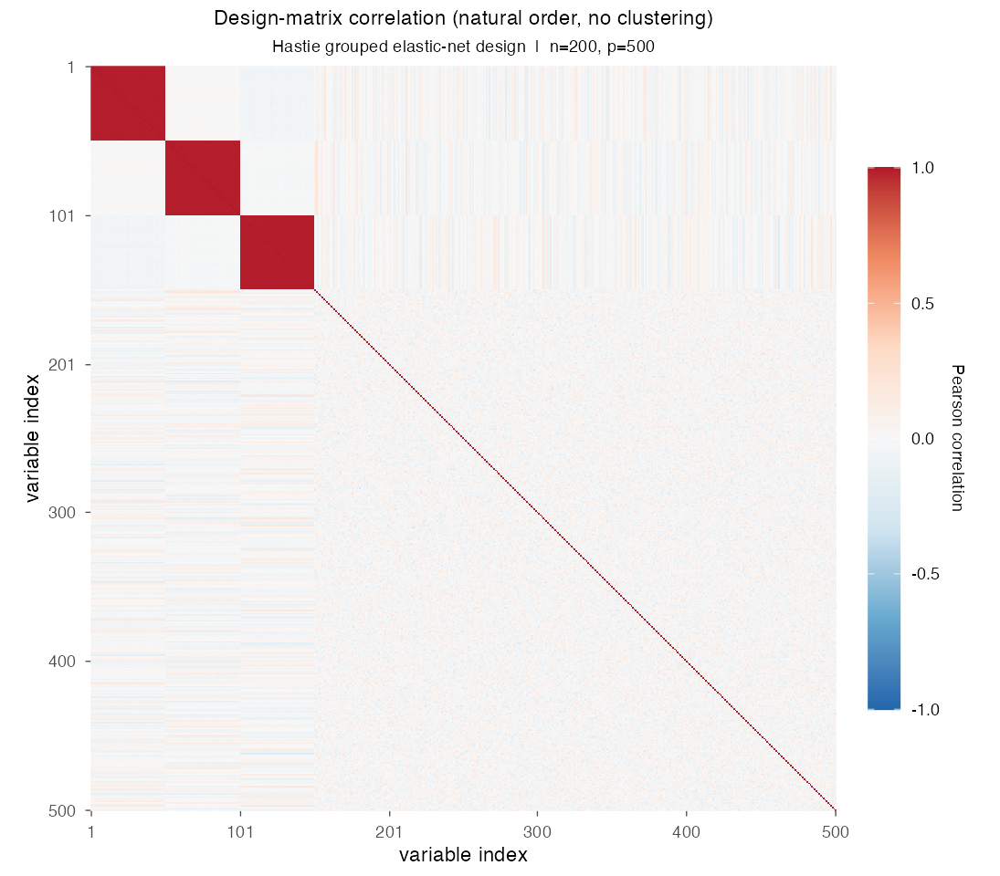
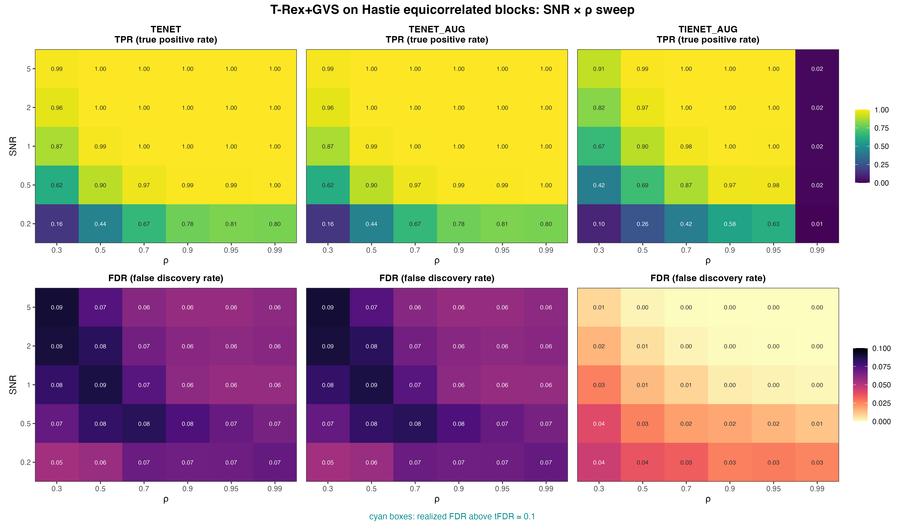
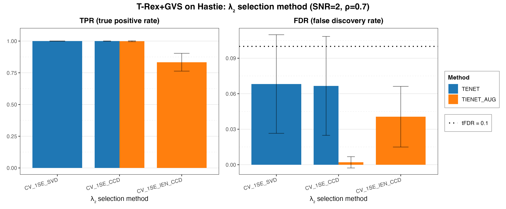
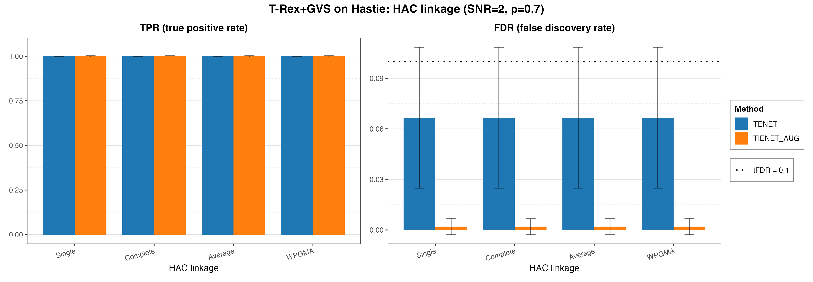

# Demo 01: T-Rex+GVS on Hastie's Equicorrelated Blocks

## Purpose

The following demo presents the Terminating Random Experiments (T-Rex) selector with Grouped Variable Selection (GVS),
T-Rex+GVS, according to [[1]](#references) and [[2]](#references). It evaluates grouped-signal recovery under strong
equicorrelation, using the classical three-group design of Zou & Hastie (2005) [[3]](#references). All variables
within an active group are themselves active, so the task is recovering all of them on an individual-variable basis
rather than with a group-level selection method. See
[What is actually measured](../../../../../cpp/trex_selector_methods/ad/trex_gvs/README.md#what-is-actually-measured-in-these-demos).
For details on grouped variable selection and false discovery rate (FDR) control see [[4]](#references).

R port of the C++ demo
[cpp/trex_selector_methods/ad/trex_gvs/demo_trex_gvs_01_mc_sim_hastie_en_blocks](../../../../../cpp/trex_selector_methods/ad/trex_gvs/demo_trex_gvs_01_mc_sim_hastie_en_blocks/README.md)
with the same data-generating process (DGP), control parameters, sweep grids and result-file naming, built on the
`TRexGVSSelector` class of `TRexSelectorNeo`. Indices are 1-based (R convention). The numbers below are this R run's
own results. R draws its own random numbers, so they differ from the C++ and
[Python](../../../../../Python/trex_selector_methods/ad/trex_gvs/demo_trex_gvs_01_mc_sim_hastie_en_blocks/README.md)
runs within Monte Carlo (MC) noise, not exactly. A cell-by-cell comparison with the C++ run, with $z$ the difference
divided by the combined Monte Carlo standard error of the two 200-trial means, finds no cell with $|z| > 3$ among the
204 cells of this demo (FDR and true positive rate (TPR) of every method at every grid point of the three parts). Over
the whole T-Rex+GVS suite 4 of 1,698 cells (0.24 %) have $|z| > 3$, which is within Monte Carlo noise.

---

## Data Generation Parameters (`dgp_hastie_snr`)

The demo considers the linear model

```math
\boldsymbol{y} = \boldsymbol{X}\boldsymbol{\beta} + \boldsymbol{\epsilon},
\qquad \boldsymbol{\epsilon} \sim \mathcal{N}(\boldsymbol{0}, \sigma_{\varepsilon}^2 \boldsymbol{I}_n)
```

- $\boldsymbol{y} \in \mathbb{R}^n$ is the response vector.
- $\boldsymbol{X} \in \mathbb{R}^{n \times p}$ is the design matrix.
- $\boldsymbol{\beta} \in \mathbb{R}^p$ is the coefficient vector, with $s$ nonzero entries.
- $\boldsymbol{\epsilon}$ is the noise vector with independent and identically distributed (i.i.d.) Gaussian entries.
- $\sigma_{\varepsilon}^2$ is the noise variance, calibrated to achieve a target linear signal-to-noise ratio (SNR).
- $n = 200$, $p = 500$, $s = 150$.

The design matrix $\boldsymbol{X}$ is generated from a latent-factor model with three active groups,

```math
X_{ij} = Z_{i,\,g(j)} + \sigma_x\, \xi_{ij}, \qquad \xi_{ij} \sim \mathcal{N}(0,1).
```

- Three latent factors $Z_{\cdot,k} \sim \mathcal{N}(0,1)$ for $k \in \lbrace1,2,3\rbrace$.
- **Group 1** (columns 1–50), **Group 2** (columns 51–100) and **Group 3** (columns 101–150) are all active with
  $\beta_j = 3$.
- **Background** (columns 151–500) is i.i.d. $\mathcal{N}(0,1)$ with $\beta_j = 0$.
- The within-group correlation is $\rho = 1/(1+\sigma_x^2)$, and the default $\sigma_x = \sqrt{0.01}$ gives
  $\rho \approx 0.99$. The sweep sets $\sigma_x = \sqrt{(1-\rho)/\rho}$.
- The noise variance is
  $\sigma_{\varepsilon}^2 = \widehat{\mathrm{Var}}(\boldsymbol{X}\boldsymbol{\beta})/\mathrm{SNR}$, with the
  sample variance of the signal.
- Trial $k$ draws a fresh design and response with seed $2026 + k - 1$.



Empirical Pearson correlation of an exemplary design drawn from `dgp_hastie_snr` ($n=200$, $p=500$, seed 2026,
default $\sigma_x = \sqrt{0.01}$), in **natural variable order with no hierarchical clustering**. The three red
squares on the diagonal are the active groups (columns 1–50, 51–100 and 101–150) at $\rho \approx 0.99$, while the
350 background columns are mutually uncorrelated. One figure per DGP lives in
[`../dgp_corr_plots/`](../dgp_corr_plots/). Regenerate the whole suite with
[`../generate_corr_plots.sh`](../generate_corr_plots.sh) (shared ggplot2 plotter
[`../../../corr_plt_utils.R`](../../../corr_plt_utils.R)).

---

## Control Parameters

```text
K = 20                       # Random experiments per T-loop iteration
tFDR = 0.1                   # Target FDR
corr_max = 0.98              # HAC auto-clustering correlation threshold
hc_linkage = Single          # Single-linkage HAC
lambda2_method = CV_1SE_CCD  # Elastic-net penalty selection (Part 2 adds CV_1SE_IEN_CCD for IEN)
MC = 200                     # Monte Carlo repetitions per grid point
```

The grouping step is hierarchical agglomerative clustering (HAC) of the columns, and the selector cuts the dendrogram
at height 1 − `corr_max`, here $0.02$, on the distance 1 − |correlation|. Every merge therefore needs at least one
pair of variables with an absolute correlation above $0.98$, whatever the linkage.

## Selector Setup in R

Each Monte Carlo trial builds the selector through the TRexSelectorNeo class interface, here for TENET in Part 1:

```r
library(TRexSelectorNeo)

ctrl <- trex_control(
  solver = "TLARS", K = 20L, max_dummy_multiplier = 10, use_max_T_stop = TRUE,
  lloop_strategy = "HCONCAT", tloop_stagnation_stop = TRUE,
  tloop_max_stagnant_steps = 5, use_memory_mapping = FALSE
)
sel <- TRexGVSSelector$new(
  X, y, tFDR = 0.1, seed = trial_seed, verbose = FALSE,
  gvs_control = trex_gvs_control(
    gvs_type = "EN", en_solver = "TENET", corr_max = 0.98, hc_linkage = "Single",
    lambda2_method = "CV_1SE_CCD", cv_seed = trial_seed
  ),
  control = ctrl
)
sel$select()
fdp <- trex_fdp(sel$selected_indices, true_support)
tpp <- trex_tpp(sel$selected_indices, true_support)
```

`.gvs_select()` in [`../../../simulation_utils.R`](../../../simulation_utils.R) builds this selector in every trial
and sets every control field explicitly, so no R default can diverge from the C++ reference. The selector seed and
the cross-validation fold seed are the trial seed, so every cell is reproducible.

---

## Methods Compared

Three T-Rex+GVS solver variants, set per row of `GVS_METHODS` at the top of the script:

- **TENET** — terminating elastic net pathwise solver (`gvs_type = "EN"`, `en_solver = "TENET"`) derived on the idea
  of a pathwise solver introduced in [[3]](#references).
- **TENET_AUG** — terminating elastic net solver based on row-augmented data to solve via a terminating lasso
  (`gvs_type = "EN"`, `en_solver = "TENET_AUG"`) as proposed in [[1]](#references).
- **TIENET_AUG** — terminating elastic net solver based on row-augmented data to solve via a terminating lasso the
  informed elastic net (IEN) proposed in [[2]](#references) (`gvs_type = "IEN"` with the base solver
  `"TIENET_AUG"`). `en_solver` is not applicable and stays at the library default, which the IEN path ignores.

---

## Three Parts

1. **2-D SNR $\times$ $\rho$ sweep** — TENET / TENET_AUG / TIENET_AUG over
   $\mathrm{SNR} \in \lbrace0.2, 0.5, 1, 2, 5\rbrace$ and
   $\rho \in \lbrace0.30, 0.50, 0.70, 0.90, 0.95, 0.99\rbrace$, 200 MC trials per cell, with `CV_1SE_CCD` for
   all three methods.
2. $\lambda_2$**-method comparison** — `CV_1SE_SVD` vs. `CV_1SE_CCD` for TENET, and `CV_1SE_CCD` vs. the rule
   `CV_1SE_IEN_CCD` built for the IEN geometry for TIENET_AUG, at the fixed operating point $\mathrm{SNR}=2$,
   $\rho=0.7$. The elastic net (EN) path does not accept the IEN rule.
3. **HAC linkage comparison** — Single / Complete / Average / weighted pair group method with arithmetic mean (WPGMA)
   linkage at the same fixed operating point (TENET and TIENET_AUG, `CV_1SE_CCD`).

Parts 2–3 are supplementary robustness checks over the $\lambda_2$-selection and linkage implementation choices.

---

## Output Files

Written to `simulation_results/data/`:

- `gvs_Hastie_2d.txt` / `.csv` — 2-D SNR $\times$ $\rho$ grid (Part 1).
- `gvs_Hastie_lambda2_method.txt` / `.csv` — $\lambda_2$-selection comparison (Part 2).
- `gvs_Hastie_hc_linkage.txt` / `.csv` — HAC-linkage comparison (Part 3).

The file names and comma-separated values (CSV) schemas match the C++ and Python demos. Figures in Portable Network
Graphics (PNG) and Portable Document Format (PDF) go to `simulation_results/plots/`, with the same file names as the
Python suite.

---

## Running the Demo

```bash
dir=R/trex_selector_methods/ad/trex_gvs/demo_trex_gvs_01_mc_sim_hastie_en_blocks

Rscript "$dir/demo_trex_gvs_01_mc_sim_hastie_en_blocks.R"      # full run, TREX_NUM_WORKERS workers (default 8)
Rscript "$dir/demo_trex_gvs_01_mc_sim_hastie_en_blocks.R" 8    # 8 worker cores
"$dir/generate_plots.sh"                                       # render the figures below from the saved CSVs
```

The three parts are toggled by the `run_part_*` flags at the top of the script (all `TRUE`). Reduce `num_MC` in
`CFG` and the sweep grids for a quick preview. Monte Carlo trials run in parallel on a parallel socket (PSOCK)
cluster of spawned R worker processes ([`../../../mc_runtime.R`](../../../mc_runtime.R)). The worker count is the
first command-line argument, else `TREX_NUM_WORKERS`, else 8, and `0` uses every core. Every finished grid cell is
appended to a cache in `simulation_results/cache/`, so a stopped run resumes where it left off, and a completed run
removes the cache. The script also sources [`../trex_gvs_dgps.R`](../trex_gvs_dgps.R),
[`../trex_gvs_sim_common.R`](../trex_gvs_sim_common.R) (2-D sweep driver and result writers),
[`../../../simulation_utils.R`](../../../simulation_utils.R) (the `.run_mc_hastie()` runner and the `.gvs_select()`
adapter) and [`../../../support_generators.R`](../../../support_generators.R). The recorded run (library commit
`44cf1ab`, 8 workers) took about 3.2 hours.

Afterwards, regenerate the figures from the CSV files with [`generate_plots.sh`](generate_plots.sh), which drives the
suite's ggplot2 plotting module [`../trex_gvs_plt_utils.R`](../trex_gvs_plt_utils.R) through `Rscript` (set
`RSCRIPT` to use another R installation).

---

## Simulation Results

The numbers and figures below are this R run's own results (200 MC trials per grid point). They agree with the
[C++ reference](../../../../../cpp/trex_selector_methods/ad/trex_gvs/demo_trex_gvs_01_mc_sim_hastie_en_blocks/README.md#simulation-results)
up to Monte Carlo noise (see [Purpose](#purpose)).

### Part 1 — 2-D SNR $\times$ $\rho$ sweep

- FDR stays below the $\mathrm{tFDR} = 0.1$ target in every cell (no cyan violation outlines). **TENET** and
  **TENET_AUG**, identical in every cell, realize $0.054\text{–}0.090$, and **TIENET_AUG** never exceeds $0.045$
  (both maxima sit in the $\rho = 0.3$ column).
- **TENET / TENET_AUG** reach a TPR of at least $0.986$ once $\mathrm{SNR} \ge 1$ for $\rho \ge 0.5$. The weakest
  column, $\rho = 0.30$, still climbs $0.87 \to 0.96 \to 0.99$ over $\mathrm{SNR} \in \lbrace1, 2, 5\rbrace$.
- **TIENET_AUG** is more conservative. Its FDR lies below the TENET value in all 30 cells, and its TPR grows more
  slowly with SNR, for example $0.67$ at $\mathrm{SNR}=1$, $\rho = 0.3$ against $0.87$ for TENET. From
  $\mathrm{SNR} = 1$ on it still reaches a TPR of at least $0.98$ for $\rho = 0.7\text{–}0.95$. The same pattern
  recurs in the other block demos of this folder, where the R runs of Demos 03–07 give TIENET_AUG the lower FDR in
  149 of their 155 cells.
- The power of TIENET_AUG **collapses in the extreme $\rho = 0.99$ column** (TPR at most $0.020$), where the
  within-group columns become nearly collinear, while TENET keeps a TPR of $0.80\text{–}1.00$ there. This is also the
  only column whose within-group correlation lies above `corr_max = 0.98`. A plausible reading is that only there
  HAC merges each active group into one cluster and TIENET_AUG then keeps very few members per cluster. A TPR of
  $0.020$ is 3 of the 150 active variables, which would fit one selected variable per group.
- Below $\rho = 0.99$ a stronger within-group correlation helps both families at low SNR. At $\mathrm{SNR} = 0.2$
  the TPR rises from $0.155$ at $\rho = 0.3$ to $0.805$ at $\rho = 0.95$ for TENET and from $0.102$ to $0.628$ for
  TIENET_AUG.

TPR (top) and FDR (bottom) heatmaps, one column per solver. FDR cells above the
$\mathrm{tFDR} = 0.1$ target would be outlined in cyan.



---

### Part 2 — $\lambda_2$ selection method

- For TENET, `CV_1SE_SVD` and `CV_1SE_CCD` give essentially the same result (FDR $0.068$ vs. $0.067$, TPR $1.000$
  for both), so the pipeline is insensitive to the ridge-shaped penalty-selection backend at this point.
- For TIENET_AUG, the IEN-geometry rule `CV_1SE_IEN_CCD` does clearly worse than `CV_1SE_CCD` (FDR $0.041$ and
  TPR $0.833$ against $0.002$ and $0.999$). The rule cross-validates $\lambda_2$ jointly with $\lambda_1$, and its
  $\lambda_1$ path stops at $0.8\, n_{\mathrm{train}} = 144$ selected variables, below the $s = 150$ true variables
  of this design. The R run does not record the picked penalties. The C++ run found a boundary pick in all 200
  trials, so a plausible reading is that the same cap drives the loss here. The IEN rows of Demos 01–07 therefore
  keep `CV_1SE_CCD`, while Demo 08 ($s \le 50$) uses the IEN rule (see
  [Demo 08](../demo_trex_gvs_08_mc_sim_block_bench/README.md)).
- The `CV_1SE_CCD` rows reproduce the Part 1 cell at $\mathrm{SNR}=2$, $\rho=0.7$ exactly, because every part runs
  the same trial seeds.

Grouped bar charts at the fixed operating point $\mathrm{SNR} = 2$, $\rho = 0.7$. Error bars show
$\pm 1$ Monte Carlo standard deviation.



---

### Part 3 — HAC linkage

- Single / Complete / Average / WPGMA linkage produce **numerically identical** results (FDR $0.067$ and TPR
  $1.000$ for TENET, FDR $0.002$ and TPR $0.999$ for TIENET_AUG), equal to the Part 1 cell at this operating point.
- At $\rho = 0.7$ the within-group correlation lies far below `corr_max = 0.98`, so the dendrogram cut leaves every
  variable in its own cluster under any linkage, and this point cannot show a linkage effect. The linkage choice would
  matter only where the cut merges variables, as in the $\rho = 0.99$ column of Part 1, which this comparison does not
  cover.
- Taken together, Parts 2 and 3 show that at $\mathrm{SNR} = 2$, $\rho = 0.7$ the results of Part 1 do not depend
  on the ridge-shaped $\lambda_2$-selection backend (`CV_1SE_SVD` or `CV_1SE_CCD`) or on the linkage rule.

Grouped bar charts at the same fixed operating point as Part 2. Error bars show $\pm 1$ Monte
Carlo standard deviation.



---

## References

1. Machkour, J., Muma, M., & Palomar, D. P., "False Discovery Rate Control for Grouped Variable Selection
   in High-Dimensional Linear Models using the T-Knock Filter.", European Signal Processing Conference (EUSIPCO), 2022,
   pp. 892–896, European Association for Signal Processing (EURASIP).
   [DOI-Link](https://doi.org/10.23919/EUSIPCO55093.2022.9909883)
2. Machkour, J., Muma, M., & Palomar, D. P., "The Informed Elastic Net for Fast Grouped Variable Selection and
   FDR Control in Genomics Research.", Workshop on Computational Advances in Multi-Sensor Adaptive Processing (CAMSAP),
   2023, pp. 466–470, Institute of Electrical and Electronics Engineers (IEEE).
   [DOI-Link](https://doi.org/10.1109/CAMSAP58249.2023.10403489)
3. Zou, H., & Hastie, T. (2005). "Regularization and variable selection via the elastic net." *Journal of the Royal
   Statistical Society: Series B (Statistical Methodology)*, 67(2), pp. 301–320.
   [DOI-Link](https://doi.org/10.1111/j.1467-9868.2005.00503.x)
4. Dai, R., & Barber, R. F., "The knockoff filter for FDR control in group-sparse and multitask regression."
   Proceedings of the 33rd International Conference on Machine Learning (ICML), vol. 48, pp. 1851–1859, 2016.
   [DOI-Link](http://proceedings.mlr.press/v48/daia16.pdf)
