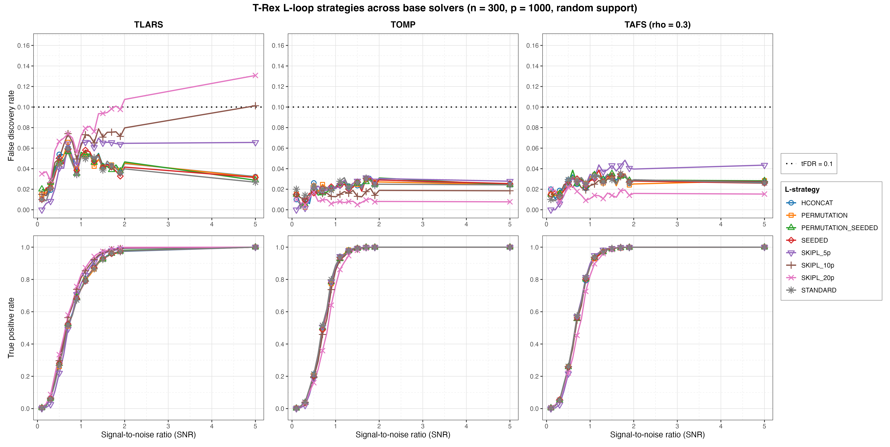
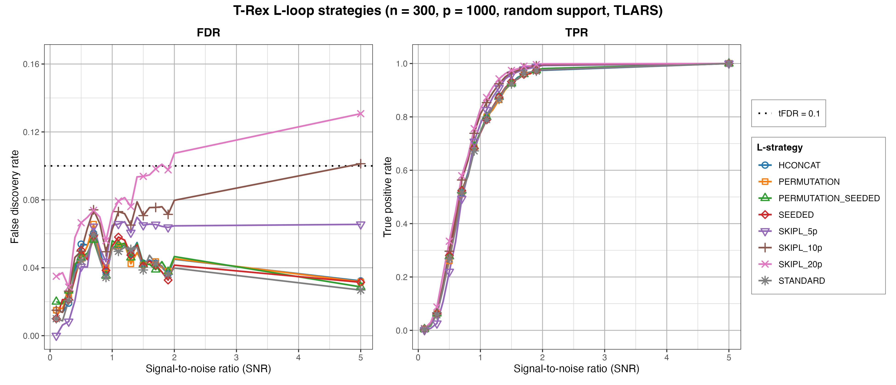
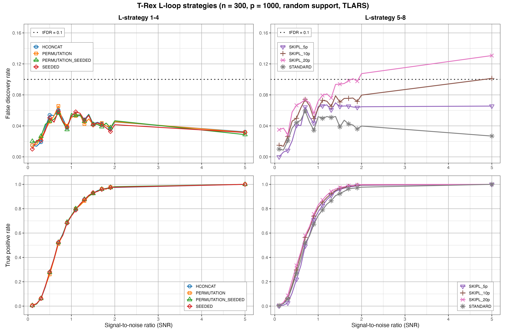
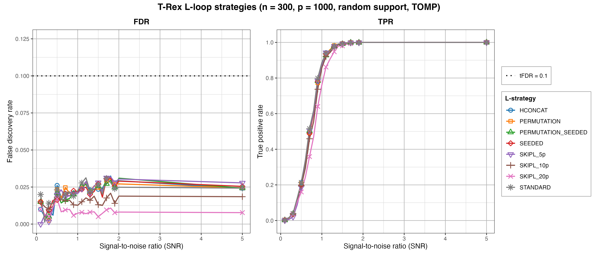
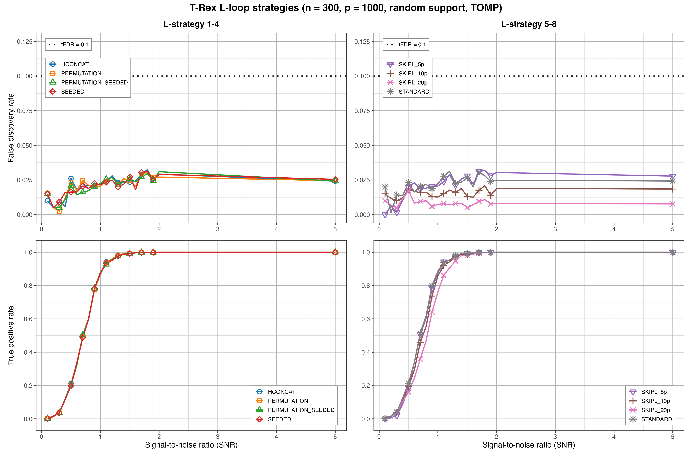
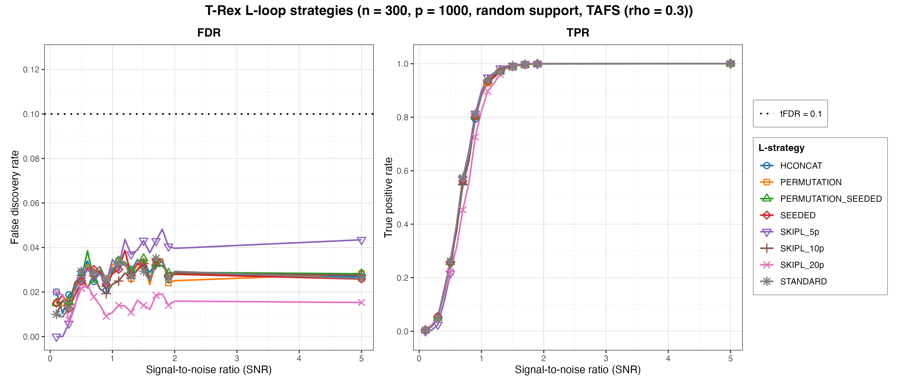
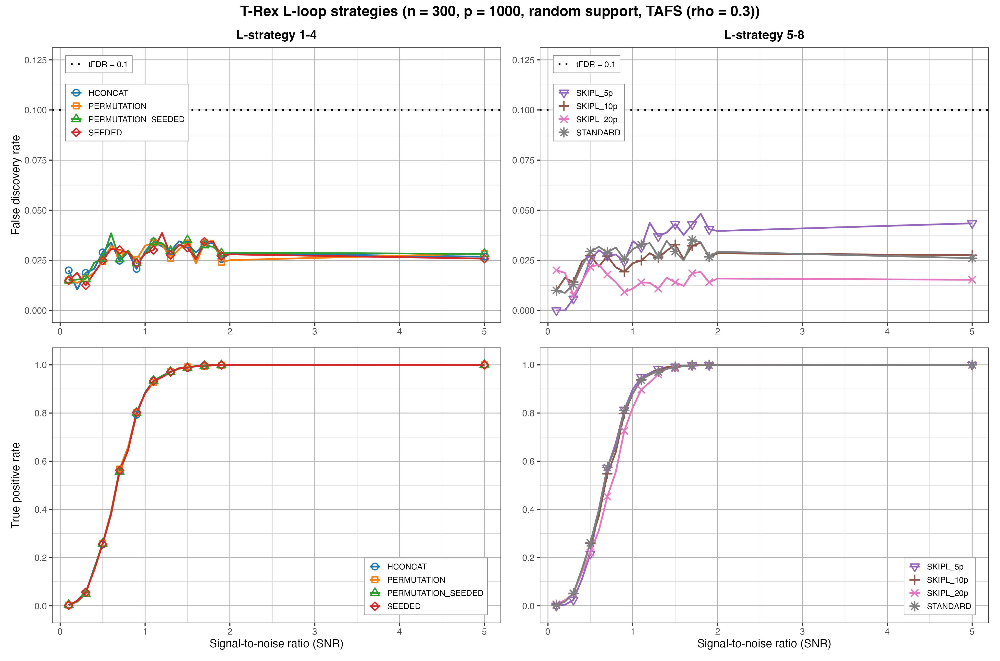

# Demo 04: L-Loop Strategy Comparison

## Purpose

Compare the T-Rex **L-loop strategies** — the mechanisms by which the dummy-variable
structure is generated/expanded across L-loop iterations — repeated across three
base solvers (**TLARS**, **TOMP**, **TAFS** with `rho_afs = 0.3`). Shows how the
strategy affects FDR, TPR, and the calibrated dummy multiplier `L` / stopping
time `T`.

## Data-generating process

`dgp_gauss_snr` — i.i.d. Gaussian design, `y = X beta + eps` calibrated to SNR.
High-dimensional config: `n = 300`, `p = 1000`, `s = 10`, `tFDR = 0.1`, fixed
coefficients `beta_j = 1`. The support is a random size-`s` subset redrawn per trial
via `make_support_random(s, p, seed = trial_seed)` (the `block_support = TRUE`
contiguous-block variant is available but its call is commented out). SNR grid
`seq(0.1, 2.0, by = 0.1)` plus `5.0` (21 values), `num_MC = 200` per strategy x SNR.

The design is the suite's shared one — independent columns, so the empirical
column-correlation matrix is essentially the identity, and every effect below is
attributable to the dummy machinery rather than to design correlation:


## Strategies compared

`L_STRATEGIES` — **8 rows** (matches the 8-row reference study):

- STANDARD — fresh i.i.d. dummy matrix each L-loop iteration.
- HCONCAT — horizontally concatenated dummy columns.
- PERMUTATION — re-use the stored base dummy matrix via deterministic row
  permutations per experiment.
- PERMUTATION_SEEDED — seed-derived base + row permutations, nothing stored
  (bit-identical to PERMUTATION for the same seed).
- SEEDED — seed-derived i.i.d. draws, nothing stored.
- SKIPL_5p / SKIPL_10p / SKIPL_20p — skip the L-loop, fixed
  `L = max_dummy_multiplier * p` at 5p / 10p / 20p.

(The former `DIRECT` / `PERMUTATION_DIRECT` strategy names were renamed to
`SEEDED` / `PERMUTATION_SEEDED`; the old names are no longer accepted. The
C++/Python demos still carry the removed `ONDEMAND` / `PERMUTATION_ONDEMAND`
labels and are stale against the current library — this R file is the corrected
version.)

The solver sweep (`SOLVERS`) is the outer loop; one `.txt` + `.csv` file pair is
written per solver. Shared control per solver x strategy: `K = 20`,
`use_max_T_stop = TRUE`, `opt_threshold = 0.75`, `tloop_max_stagnant_steps = 5`,
`use_openmp = FALSE`, `use_memory_mapping = FALSE`, `lloop_strategy` and
`max_dummy_multiplier` swept; `tloop_stagnation_stop` is left unset (AUTO — the
per-solver-family default). Reports averaged FDR, TPR, Avg L, Avg T per strategy
x SNR (`track_L_T = TRUE`). MC trials run in parallel over a hardcoded
`num_cores <- 6L`.

## Results: the fixed-budget FDR overshoot is solver-specific

At `SNR = 5` the three solvers separate sharply. `Avg T` is the calibrated
stopping time, `Avg L` the realized dummy multiplier:

| Strategy | `L` | TLARS `T` | TLARS FDR | TOMP `T` | TOMP FDR | TAFS `T` | TAFS FDR |
| --- | --- | --- | --- | --- | --- | --- | --- |
| STANDARD (adaptive) | 1p | 5.0 | 0.027 | 5.6 | 0.024 | 5.0 | 0.026 |
| SKIPL_5p | 5p | 26.2 | 0.066 | 6.2 | 0.028 | 6.4 | 0.043 |
| SKIPL_10p | 10p | 85.2 | 0.101 | 6.0 | 0.018 | 6.2 | 0.028 |
| SKIPL_20p | 20p | 146.5 | **0.131** | 6.0 | 0.008 | 6.1 | 0.015 |

TPR is 1.0 everywhere at this SNR, so the differences are pure false-discovery
cost. Only **TLARS** breaches `tFDR = 0.1`, and only once the L-loop is skipped
with a large fixed budget. Under TOMP and TAFS the same budgets are *more*
conservative, not less.

The cross-solver grid renders the same conclusion over the full SNR sweep — a 2x3
layout, rows = metric (FDR / TPR), columns = base solver (TLARS / TOMP / TAFS),
with all eight L-loop strategies drawn in every panel. Colours are keyed to the
strategy, so a strategy can be tracked across solvers; the three FDR panels share
one y-scale and the three TPR panels share `[0, 1]`, so the columns are directly
comparable:



Reading the FDR row left to right: only the **TLARS** panel has curves that reach
the `tFDR = 0.1` line at all. There the five adaptive strategies (STANDARD,
HCONCAT, PERMUTATION, PERMUTATION_SEEDED, SEEDED) form a single tight band that
humps at SNR 0.7 (0.057–0.066) and then falls away to 0.027–0.032 at SNR 5.0,
while the three `SKIPL` levels fan out in ascending order of budget: `SKIPL_5p`
stays under the line throughout (maximum 0.070 at SNR 1.4), `SKIPL_10p` tracks
just above the adaptive band until it grazes the line at SNR 5.0 (0.101), and
`SKIPL_20p` crosses it first at SNR 1.8 (0.101) and climbs to 0.131. In the
**TOMP** and **TAFS** panels the eight curves stay bunched near the bottom —
nothing exceeds 0.032 (TOMP, HCONCAT at SNR 1.8) or 0.048 (TAFS, `SKIPL_5p` at
SNR 1.8) anywhere on the grid — and the budget ordering *reverses*: at SNR 5.0 a
larger fixed `L` gives a *lower* FDR (TOMP 0.028 / 0.018 / 0.008 and TAFS
0.043 / 0.028 / 0.015 for 5p / 10p / 20p). The TPR row shows why the FDR
differences are the whole story at high SNR: every strategy under every solver
reaches 1.0 by SNR 5.0, and the only visible power cost is `SKIPL_20p` lagging
the field through the mid-SNR range under the two greedy solvers (at SNR 0.9,
TOMP 0.640 and TAFS 0.726 against ≈ 0.77–0.81 for the adaptive strategies) —
under TLARS the same budget is instead slightly *ahead* on power, which is the
same deeper path that costs it the FDR control.

### Mechanism 1 — a larger dummy budget lets the T-loop run deeper

The T-loop stops when the dummy-based FDP estimate reaches the target. That
estimate rests on the exchangeability of the dummies with the null predictors:
if $T$ of the $L \cdot p$ dummies have entered the path, the expected number of
null *originals* that entered is

```math
\mathbb{E}[V] \;\approx\; T \cdot \frac{p - s}{L \cdot p},
```

so the estimated FDP cost of one dummy inclusion falls like $1/L$. Fixing the
budget at 20p instead of letting the L-loop choose it makes each dummy inclusion
roughly twenty times cheaper in the estimate, and the T-loop can therefore run
much further before it is stopped. That is exactly what the data shows: the
calibrated stopping time grows in step with the budget, `T = 5` (adaptive)
→ 26 → 85 → 146, while the adaptive L-loop converges to `Avg L = 1`, i.e.
$L \cdot p = p$ dummies. This part is arithmetic, not yet an error — the
estimate only becomes wrong at the depth it unlocks.

### Mechanism 2 — at that depth the vote-level estimate loses its footing

Dummies are drawn **once per random experiment** $k = 1, \dots, K$ (one
$n \times L p$ matrix per experiment) before selection starts; the T-loop then
merely varies the termination threshold over the already-computed path. Across
the $K$ experiments the dummy matrix changes, but $\boldsymbol{X}$ and
$\boldsymbol{y}$ do not — and that is where the symmetry between dummies and
null predictors ends:

- A **dummy column** exists in exactly one experiment. Its relative occurrence
  is bounded by $1/K$ by construction, and its inclusions are genuinely
  independent across experiments.
- A **null predictor** is the same column, with the same sample correlation to
  $\boldsymbol{y}$, in every experiment. If that correlation happens to be large
  it is large *every time*, so its inclusions across $k$ are strongly positively
  correlated rather than independent Bernoulli draws.

Selection is by vote — a predictor is kept when its relative occurrence
$\Phi_T(j)$ exceeds the threshold $v$ — so what matters is the distribution of
$\Phi_T$ over the null predictors, and the dummy statistics model it as
independent draws. The real distribution is over-dispersed: most nulls sit near
zero while a few unlucky ones sit near one.

At the shallow stopping times the L-loop produces ($T \approx 5$) this is
harmless, because essentially no null predictor enters the path at all and there
is nothing to accumulate. At $T = 146$ roughly
$146 \cdot 990 / 20000 \approx 7$ null predictors enter *per experiment*, drawn
again and again from the same unlucky tail, and a couple of them reach
$\Phi_T \approx 1$ and survive the vote. The observed FDR of 0.131 at TPR 1.0
corresponds to about 1.5 false discoveries on top of the 10 true ones.

Two corollaries follow, both visible in the data:

- **TOMP and TAFS are immune because they never get deep.** Their `Avg T`
  saturates near 6 regardless of the budget (6.2 / 6.0 / 6.0), since the
  tri-state `tloop_stagnation_stop = AUTO` resolves to `TRUE` for the greedy
  solver family and to `FALSE` for TLARS: they halt once the selected set stops
  changing, while TLARS keeps going until the FDP estimate alone stops it.
- **More signal makes it worse.** Since $\widehat{FDP} = \hat{V} / R$, a larger
  true-positive count inflates the denominator, so the estimate stays under
  target longer and the T-loop runs further. For TLARS at 20p the stopping time
  climbs 47 → 89 → 142 → 146 as SNR goes 0.1 → 1 → 2 → 5, with FDR tracking it
  0.035 → 0.072 → 0.107 → 0.131. The adaptive strategies show the healthy
  opposite: `T` pinned near 5 and FDR *falling* with SNR.

### Reading

This is an empirical vindication of the L-loop. Its job is to find the
*smallest* dummy budget at which the T-loop can still terminate, which keeps the
path shallow and the estimator inside the regime where per-experiment
exchangeability also governs the vote. Over-provisioning dummies does not buy
safety — it removes the brake. `SKIPL` remains a legitimate (and cheaper)
shortcut for the greedy solvers, but with LARS a fixed budget must stay small.

### Per-solver figure sets

`./generate_plots.sh` also renders, for each base solver, the standard overview
(all eight strategies on one FDR | TPR pair, log-scaled x-axis) and a
de-cluttered grouped 2x2 view that splits the strategies across two columns. The
CSV's "solver" column holds the strategy name, so the strategies are the legend.
All figures go to `simulation_results/plots/` as PNG + PDF (this port renders no
interactive HTML).

**TLARS** — the only panel where the mechanism above is visible. The five
adaptive strategies overlap almost exactly; the three `SKIPL` levels peel off
upwards in budget order and keep rising with SNR instead of decaying:





**TOMP** — all eight strategies collapse onto one band below 0.033, and the two
larger `SKIPL` levels sit at the *bottom* of it rather than the top:





**TAFS** (`rho_afs = 0.3`) — the same picture as TOMP, with `SKIPL_5p` the one
mildly elevated row (maximum 0.048 at SNR 1.8, still half the target):





## Running

```bash
Rscript R/trex_selector_methods/trex/demo_trex_04_mc_sim_lloop_strategies/demo_trex_04_mc_sim_lloop_strategies.R
```

Results are written to this demo's own `simulation_results/data/` folder as a `.txt` table
and a tidy `.csv` (the "solver" column holds the strategy name), stems
`demo_trex_04_lloop_strategies_results_n300_p1000_{tlars,tomp,tafs}_random_support`.
The script sources `../../support_generators.R`, `../../simulation_utils.R`, and
`../trex_sim_utils.R`.
