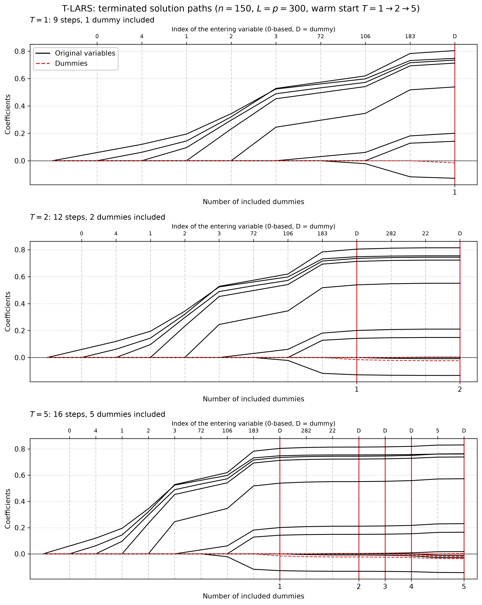

# Demo: T-LARS Solver

## Purpose

This demo illustrates the **T-LARS (Terminating Least Angle Regression)** solver, one of the core terminating solvers used in the T-Rex framework.

It shows how T-LARS is used in five settings:

1. basic execution with early stopping,
2. external versus internal normalization,
3. serialization and warm-start continuation,
4. operation on memory-mapped data,
5. terminated solution paths of one warm-started object, drawn as a figure.

The demo is intended to explain solver behavior and interface usage in isolation, outside the full T-Rex calibration loops.

---

## Key idea

A terminating solver does not compute a full path over all possible steps. Instead, it stops early once a prescribed number $T_{\text{stop}}$ of dummy variables has entered the active set:

```math
\hat{\boldsymbol{\beta}}^{(T)} = \mathrm{TLARS}(\mathbf{X}, \mathbf{D}, \mathbf{y}; T_{\text{stop}}).
```

In the demo, this is done through calls of the form:

```cpp
executeStep(T_stop, /*early_stop=*/true)
```

where `T_stop` is the number of dummy variables that must enter the active set before the solver terminates early: with `early_stop=true` the run stops as soon as the count of active dummies reaches $T_{\text{stop}}$.

---

## Demo structure

### 1. Basic T-LARS with early stopping

The first part runs T-LARS with **internal normalization** and an intercept on synthetic data, and it is executed in both a high-dimensional regime $(p > n)$ and a low-dimensional regime $(n > p)$.

After execution, the demo prints the selected variables and selection-quality diagnostics relative to the known true support.

### 2. External normalization

The second part preprocesses the signal matrix and dummy matrix externally using L2-based column normalization, centers the response manually, and then runs T-LARS with internal normalization disabled.

This section is useful for comparing the solver’s external-normalization workflow against the internally normalized workflow from the first demo.

### 3. Serialization and warm start

The third part runs a reference T-LARS fit to a final stopping level, then separately runs a shorter partial fit, saves the solver state to disk, reloads it, and continues to the same final stopping level.

The data are normalized once in front (`scaler::LpNormScaler` on `X` and `D`, `y` centered) and the reference, checkpoint and resumed solvers run as readers (`.normalize = false, .intercept = false`), so the three solvers share the data without copies and the paths are bit-identical. Three writer solvers on the same data would each center and scale it in place, which moves the data by rounding and made the paths differ (the 2026-09-25 finding). Under the library's in-place contract, a second writer on a held buffer now raises an error instead.

The reloaded solver is compared against the reference run through the number of steps, the final RSS difference, the final $R^2$ difference, and the equality of the recorded action path.

### 4. Memory-mapped data

The fourth part generates synthetic data directly on disk, retrieves memory-mapped matrix views, and runs T-LARS on those mapped objects.

This demonstrates that the solver can also be used in workflows where the data are too large or too inconvenient to keep entirely in ordinary in-memory matrices.

### 5. Terminated solution paths

The fifth part repeats the quick start of the R tlars vignette. With $n = 150$, $p = 300$, five true coefficients
equal to 1 and $L = p = 300$ dummies, one T-LARS object runs to $T = 1$ and is then warm-started to $T = 2$ and
$T = 5$. Each call continues the stored path, and a snapshot of the path after each call goes to
`simulation_results/data/`. The setting `snr = 5` gives a noise standard deviation of about 1, as in the vignette.

```text
=== Demo 5: T-LARS Terminated Solution Paths ===
============================================================
Configuration:
  n = 150, p = 300
  num_dummies = 300
  T_stop = 5
  True support size = 5
  True support: 0 1 2 3 4
  True coefficients: 1 1 1 1 1
  SNR = 5

T_stop = 1: steps =  9, predictors =  8, dummies = 1, FDP = 0.375, TPP = 1.000
T_stop = 2: steps = 12, predictors = 10, dummies = 2, FDP = 0.500, TPP = 1.000
T_stop = 5: steps = 16, predictors = 11, dummies = 5, FDP = 0.545, TPP = 1.000

Selection:
  Predictors: {0, 4, 1, 2, 3, 72, 106, 183, 282, 22, 5}
  Dummies: {564, 399, 355, 321, 383}
  Path: [+v0, +v4, +v1, +v2, +v3, +v72, +v106, +v183, +D264, +v282, +v22, +D99, +D55, +D21, +v5, +D83]

Path data written to:
  .../cpp/tsolvers/demo_ts_01_tlars/simulation_results/data/tlars_terminated_paths_path.csv
  .../cpp/tsolvers/demo_ts_01_tlars/simulation_results/data/tlars_terminated_paths_actions.csv
```

The five true variables enter in the first five steps. Three false ones follow before the first dummy ends the path at
$T = 1$. The true positive proportion (TPP) stays at 1 while the false discovery proportion (FDP) grows from 0.375 to
0.545, because the later steps admit noise variables as well as dummies. The figure shows the three snapshots, and
each one continues the previous path. Original variables are black, dummies red and dashed, a red vertical line marks
each included dummy, and the top axis names the variable that enters at each step.



---

## Running

From the repository root, after `cmake --preset release && cmake --build --preset release-build` in `cpp/`:

```bash
cpp/build/release/bin/tsolvers/demo_ts_01_tlars/demo_ts_01_tlars      # Parts 1-5
cpp/build/release/bin/tsolvers/demo_ts_01_tlars/demo_ts_01_tlars 5    # Part 5 only
cpp/tsolvers/demo_ts_01_tlars/generate_plots.sh                        # path figure from the Part 5 data
```

The optional arguments select the parts to run. Part 4 writes about 44 GB of temporary files, so `5` refreshes the
path data in well under a second without it. The demo prints its diagnostics to the console, including configuration
summaries, selected variables, selection-quality measures, serialization checks, and memory-mapped execution status
messages. `generate_plots.sh` uses the repository's `.venv` and writes the figure as PNG and PDF to
`simulation_results/plots/`.

---

## What to look for

When reading the console output, focus on the following points:

- whether the selected variables recover the known true support reasonably well,
- how the solver behaves under both high-dimensional and low-dimensional settings,
- whether externally normalized and internally normalized workflows both execute successfully,
- whether the serialized solver state can be reloaded and continued without changing the final path,
- whether the memory-mapped workflow completes successfully and cleans up its generated files,
- how the terminated path grows with $T$ when the same object is warm-started.

---

## Notes

- The demo uses synthetic data with known support and coefficients, so the selected path can be compared against ground truth.
- The in-memory examples use both ordinary dense matrices and externally normalized matrices.
- The serialization example writes a temporary checkpoint file and removes it after the comparison.
- The memory-mapped example writes temporary files for $X$, $D$, and $y$, runs the solver on mapped views, and then removes those files at the end.
- The path data and figures under `simulation_results/` are committed, so the figure is visible without a run.
