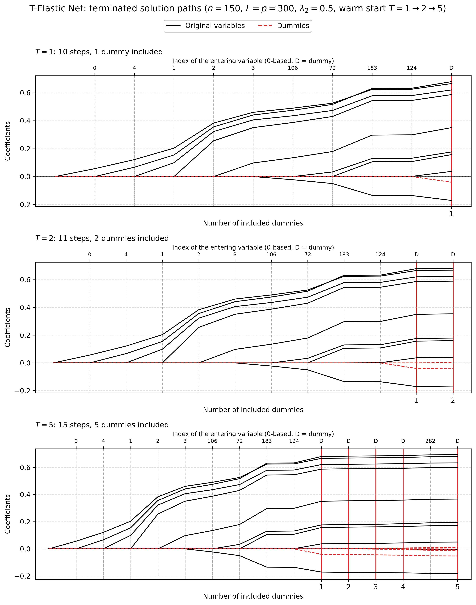

# Demo: T-ENET (Elastic Net) Solver

## Purpose

This demo illustrates the **T-ENET (Terminating Elastic Net)** solver.

T-ENET combines L1-style sparsity with an additional L2 component, making it useful in settings with correlated predictors and grouped signal structure. The demo shows how the solver is used in five settings:

1. basic execution with early stopping,
2. external versus internal normalization,
3. serialization and warm-start continuation,
4. operation on memory-mapped data,
5. terminated solution paths of one warm-started object, drawn as a figure.

---

## Key idea

Like the other terminating solvers, T-ENET stops early once a prescribed number $T_{\text{stop}}$ of dummy variables has entered the active set:

```math
\hat{\boldsymbol{\beta}}^{(T)} = \mathrm{TENET}(\mathbf{X}, \mathbf{D}, \mathbf{y}; T_{\text{stop}}, \lambda_2).
```

In this demo, the solver is constructed with a fixed L2 parameter and then advanced through calls of the form

```cpp
executeStep(T_stop, /*early_stop=*/true)
```

so, with `early_stop=true`, the run terminates early once the number of dummy variables in the active set reaches $T_{\text{stop}}$.

---

## Demo structure

### 1. Basic T-Elastic Net with early stopping

The first part runs T-ENET with **internal normalization** and an intercept on synthetic data, in both a high-dimensional regime $(p > n)$ and a low-dimensional regime $(n > p)$.

After execution, the demo prints the selected variables, selection-quality diagnostics, and T-ENET-specific path diagnostics such as the number of removals and the cycling ratio.

### 2. External normalization

The second part applies external L2 normalization to both the signal matrix and the dummy matrix, centers the response manually, and then runs T-ENET with internal normalization disabled.

This demonstrates the externally normalized workflow and allows it to be compared conceptually with the internally normalized workflow from the first part.

### 3. Serialization and path consistency

The third part runs a reference fit to a final stopping level, then separately runs a shorter partial fit, saves the solver state to disk, reloads it, and continues from the checkpoint to the same final stopping level.

The data are normalized once in front (`scaler::LpNormScaler` on `X` and `D`, `y` centered) and the reference, checkpoint and resumed solvers run as readers (`.normalize = false, .intercept = false`), so the three solvers share the data without copies and the paths are bit-identical. Three writer solvers on the same data would each center and scale it in place, which moves the data by rounding and made the paths differ (the 2026-09-25 finding). Under the library's in-place contract, a second writer on a held buffer now raises an error instead.

The reloaded run is compared against the reference path using the final number of steps, the final RSS difference, the final $R^2$ difference, equality of the recorded action path, and the T-ENET-specific removal and cycling diagnostics.

### 4. Memory-mapped data

The fourth part generates synthetic data directly on disk, retrieves memory-mapped views of $X$, $D$, and $y$, and runs T-ENET on those mapped objects.

This shows that the solver can also be used in workflows where large matrices are stored on disk rather than held entirely in ordinary in-memory matrices.

### 5. Terminated solution paths

The fifth part repeats the quick start of the R tlars vignette. With $n = 150$, $p = 300$, five true coefficients
equal to 1 and $L = p = 300$ dummies, one T-Elastic Net object with $\lambda_2 = 0.5$ runs to $T = 1$ and is then
warm-started to $T = 2$ and $T = 5$. Each call continues the stored path, and a snapshot of the path after each call
goes to `simulation_results/data/`. The setting `snr = 5` gives a noise standard deviation of about 1, as in the
vignette.

```text
=== Demo 5: T-Elastic Net Terminated Solution Paths ===
============================================================
Configuration:
  n = 150, p = 300
  num_dummies = 300
  T_stop = 5
  True support size = 5
  True support: 0 1 2 3 4
  True coefficients: 1 1 1 1 1
  SNR = 5

T_stop = 1: steps = 10, predictors =  9, dummies = 1, FDP = 0.444, TPP = 1.000
T_stop = 2: steps = 11, predictors =  9, dummies = 2, FDP = 0.444, TPP = 1.000
T_stop = 5: steps = 15, predictors = 10, dummies = 5, FDP = 0.500, TPP = 1.000

Selection:
  Predictors: {0, 4, 1, 2, 3, 106, 72, 183, 124, 282}
  Dummies: {315, 578, 564, 532, 321}
  Path: [+v0, +v4, +v1, +v2, +v3, +v106, +v72, +v183, +v124, +D15, +D278, +D264, +D232, +v282, +D21]

Path data written to:
  .../cpp/tsolvers/demo_ts_04_tenet/simulation_results/data/tenet_terminated_paths_path.csv
  .../cpp/tsolvers/demo_ts_04_tenet/simulation_results/data/tenet_terminated_paths_actions.csv
```

The ridge part of the penalty shrinks all coefficients further than T-LARS does, and the five true coefficients end
between 0.37 and 0.69 against 0.57 to 0.83 for T-LARS. The entry order changes slightly after the fifth step, and
variable 124 enters before the first dummy, so four false variables give a false discovery proportion (FDP) of 0.444
at $T = 1$. The next four dummies then enter almost back to back, with only variable 282 in between, and the FDP rises
only to 0.500 at $T = 5$. The true positive proportion (TPP) stays at 1. The figure shows the three snapshots.
Original variables are black, dummies red and dashed, a red vertical line marks each included dummy, and the top axis
names the variable that enters at each step.



---

## Running

From the repository root, after `cmake --preset release && cmake --build --preset release-build` in `cpp/`:

```bash
cpp/build/release/bin/tsolvers/demo_ts_04_tenet/demo_ts_04_tenet      # Parts 1-5
cpp/build/release/bin/tsolvers/demo_ts_04_tenet/demo_ts_04_tenet 5    # Part 5 only
cpp/tsolvers/demo_ts_04_tenet/generate_plots.sh                        # path figure from the Part 5 data
```

The optional arguments select the parts to run. Part 4 writes about 44 GB of temporary files, so `5` refreshes the
path data in well under a second without it. `generate_plots.sh` uses the repository's `.venv` and writes the figure
as PNG and PDF to `simulation_results/plots/`.

The demo prints its diagnostics to the console, including configuration summaries, selected variables, selection-quality measures, removal counts, cycling ratios, serialization checks, and memory-mapped execution status messages.

---

## What to look for

When reading the console output, focus on the following points:

- whether the selected variables recover the known true support reasonably well,
- how the solver behaves under both high-dimensional and low-dimensional settings,
- whether externally normalized and internally normalized workflows both execute successfully,
- whether the serialized solver state can be reloaded and continued without changing the final path,
- how many active-set removals occur,
- whether the reported cycling ratio stays well behaved,
- whether the memory-mapped workflow completes successfully and cleans up its temporary files.

For the dedicated equivalence check between the Gram-based T-ENET formulation and the augmented-LASSO formulation, see `validation_ts_01_tenet_aug_comparison` in the TRexSelector library test suite (`TRexSelector/cpp/tests/validation/tsolvers/`),
- how the terminated path grows with $T$ when the same object is warm-started.

---

## Notes

- The examples in this demo use a fixed elastic-net L2 parameter `lambda2 = 0.5`.
- The serialization example writes a temporary checkpoint file named `tenet_checkpoint.bin` and removes it afterward.
- The memory-mapped example writes temporary files for $X$, $D$, and $y$, runs T-ENET on those mapped views, and removes those files at the end.
- The path data and figures under `simulation_results/` are committed, so the figure is visible without a run.
