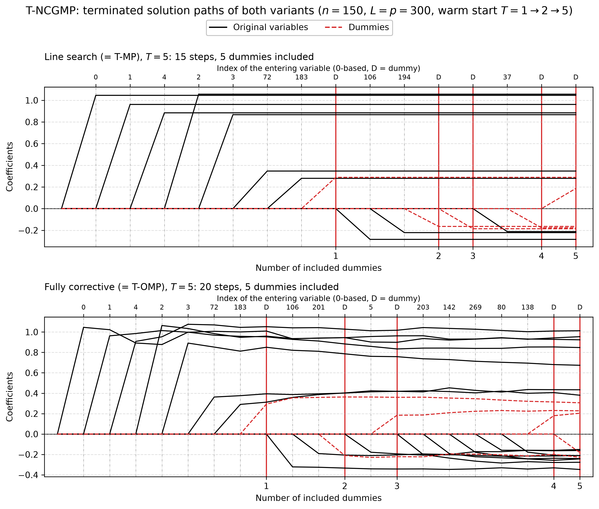

# Demo: T-NCGMP (Norm-Corrective Generalized Matching Pursuit) Solver

## Purpose

This demo illustrates the **T-NCGMP (Terminating Norm-Corrective Generalized Matching Pursuit)** solver.

T-NCGMP is a pursuit-style greedy method that augments matching-pursuit-style updates with a norm-correction mechanism, aiming for better numerical stability and improved convergence behavior over longer paths. The demo shows how the solver is used in five settings:

1. basic execution with early stopping,
2. external versus internal normalization,
3. serialization and warm-start continuation,
4. operation on memory-mapped data,
5. terminated solution paths of both variants, drawn as a figure.

---

## Key idea

Like the other terminating solvers, T-NCGMP stops early once a prescribed number $T_{\text{stop}}$ of dummy variables has entered the active set:

```math
\hat{\boldsymbol{\beta}}^{(T)} = \mathrm{TNCGMP}(\mathbf{X}, \mathbf{D}, \mathbf{y}; T_{\text{stop}}).
```

In the demo, this is done through calls of the form

```cpp
executeStep(T_stop, /*early_stop=*/true)
```

so, with `early_stop=true`, the solver terminates early once the number of dummy variables in the active set reaches $T_{\text{stop}}$.

---

## Demo structure

### 1. Basic T-NCGMP with early stopping

The first part runs T-NCGMP with **internal normalization** and an intercept on synthetic data, in both a high-dimensional regime $(p > n)$ and a low-dimensional regime $(n > p)$.

After execution, the demo prints the selected variables and selection-quality diagnostics relative to the known true support.

### 2. External normalization

The second part applies external L2 normalization to both the signal matrix and the dummy matrix, centers the response manually, and then runs T-NCGMP with the same solver variant on the transformed data.

This demonstrates the externally normalized workflow and allows it to be compared conceptually with the internally normalized workflow from the first part.

### 3. Serialization and warm start

The third part runs a reference fit to a final stopping level, then separately runs a shorter partial fit, saves the solver state to disk, reloads it, and continues from the checkpoint to the same final stopping level.

The data are normalized once in front (`scaler::LpNormScaler` on `X` and `D`, `y` centered) and the reference, checkpoint and resumed solvers run as readers (`.normalize = false, .intercept = false`), so the three solvers share the data without copies and the paths are bit-identical. Three writer solvers on the same data would each center and scale it in place, which moves the data by rounding and made the paths differ (the 2026-09-25 finding). Under the library's in-place contract, a second writer on a held buffer now raises an error instead.

The reloaded run is compared against the reference path using the final number of steps, the final RSS difference, the final $R^2$ difference, and equality of the recorded action path.

### 4. Memory-mapped data

The fourth part generates synthetic data directly on disk, retrieves memory-mapped views of $X$, $D$, and $y$, and runs T-NCGMP on those mapped objects.

This shows that the solver can also be used in workflows where large matrices are stored on disk rather than held entirely in ordinary in-memory matrices.

### 5. Terminated solution paths

The fifth part repeats the quick start of the R tlars vignette. With $n = 150$, $p = 300$, five true coefficients
equal to 1 and $L = p = 300$ dummies, one T-NCGMP object per variant, line search and fully corrective, runs to
$T = 1$ and is then warm-started to $T = 2$ and $T = 5$. Each call continues the stored path, and a snapshot of the
path after each call goes to `simulation_results/data/`. The setting `snr = 5` gives a noise standard deviation of
about 1, as in the vignette.

```text
=== Demo 5: T-NCGMP Terminated Solution Paths (line search) ===
============================================================
Configuration:
  n = 150, p = 300
  num_dummies = 300
  T_stop = 5
  True support size = 5
  True support: 0 1 2 3 4
  True coefficients: 1 1 1 1 1
  SNR = 5

T_stop = 1: steps =  8, predictors =  7, dummies = 1, FDP = 0.286, TPP = 1.000
T_stop = 2: steps = 11, predictors =  9, dummies = 2, FDP = 0.444, TPP = 1.000
T_stop = 5: steps = 15, predictors = 10, dummies = 5, FDP = 0.500, TPP = 1.000

Selection:
  Predictors: {0, 1, 4, 2, 3, 72, 183, 106, 194, 37}
  Dummies: {383, 553, 399, 469, 407}
  Path: [+v0, +v1, +v4, +v2, +v3, +v72, +v183, +D83, +v106, +v194, +D253, +D99, +v37, +D169, +D107]

Path data written to:
  .../cpp/tsolvers/demo_ts_10_tncgmp/simulation_results/data/tncgmp_linesearch_terminated_paths_path.csv
  .../cpp/tsolvers/demo_ts_10_tncgmp/simulation_results/data/tncgmp_linesearch_terminated_paths_actions.csv


============================================================
=== Demo 5: T-NCGMP Terminated Solution Paths (fully corrective) ===
============================================================
Configuration:
  n = 150, p = 300
  num_dummies = 300
  T_stop = 5
  True support size = 5
  True support: 0 1 2 3 4
  True coefficients: 1 1 1 1 1
  SNR = 5

T_stop = 1: steps =  8, predictors =  7, dummies = 1, FDP = 0.286, TPP = 1.000
T_stop = 2: steps = 11, predictors =  9, dummies = 2, FDP = 0.444, TPP = 1.000
T_stop = 5: steps = 20, predictors = 15, dummies = 5, FDP = 0.667, TPP = 1.000

Selection:
  Predictors: {0, 1, 4, 2, 3, 72, 183, 106, 201, 5, 203, 142, 269, 80, 138}
  Dummies: {383, 399, 357, 372, 388}
  Path: [+v0, +v1, +v4, +v2, +v3, +v72, +v183, +D83, +v106, +v201, +D99, +v5, +D57, +v203, +v142, +v269, +v80, +v138, +D72, +D88]

Path data written to:
  .../cpp/tsolvers/demo_ts_10_tncgmp/simulation_results/data/tncgmp_fullycorrective_terminated_paths_path.csv
  .../cpp/tsolvers/demo_ts_10_tncgmp/simulation_results/data/tncgmp_fullycorrective_terminated_paths_actions.csv
```

Norm-corrective generalized matching pursuit (NCGMP) comes in two variants. For the least-squares loss, the
line-search variant reduces exactly to matching pursuit (MP) and the fully corrective variant to orthogonal matching
pursuit (OMP). The paths of the two runs equal the T-MP path of [demo_ts_09_tmp](../demo_ts_09_tmp/README.md) and the
T-OMP path of [demo_ts_06_tomp](../demo_ts_06_tomp/README.md) to the last digit. In the line-search variant each
coefficient is set once, when its variable enters, and then stays flat. In the fully corrective variant all active
coefficients are refit by least squares after each entry. The false discovery proportion (FDP) at $T = 5$ is 0.500 for
the line-search and 0.667 for the fully corrective variant, and the true positive proportion (TPP) stays at 1 in both.
The library keeps the class for non-quadratic losses such as a planned logistic model, where the norm-corrective
updates really differ from MP and OMP. The figure shows both paths at $T = 5$, where the red lines also mark where the
runs to $T = 1$ and $T = 2$ ended. Original variables are black, dummies red and dashed, a red vertical line marks
each included dummy, and the top axis names the variable that enters at each step.



---

## Running

From the repository root, after `cmake --preset release && cmake --build --preset release-build` in `cpp/`:

```bash
cpp/build/release/bin/tsolvers/demo_ts_10_tncgmp/demo_ts_10_tncgmp      # Parts 1-5
cpp/build/release/bin/tsolvers/demo_ts_10_tncgmp/demo_ts_10_tncgmp 5    # Part 5 only
cpp/tsolvers/demo_ts_10_tncgmp/generate_plots.sh                        # path figure from the Part 5 data
```

The optional arguments select the parts to run. Part 4 writes about 44 GB of temporary files, so `5` refreshes the
path data in well under a second without it. `generate_plots.sh` uses the repository's `.venv` and writes the figure
as PNG and PDF to `simulation_results/plots/`.

The demo prints its diagnostics to the console, including configuration summaries, selected variables, selection-quality measures, serialization checks, and memory-mapped execution status messages.

---

## What to look for

When reading the console output, focus on the following points:

- whether the selected variables recover the known true support reasonably well,
- how the solver behaves under both high-dimensional and low-dimensional settings,
- whether externally normalized and internally normalized workflows both execute successfully,
- whether the serialized solver state can be reloaded and continued without changing the final path,
- whether the memory-mapped workflow completes successfully and cleans up its temporary files,
- how the terminated path grows with $T$ when the same object is warm-started.

Conceptually, T-NCGMP extends the simpler pursuit variants with a norm-corrective step, so it is a natural place to watch for improved stability and more controlled long-path behavior relative to plain T-MP.

---

## Notes

- The synthetic data are generated with known support and coefficients, so the selected path can be compared against ground truth.
- The serialization example writes a temporary checkpoint file named `tncgmp_checkpoint.bin` and removes it afterward.
- The memory-mapped example writes temporary files for $X$, $D$, and $y$, runs T-NCGMP on those mapped views, and removes those files at the end.
- The path data and figures under `simulation_results/` are committed, so the figure is visible without a run.
