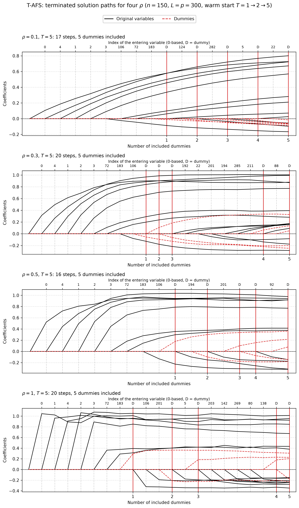

# Demo: T-AFS (Adaptive Forward Stepwise) Solver

## Purpose

This demo illustrates the **T-AFS (Terminating Adaptive Forward Stepwise)** solver.

T-AFS is a forward-selection method with an adaptive decision rule that adjusts the variable-selection criterion as the active set evolves. The demo shows how the solver is used in five settings:

1. basic execution with early stopping,
2. external versus internal normalization,
3. serialization and warm-start continuation,
4. operation on memory-mapped data,
5. terminated solution paths for four values of $\rho$, drawn as a figure.

---

## Key idea

Like the other terminating solvers, T-AFS stops early once a prescribed number $T_{\text{stop}}$ of dummy variables has entered the active set:

```math
\hat{\boldsymbol{\beta}}^{(T)} = \mathrm{TAFS}(\mathbf{X}, \mathbf{D}, \mathbf{y}; T_{\text{stop}}).
```

In the demo, this is done through calls of the form

```cpp
executeStep(T_stop, /*early_stop=*/true)
```

so, with `early_stop=true`, the solver terminates early once the number of dummy variables in the active set reaches $T_{\text{stop}}$.

---

## Demo structure

### 1. Basic T-AFS with early stopping

The first part runs T-AFS with **internal normalization** and an intercept on synthetic data, in both a high-dimensional regime $(p > n)$ and a low-dimensional regime $(n > p)$.

After execution, the demo prints the selected variables and selection-quality diagnostics relative to the known true support.

### 2. External normalization

The second part applies external L2 normalization to both the signal matrix and the dummy matrix, centers the response manually, and then runs T-AFS with internal normalization disabled.

This demonstrates the externally normalized workflow and allows it to be compared conceptually with the internally normalized workflow from the first part.

### 3. Serialization and warm start

The third part runs a reference fit to a final stopping level, then separately runs a shorter partial fit, saves the solver state to disk, reloads it, and continues from the checkpoint to the same final stopping level.

The data are normalized once in front (`scaler::LpNormScaler` on `X` and `D`, `y` centered) and the reference, checkpoint and resumed solvers run as readers (`.normalize = false, .intercept = false`), so the three solvers share the data without copies and the paths are bit-identical. Three writer solvers on the same data would each center and scale it in place, which moves the data by rounding and made the paths differ (the 2026-09-25 finding). Under the library's in-place contract, a second writer on a held buffer now raises an error instead.

The reloaded run is compared against the reference path using the final number of steps, the final RSS difference, the final $R^2$ difference, and equality of the recorded action path.

### 4. Memory-mapped data

The fourth part generates synthetic data directly on disk, retrieves memory-mapped views of $X$, $D$, and $y$, and runs T-AFS on those mapped objects.

This shows that the solver can also be used in workflows where large matrices are stored on disk rather than held entirely in ordinary in-memory matrices.

### 5. Terminated solution paths

The fifth part repeats the quick start of the R tlars vignette. With $n = 150$, $p = 300$, five true coefficients
equal to 1 and $L = p = 300$ dummies, one T-AFS object per $\rho \in \lbrace 0.1, 0.3, 0.5, 1 \rbrace$ runs to $T = 1$
and is then warm-started to $T = 2$ and $T = 5$. Each call continues the stored path, and a snapshot of the path after
each call goes to `simulation_results/data/`. The setting `snr = 5` gives a noise standard deviation of about 1, as in
the vignette.

```text
=== Demo 5: T-AFS Terminated Solution Paths (rho = 0.1) ===
============================================================
Configuration:
  n = 150, p = 300
  num_dummies = 300
  T_stop = 5
  True support size = 5
  True support: 0 1 2 3 4
  True coefficients: 1 1 1 1 1
  SNR = 5

T_stop = 1: steps =  9, predictors =  8, dummies = 1, FDP = 0.375, TPP = 1.000
T_stop = 2: steps = 11, predictors =  9, dummies = 2, FDP = 0.444, TPP = 1.000
T_stop = 5: steps = 17, predictors = 12, dummies = 5, FDP = 0.583, TPP = 1.000

Selection:
  Predictors: {0, 4, 1, 2, 3, 106, 72, 183, 124, 282, 5, 22}
  Dummies: {315, 564, 321, 399, 355}
  Path: [+v0, +v4, +v1, +v2, +v3, +v106, +v72, +v183, +D15, +v124, +D264, +v282, +D21, +v5, +D99, +v22, +D55]

Path data written to:
  .../cpp/tsolvers/demo_ts_12_tafs/simulation_results/data/tafs_rho_0.1_terminated_paths_path.csv
  .../cpp/tsolvers/demo_ts_12_tafs/simulation_results/data/tafs_rho_0.1_terminated_paths_actions.csv


============================================================
=== Demo 5: T-AFS Terminated Solution Paths (rho = 0.3) ===
============================================================
Configuration:
  n = 150, p = 300
  num_dummies = 300
  T_stop = 5
  True support size = 5
  True support: 0 1 2 3 4
  True coefficients: 1 1 1 1 1
  SNR = 5

T_stop = 1: steps =  9, predictors =  8, dummies = 1, FDP = 0.375, TPP = 1.000
T_stop = 2: steps = 10, predictors =  8, dummies = 2, FDP = 0.375, TPP = 1.000
T_stop = 5: steps = 20, predictors = 15, dummies = 5, FDP = 0.667, TPP = 1.000

Selection:
  Predictors: {0, 4, 1, 2, 3, 72, 183, 106, 192, 22, 201, 194, 285, 211, 88}
  Dummies: {564, 383, 399, 339, 537}
  Path: [+v0, +v4, +v1, +v2, +v3, +v72, +v183, +v106, +D264, +D83, +D99, +v192, +v22, +v201, +v194, +v285, +v211, +D39, +v88, +D237]

Path data written to:
  .../cpp/tsolvers/demo_ts_12_tafs/simulation_results/data/tafs_rho_0.3_terminated_paths_path.csv
  .../cpp/tsolvers/demo_ts_12_tafs/simulation_results/data/tafs_rho_0.3_terminated_paths_actions.csv


============================================================
=== Demo 5: T-AFS Terminated Solution Paths (rho = 0.5) ===
============================================================
Configuration:
  n = 150, p = 300
  num_dummies = 300
  T_stop = 5
  True support size = 5
  True support: 0 1 2 3 4
  True coefficients: 1 1 1 1 1
  SNR = 5

T_stop = 1: steps =  9, predictors =  8, dummies = 1, FDP = 0.375, TPP = 1.000
T_stop = 2: steps = 11, predictors =  9, dummies = 2, FDP = 0.444, TPP = 1.000
T_stop = 5: steps = 16, predictors = 11, dummies = 5, FDP = 0.545, TPP = 1.000

Selection:
  Predictors: {0, 4, 1, 2, 3, 72, 183, 106, 194, 201, 92}
  Dummies: {383, 399, 339, 553, 308}
  Path: [+v0, +v4, +v1, +v2, +v3, +v72, +v183, +v106, +D83, +v194, +D99, +v201, +D39, +D253, +v92, +D8]

Path data written to:
  .../cpp/tsolvers/demo_ts_12_tafs/simulation_results/data/tafs_rho_0.5_terminated_paths_path.csv
  .../cpp/tsolvers/demo_ts_12_tafs/simulation_results/data/tafs_rho_0.5_terminated_paths_actions.csv


============================================================
=== Demo 5: T-AFS Terminated Solution Paths (rho = 1.0) ===
============================================================
Configuration:
  n = 150, p = 300
  num_dummies = 300
  T_stop = 5
  True support size = 5
  True support: 0 1 2 3 4
  True coefficients: 1 1 1 1 1
  SNR = 5

T_stop = 1: steps =  8, predictors =  7, dummies = 1, FDP = 0.286, TPP = 1.000
T_stop = 2: steps = 11, predictors =  9, dummies = 2, FDP = 0.444, TPP = 1.000
T_stop = 5: steps = 20, predictors = 15, dummies = 5, FDP = 0.667, TPP = 1.000

Selection:
  Predictors: {0, 1, 4, 2, 3, 72, 183, 106, 201, 5, 203, 142, 269, 80, 138}
  Dummies: {383, 399, 357, 372, 388}
  Path: [+v0, +v1, +v4, +v2, +v3, +v72, +v183, +D83, +v106, +v201, +D99, +v5, +D57, +v203, +v142, +v269, +v80, +v138, +D72, +D88]

Path data written to:
  .../cpp/tsolvers/demo_ts_12_tafs/simulation_results/data/tafs_rho_1.0_terminated_paths_path.csv
  .../cpp/tsolvers/demo_ts_12_tafs/simulation_results/data/tafs_rho_1.0_terminated_paths_actions.csv
```

Adaptive forward stepwise (AFS) shrinks each forward-stepwise update by the factor $\rho$. It is forward stepwise at
$\rho = 1$ and approaches least angle regression (LAR) and the lasso as $\rho \to 0$. At $\rho = 0.1$ the coefficients
grow gradually over many steps as in T-LARS, the first five variables enter in the T-LARS order 0, 4, 1, 2, 3, and the
five true coefficients end at 0.57 to 0.80, close to the 0.57 to 0.83 of T-LARS. At $\rho = 1$ every entering variable
jumps to its least-squares size, and the path equals the T-OMP path of [demo_ts_06_tomp](../demo_ts_06_tomp/README.md)
to the last digit, with true coefficients of 0.67 to 1.01. The values 0.3 and 0.5 lie in between. The true positive
proportion (TPP) is 1 in all runs, while the false discovery proportion (FDP) at $T = 5$ ranges from 0.545 at
$\rho = 0.5$ to 0.667 at $\rho = 0.3$ and $\rho = 1$. The figure shows each path at $T = 5$, where the red lines also
mark where the runs to $T = 1$ and $T = 2$ ended. Original variables are black, dummies red and dashed, a red vertical
line marks each included dummy, and the top axis names the variable that enters at each step.



---

## Running

From the repository root, after `cmake --preset release && cmake --build --preset release-build` in `cpp/`:

```bash
cpp/build/release/bin/tsolvers/demo_ts_12_tafs/demo_ts_12_tafs      # Parts 1-5
cpp/build/release/bin/tsolvers/demo_ts_12_tafs/demo_ts_12_tafs 5    # Part 5 only
cpp/tsolvers/demo_ts_12_tafs/generate_plots.sh                        # path figure from the Part 5 data
```

The optional arguments select the parts to run. Part 4 writes about 44 GB of temporary files, so `5` refreshes the
path data in well under a second without it. `generate_plots.sh` uses the repository's `.venv` and writes the figure
as PNG and PDF to `simulation_results/plots/`.

The demo prints its diagnostics to the console, including configuration summaries, selected variables, selection-quality measures, serialization checks, and memory-mapped execution status messages.

---

## What to look for

When reading the console output, focus on the following points:

- whether the selected variables recover the known true support reasonably well,
- how the solver behaves under both high-dimensional and low-dimensional settings,
- whether externally normalized and internally normalized workflows both execute successfully,
- whether the serialized solver state can be reloaded and continued without changing the final path,
- whether the memory-mapped workflow completes successfully and cleans up its temporary files,
- how the terminated path grows with $T$ when the same object is warm-started.

Conceptually, T-AFS is a useful counterpart to plain T-Stepwise because its adaptive selection rule may behave differently once the active set begins to grow, especially in correlated designs.

---

## Notes

- The synthetic data are generated with known support and coefficients, so the selected path can be compared against ground truth.
- The serialization example writes a temporary checkpoint file and removes it afterward.
- The memory-mapped example writes temporary files for $X$, $D$, and $y$, runs T-AFS on those mapped views, and removes those files at the end.
- The path data and figures under `simulation_results/` are committed, so the figure is visible without a run.
