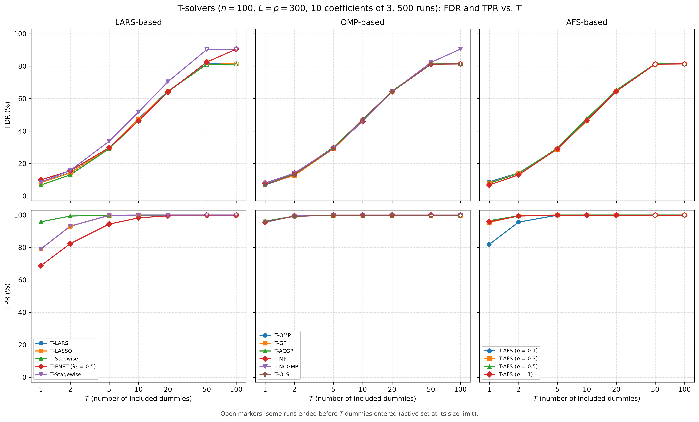
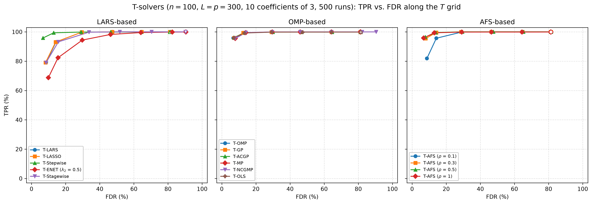
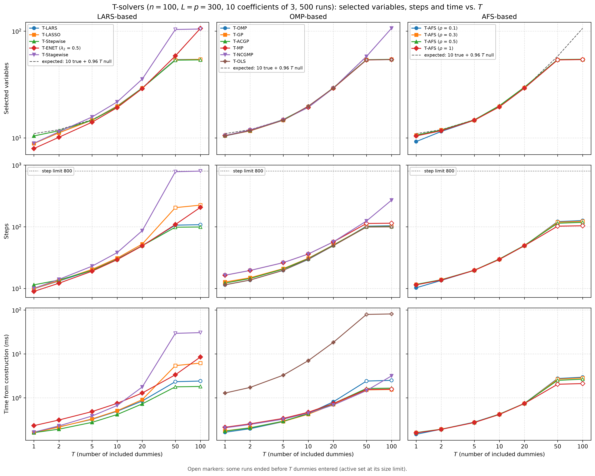

# Demo: FDR and TPR of the T-Solvers vs. T

## Purpose

This demo compares the terminated solution paths of all demo T-solvers by their false discovery rate (FDR) and true
positive rate (TPR) as the number $T$ of included dummies grows. It repeats the simulation study of the R tlars
vignette, runs it for every solver on the same data, and warm-starts each solver along the $T$ grid instead of
fitting every $T$ from scratch.

---

## Setup

- $n = 100$ observations and $p = 300$ variables with independent standard normal entries,
- ten true coefficients equal to 3 on a fixed random support, noise standard deviation about 1 (`snr = 90`),
- $L = p = 300$ standard normal dummies, drawn fresh in every run,
- $T \in \lbrace 1, 2, 5, 10, 20, 50, 100 \rbrace$ and 500 Monte Carlo runs.

Each run scales $\mathbf{X}$ and $\mathbf{D}$ once and hands them to all 15 solver configurations as readers. These
are the 12 solvers of the solver demos with their demo settings (T-ENET with $\lambda_2 = 0.5$, T-NCGMP in its
line-search variant) and T-AFS for $\rho \in \lbrace 0.1, 0.3, 0.5, 1 \rbrace$.

A variable counts as selected when its coefficient is nonzero, as in the T-Rex selector and the vignette. With the
selected set $\widehat{\mathcal{A}}$ and the true support $\mathcal{A}$, the false discovery proportion (FDP) and the
true positive proportion (TPP) of a run are

```math
\mathrm{FDP} = \frac{\lvert \widehat{\mathcal{A}} \setminus \mathcal{A} \rvert}
{\max(1, \lvert \widehat{\mathcal{A}} \rvert)},
\qquad
\mathrm{TPP} = \frac{\lvert \widehat{\mathcal{A}} \cap \mathcal{A} \rvert}{\max(1, \lvert \mathcal{A} \rvert)},
```

and FDR and TPR are their means over the runs.

---

## Running the demo

From the repository root, after `cmake --preset release && cmake --build --preset release-build` in `cpp/`:

```bash
cpp/build/release/bin/tsolvers/demo_ts_perf_01_fdr_tpr_vs_T/demo_ts_perf_01_fdr_tpr_vs_T         # 500 runs, 6 threads
cpp/build/release/bin/tsolvers/demo_ts_perf_01_fdr_tpr_vs_T/demo_ts_perf_01_fdr_tpr_vs_T 20 8    # 20 runs, 8 threads
cpp/tsolvers/demo_ts_perf_01_fdr_tpr_vs_T/generate_plots.sh                                       # figures
```

The two optional arguments are the number of runs and of threads. The runs are spread over the threads, and each
solver runs single-threaded inside its run. The 500 runs take about 13 s on an Apple Silicon machine with 6 threads.
The result files carry the number of runs in their name (`fdr_tpr_vs_T_mc500.csv` and `.txt`), so a short test run
does not overwrite the full one. The output below is a run against library 8ad3376. The data are drawn with
`std::mt19937` and `std::normal_distribution`, and run $k$ uses the seed $1{,}000 + k$, so the results do not depend
on the number of threads. Another standard library, such as libstdc++ on Linux, may draw different data.

---

## Console walk-through

### FDR and TPR

```text
n = 100, p = 300, L = p = 300, true coefficients: 10 x 3, SNR = 90
True support: 34 48 63 67 76 128 138 162 191 278
T grid: 1 2 5 10 20 50 100
15 solvers, 500 runs on 6 threads

FDR (%)
solver                     T=1     T=2     T=5    T=10    T=20    T=50   T=100
------------------------------------------------------------------------------
T-LARS                     8.5    14.3    29.4    47.5    64.6    81.3    81.5
T-LASSO                    8.2    14.2    29.4    47.3    64.5    81.1    81.5
T-Stepwise                 6.8    13.0    29.1    46.5    64.4    81.1    81.3
T-ENET (lambda2 0.5)       9.9    15.6    29.7    46.3    64.1    82.5    90.5
T-Stagewise                8.5    15.7    33.7    51.8    70.4    90.2    90.4
T-OMP                      6.8    13.0    29.1    46.5    64.4    81.2    81.4
T-GP                       7.2    12.6    29.1    46.3    64.3    81.3    81.5
T-ACGP                     7.1    13.5    30.0    46.9    64.7    81.3    81.5
T-MP                       7.9    14.1    29.6    45.9    64.3    81.2    81.4
T-NCGMP                    7.9    14.1    29.6    45.9    64.3    82.3    90.5
T-OLS                      7.0    13.2    29.2    47.4    64.3    81.3    81.4
T-AFS (rho 0.1)            8.7    14.2    29.1    46.6    64.4    81.3    81.5
T-AFS (rho 0.3)            7.9    14.1    28.8    46.4    64.7    81.2    81.4
T-AFS (rho 0.5)            7.8    13.9    29.5    47.7    65.3    81.4    81.5
T-AFS (rho 1)              6.8    13.0    29.1    46.5    64.4    81.2    81.4

TPR (%)
solver                     T=1     T=2     T=5    T=10    T=20    T=50   T=100
------------------------------------------------------------------------------
T-LARS                    79.1    93.1    99.8   100.0   100.0   100.0   100.0
T-LASSO                   79.1    93.1    99.8   100.0   100.0   100.0   100.0
T-Stepwise                95.8    99.4    99.9    99.9    99.9    99.9    99.9
T-ENET (lambda2 0.5)      68.8    82.4    94.4    98.2    99.5    99.9    99.9
T-Stagewise               79.1    93.2    99.8   100.0   100.0   100.0   100.0
T-OMP                     95.8    99.4    99.9    99.9    99.9    99.9    99.9
T-GP                      95.9    99.4    99.8    99.8    99.9    99.9    99.9
T-ACGP                    96.2    99.4    99.8    99.8    99.8    99.9    99.9
T-MP                      95.5    99.5    99.9    99.9   100.0   100.0   100.0
T-NCGMP                   95.5    99.5    99.9    99.9   100.0   100.0   100.0
T-OLS                     95.9    99.2    99.8    99.8    99.8    99.8    99.8
T-AFS (rho 0.1)           81.9    95.6    99.9   100.0   100.0   100.0   100.0
T-AFS (rho 0.3)           95.5    99.5   100.0   100.0   100.0   100.0   100.0
T-AFS (rho 0.5)           96.5    99.5   100.0   100.0   100.0   100.0   100.0
T-AFS (rho 1)             95.8    99.4    99.9    99.9    99.9    99.9    99.9
```

At $T = 1$ every solver keeps the FDR between 6.8% and 9.9%, and the TPR separates the families. The solvers that
refit by least squares after each entry (T-Stepwise, the OMP family and T-AFS for $\rho \ge 0.3$) find 95.5% to 96.5%
of the true variables. T-LARS, T-LASSO and T-Stagewise find 79.1%, T-ENET 68.8%, and T-AFS at $\rho = 0.1$ sits close
to its LARS end at 81.9%.

As $T$ grows, the FDR rises alike for all solvers except T-Stagewise, to about 29% at $T = 5$, 47% at $T = 10$ and 64%
at $T = 20$. This follows from the exchangeability of null variables and dummies. The 290 null variables and the 300
dummies are independent standard normal columns that carry no information about $\mathbf{y}$, so a solver cannot tell
them apart, and every order in which they enter the path is equally likely. When the $T$-th dummy enters, the number
$V_T$ of null variables that entered before it follows a negative hypergeometric distribution with mean

```math
\mathbb{E}[V_T] = \frac{p - s}{L + 1}\,T = \frac{290}{301}\,T \approx 0.96\,T.
```

With $s = 10$ true variables that are nearly always found, a path holds about $10 + 0.96\,T$ variables, which matches
the tables. At $T = 20$, for example, the OMP paths hold 29.3 variables, 19.3 of them null against the expected 19.3.
This is the idea behind the T-Rex selector. The included dummies count the null variables that entered, so they
estimate the false discoveries of a path. The TPR reaches 100% by $T = 5$ for most solvers. A single terminated path
therefore trades FDR against TPR through $T$, and the T-Rex selector controls the FDR by averaging many such paths
with a calibrated $T$ and $L$.

### Paths that end early

```text
Runs that reached T dummies (%)
solver                     T=1     T=2     T=5    T=10    T=20    T=50   T=100
------------------------------------------------------------------------------
T-LARS                     100     100     100     100     100      19       0
T-LASSO                    100     100     100     100     100      25       0
T-Stepwise                 100     100     100     100     100      16       0
T-ENET (lambda2 0.5)       100     100     100     100     100     100     100
T-Stagewise                100     100     100     100     100      11       0
T-OMP                      100     100     100     100     100      18       0
T-GP                       100     100     100     100     100      22       0
T-ACGP                     100     100     100     100     100      19       0
T-MP                       100     100     100     100     100      21       0
T-NCGMP                    100     100     100     100     100     100     100
T-OLS                      100     100     100     100     100      17       0
T-AFS (rho 0.1)            100     100     100     100     100      20       0
T-AFS (rho 0.3)            100     100     100     100     100      19       0
T-AFS (rho 0.5)            100     100     100     100     100      17       0
T-AFS (rho 1)              100     100     100     100     100      18       0

Average number of selected variables
solver                     T=1     T=2     T=5    T=10    T=20    T=50   T=100
------------------------------------------------------------------------------
T-LARS                     8.9    11.2    14.7    19.9    29.3    54.1    54.4
T-LASSO                    8.8    11.1    14.7    19.8    29.3    53.7    54.4
T-Stepwise                10.4    11.7    14.6    19.5    29.3    53.4    53.8
T-ENET (lambda2 0.5)       7.9    10.1    14.0    19.2    28.9    58.6   106.1
T-Stagewise                8.9    11.4    15.7    21.7    35.5   103.6   104.7
T-OMP                     10.4    11.7    14.6    19.5    29.3    53.7    54.1
T-GP                      10.5    11.6    14.6    19.5    29.3    53.9    54.4
T-ACGP                    10.5    11.7    14.8    19.6    29.5    54.0    54.4
T-MP                      10.5    11.8    14.7    19.3    29.2    53.6    54.1
T-NCGMP                   10.5    11.8    14.7    19.3    29.2    57.8   106.4
T-OLS                     10.5    11.7    14.6    19.8    29.3    53.8    54.1
T-AFS (rho 0.1)            9.2    11.5    14.6    19.6    29.3    53.9    54.3
T-AFS (rho 0.3)           10.6    11.8    14.6    19.6    29.5    53.8    54.1
T-AFS (rho 0.5)           10.6    11.8    14.7    20.0    29.9    54.1    54.5
T-AFS (rho 1)             10.4    11.7    14.6    19.5    29.3    53.7    54.1
```

Without an intercept, the active set of most solvers is capped at $n = 100$ variables, dummies included. At $T = 50$
only 11% to 25% of the runs reach 50 dummies before the cap, and no run reaches 100. The paths then end with about 54
original variables and 46 dummies, and the FDR stays at about 81%. The open markers in the figures show these $T$
values.

Three solvers go further. T-ENET reaches 100 dummies in every run, because an elastic-net path with $\lambda_2 > 0$
may hold more than $n$ variables, as in the algorithm of Zou and Hastie (2005). T-NCGMP does as well, because its
line-search variant may select a variable again and has no active-set cap, while T-MP stops at $n$ active variables.
Both end at an FDR of 90.5% with about 106 selected variables. T-Stagewise freezes the variables it drops from the
active set, and a frozen variable keeps its coefficient, so its selection grows to more than 100 variables at
$T = 50$. It also cycles through drops and re-entries and needs 86 steps to reach $T = 20$, against about 50 for the
other solvers. At $T = 100$ it ends at its limit of 800 steps.

### Steps and run time

```text
Average number of steps
solver                     T=1     T=2     T=5    T=10    T=20    T=50   T=100
------------------------------------------------------------------------------
T-LARS                     9.9    13.2    19.7    29.9    49.3   106.2   108.0
T-LASSO                    9.9    13.4    20.4    30.9    52.4   204.3   224.4
T-Stepwise                11.4    13.7    19.6    29.5    49.3    98.4    99.1
T-ENET (lambda2 0.5)       8.9    12.1    19.0    29.2    48.9   108.8   206.5
T-Stagewise               10.0    14.0    23.0    38.1    86.3   780.3   800.0
T-OMP                     11.4    13.7    19.6    29.5    49.3   102.2   103.8
T-GP                      12.7    14.9    20.9    30.8    50.6   100.4   101.3
T-ACGP                    12.2    14.5    20.6    30.4    50.2   100.0   100.7
T-MP                      16.4    19.6    26.2    36.1    56.9   113.1   114.2
T-NCGMP                   16.4    19.6    26.2    36.1    56.9   124.0   270.0
T-OLS                     11.5    13.7    19.6    29.8    49.3    98.9    99.6
T-AFS (rho 0.1)           10.2    13.5    19.6    29.6    49.3   121.3   126.0
T-AFS (rho 0.3)           11.6    13.8    19.6    29.6    49.5   118.7   122.5
T-AFS (rho 0.5)           11.6    13.8    19.7    30.0    49.9   114.1   117.8
T-AFS (rho 1)             11.4    13.7    19.6    29.5    49.3   102.2   103.8

Average time from construction to T (ms, cumulative)
solver                     T=1     T=2     T=5    T=10    T=20    T=50   T=100
------------------------------------------------------------------------------
T-LARS                    0.17    0.22    0.32    0.49    0.85    2.33    2.41
T-LASSO                   0.16    0.22    0.33    0.51    0.91    5.42    6.17
T-Stepwise                0.16    0.19    0.28    0.42    0.73    1.78    1.81
T-ENET (lambda2 0.5)      0.23    0.31    0.49    0.75    1.29    3.35    8.50
T-Stagewise               0.16    0.23    0.39    0.67    1.76   29.39   30.49
T-OMP                     0.16    0.20    0.29    0.44    0.81    2.41    2.50
T-GP                      0.18    0.21    0.29    0.42    0.71    1.52    1.55
T-ACGP                    0.17    0.21    0.29    0.43    0.74    1.63    1.66
T-MP                      0.21    0.26    0.34    0.47    0.74    1.54    1.57
T-NCGMP                   0.21    0.25    0.33    0.45    0.69    1.46    3.16
T-OLS                     1.28    1.72    3.27    7.03   18.32   79.29   81.29
T-AFS (rho 0.1)           0.15    0.19    0.28    0.43    0.75    2.75    2.95
T-AFS (rho 0.3)           0.16    0.19    0.27    0.42    0.74    2.66    2.83
T-AFS (rho 0.5)           0.16    0.19    0.28    0.42    0.75    2.50    2.66
T-AFS (rho 1)             0.16    0.19    0.27    0.42    0.74    2.04    2.11

Failed solver runs: 0
Wall time: 13.1 s
```

Up to $T = 20$, where every path still reaches its $T$, a whole warm-started path takes 0.7 to 1.3 ms for most
solvers, and T-OMP needs about 0.8 ms. Two solvers stand out. T-OLS needs about 1.3 ms already at $T = 1$ and 18 ms at
$T = 20$, because it scores every inactive candidate by its residual reduction after a refit and recomputes the inner
products with all active columns for each candidate. Its cost therefore grows with the square of the path length,
while T-OMP needs one pass over the candidates per step. T-Stagewise stays fast up to $T = 20$ with about 1.8 ms, and
its time jumps to 29 ms at $T = 50$, where the capped paths cycle through drops and re-entries for 780 steps on
average. T-LASSO shows the same effect more mildly, with 204 steps at $T = 50$ against 106 for T-LARS. The times at
$T = 50$ and 100 therefore describe the saturated regime rather than the solvers. They are measured inside the
parallel loop and serve for comparison only.

---

## Figures

The first figure shows FDR (top row) and TPR (bottom row) against $T$, one column per library family. Solvers with
identical results overlap within a panel: T-LARS lies under T-LASSO, and T-MP under T-NCGMP up to $T = 20$.



The second figure shows TPR against FDR along the $T$ grid. The least-squares refit solvers start near the top left
corner, with a TPR of about 96% at an FDR of about 7%, while T-LARS, T-LASSO, T-Stagewise and T-ENET need a larger $T$
and a higher FDR for the same TPR.



The third figure shows the remaining tables against $T$ on log axes. The dashed line in the top row is the expected
selection $10 + 0.96\,T$ derived above. The OMP family and T-AFS follow it until the active-set cap stops their paths
after $T = 20$. T-ENET and T-NCGMP, which have no cap at $n$, stay on it up to $T = 100$ with about 106 variables. The
LARS-based solvers start below the line because they find fewer true variables at $T = 1$, and T-Stagewise rises above
it as its frozen variables pile up. The middle row shows T-Stagewise reaching the step limit of 800 and T-LASSO and
T-NCGMP climbing at saturation. The bottom row shows the quadratic cost of T-OLS, a decade above the rest of its
family at every $T$, and the jump of T-Stagewise at $T = 50$.



---

## Technical notes

- The loop of the vignette passes the loop index `t` instead of `T_vec[t]` to `tlars()`. The published curves are
  therefore the results for $T = 1, \dots, 7$, drawn at the positions 1, 2, 5, 10, 20, 50 and 100. This demo runs the
  intended grid.
- Every solver gets the seed of its run for its tie-break engine, which resolves exact ties such as several dummies
  entering at once. The library default seeds that engine from `std::random_device`, which made single runs at $T = 50$
  differ between repetitions.
- The support is drawn once with the seed 12345 and printed 0-based. In the vignette it comes from an unseeded
  `sample()`.
- The active set is not the selection for every solver. T-Stagewise keeps frozen variables with their coefficients
  outside it, so this demo selects by nonzero coefficient, as the T-Rex selector does.
- T-Stepwise and T-OMP follow the same steps but stop by the rules of their families (LARS and OMP), so they differ
  slightly once the paths reach the cap at $T = 50$.
