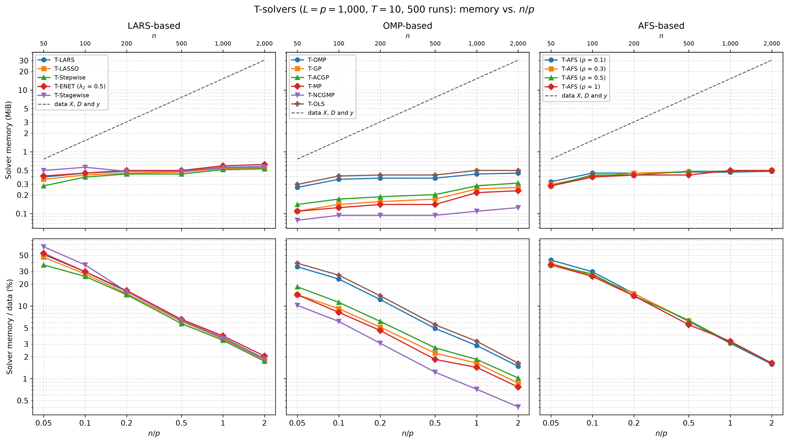

# Demo: Memory of the T-Solvers vs. the Ratio n/p

## Purpose

This demo measures the solver memory of the demo T-solvers, the memory a solver allocates beyond the data it works on,
for a fixed number $p$ of variables and a growing number $n$ of observations, so the ratio $n/p$ runs from 0.05 to 2.
It compares the solver memory with the size of the data and reports the number of steps to $T$, which sets the length
of the stored path.

---

## Setup

- $p = 1{,}000$ variables and $n \in \lbrace 50, 100, 200, 500, 1{,}000, 2{,}000 \rbrace$ observations with
  independent standard normal entries,
- ten true coefficients equal to 3 on a fixed random support, noise standard deviation about 1 (`snr = 90`),
- $L = p$ standard normal dummies and $T = 10$,
- 500 Monte Carlo runs, with medians over the runs.

For every run and $n$ the demo draws the data with the seed of the run. It centers and scales $\mathbf{X}$ and
$\mathbf{D}$ and centers $\mathbf{y}$ once, and all 15 solver configurations of
[demo_ts_perf_01](../demo_ts_perf_01_fdr_tpr_vs_T/README.md) run on it as precentered readers to $T = 10$. Each solver
runs in a process of its own, which reports its solver memory (see the technical notes).
The data take

```math
8\,n\,(p + L + 1)\ \text{bytes} = 16{,}008\,n\ \text{bytes},
```

which is 0.76 mebibytes (MiB, $2^{20}$ bytes) at $n = 50$ and 30.5 MiB at $n = 2{,}000$.

---

## Running the demo

From the repository root, after `cmake --preset release && cmake --build --preset release-build` in `cpp/`:

```bash
cpp/build/release/bin/tsolvers/demo_ts_perf_03_memory_vs_np/demo_ts_perf_03_memory_vs_np        # 500 runs, 6 children
cpp/build/release/bin/tsolvers/demo_ts_perf_03_memory_vs_np/demo_ts_perf_03_memory_vs_np 5 3    # 5 runs, 3 children
cpp/tsolvers/demo_ts_perf_03_memory_vs_np/generate_plots.sh                                     # figure
```

The two optional arguments are the number of runs and the number of solver processes that run at the same time. The
500 runs take about 4 minutes on an Apple Silicon machine with 6 processes at a time. The result files carry the number
of runs in their name (`memory_vs_np_mc500.csv` and `.txt`), so a short test run does not overwrite the full one. The
output below is a run against library b95b984.

---

## Console walk-through

### Solver memory

```text
p = 1000, L = p, n in {50, 100, 200, 500, 1000, 2000}, T = 10, true coefficients: 10 x 3, SNR = 90
15 solvers, 500 runs, 6 children at a time (one forked child per solver)

Data X, D and y (MiB)
solver                     n=50    n=100    n=200    n=500   n=1000   n=2000
----------------------------------------------------------------------------
all solvers                0.76     1.53     3.05     7.63    15.27    30.53

Median solver memory (MiB)
solver                     n=50    n=100    n=200    n=500   n=1000   n=2000
----------------------------------------------------------------------------
T-LARS                     0.39     0.45     0.48     0.48     0.56     0.58
T-LASSO                    0.36     0.42     0.45     0.47     0.54     0.55
T-Stepwise                 0.28     0.39     0.44     0.44     0.52     0.53
T-ENET (lambda2 0.5)       0.41     0.45     0.50     0.50     0.59     0.62
T-Stagewise                0.50     0.56     0.48     0.48     0.55     0.57
T-OMP                      0.27     0.36     0.38     0.38     0.44     0.45
T-GP                       0.11     0.14     0.16     0.17     0.25     0.27
T-ACGP                     0.14     0.17     0.19     0.20     0.28     0.31
T-MP                       0.11     0.12     0.14     0.14     0.22     0.23
T-NCGMP                    0.08     0.09     0.09     0.09     0.11     0.12
T-OLS                      0.30     0.41     0.42     0.42     0.50     0.50
T-AFS (rho 0.1)            0.33     0.45     0.45     0.47     0.47     0.48
T-AFS (rho 0.3)            0.30     0.40     0.45     0.48     0.48     0.50
T-AFS (rho 0.5)            0.28     0.42     0.42     0.48     0.48     0.50
T-AFS (rho 1)              0.28     0.39     0.42     0.42     0.50     0.50

Largest solver memory over the runs (MiB)
solver                     n=50    n=100    n=200    n=500   n=1000   n=2000
----------------------------------------------------------------------------
T-LARS                     0.62     0.67     0.70     0.66     0.72     0.81
T-LASSO                    0.61     0.77     0.72     0.66     0.72     0.81
T-Stepwise                 0.48     0.61     0.59     0.67     0.73     0.81
T-ENET (lambda2 0.5)       0.58     0.69     0.66     0.67     0.75     0.80
T-Stagewise                0.95     0.92     0.97     0.73     0.72     0.80
T-OMP                      0.45     0.66     0.58     0.69     0.73     0.80
T-GP                       0.22     0.19     0.22     0.23     0.33     0.33
T-ACGP                     0.23     0.27     0.25     0.30     0.36     0.39
T-MP                       0.14     0.19     0.20     0.19     0.28     0.30
T-NCGMP                    0.12     0.11     0.12     0.12     0.14     0.14
T-OLS                      0.56     0.64     0.66     0.78     0.80     0.86
T-AFS (rho 0.1)            0.53     0.64     0.70     0.66     0.64     0.67
T-AFS (rho 0.3)            0.48     0.61     0.59     0.72     0.66     0.78
T-AFS (rho 0.5)            0.64     0.59     0.61     0.72     0.72     0.73
T-AFS (rho 1)              0.48     0.62     0.58     0.67     0.72     0.80
```

The data grow 40-fold from $n = 50$ to $n = 2{,}000$, while the solver memory stays at 0.62 MiB or less in the
median and below 1 MiB in every single run. T-LARS needs 0.39 MiB at $n = 50$ and 0.58 MiB at $n = 2{,}000$, 1.5 times
as much for 40 times as many observations. At $n = 2{,}000$ the LARS family needs 0.53 to 0.62 MiB, and T-OMP, T-OLS
and T-AFS need 0.45 to 0.50 MiB. T-GP, T-ACGP and T-MP need about half of that, and T-NCGMP needs the least with
0.12 MiB.

The solver memory hardly depends on $n$ because the solvers work on the caller's $\mathbf{X}$ and $\mathbf{D}$ without a
copy. They keep a centered copy of $\mathbf{y}$, vectors of length $n$ and $p + L$ such as the residual and the
correlations, the Cholesky factor of the active set with $k \times k$ entries, and the sparse path. At $n = 2{,}000$
such a vector takes 16,000 bytes, so the half mebibyte of the LARS family amounts to about 30 vectors.

### Share of the data

```text
Median solver memory relative to the data (%)
solver                     n=50    n=100    n=200    n=500   n=1000   n=2000
----------------------------------------------------------------------------
T-LARS                     51.2     29.7     15.9      6.3      3.7      1.9
T-LASSO                    47.1     27.6     14.8      6.1      3.5      1.8
T-Stepwise                 36.8     25.6     14.3      5.7      3.4      1.7
T-ENET (lambda2 0.5)       53.2     29.7     16.4      6.6      3.9      2.0
T-Stagewise                65.5     36.8     15.9      6.3      3.6      1.9
T-OMP                      34.8     23.5     12.3      4.9      2.9      1.5
T-GP                       14.3      9.2      5.1      2.3      1.6      0.9
T-ACGP                     18.4     11.3      6.1      2.7      1.8      1.0
T-MP                       14.3      8.2      4.6      1.8      1.4      0.8
T-NCGMP                    10.2      6.1      3.1      1.2      0.7      0.4
T-OLS                      38.9     26.6     13.8      5.5      3.3      1.6
T-AFS (rho 0.1)            43.0     29.7     14.8      6.1      3.1      1.6
T-AFS (rho 0.3)            38.9     26.1     14.8      6.2      3.2      1.6
T-AFS (rho 0.5)            36.8     27.6     13.8      6.3      3.2      1.6
T-AFS (rho 1)              36.8     25.6     13.8      5.5      3.3      1.6
```

Since the solver memory is nearly constant, its share of the data falls roughly like $1/n$. At $n/p = 0.05$
the solvers add 10% to 66% to the data, and from $n/p = 0.5$ on they add less than 7%. At $n/p = 2$ the share is 0.4%
to 2%, so the data set the memory of a terminated path in all but the smallest problems.

### Steps to $T = 10$

```text
Median steps to T = 10
solver                     n=50    n=100    n=200    n=500   n=1000   n=2000
----------------------------------------------------------------------------
T-LARS                     24.0     29.0     29.0     29.0     29.0     29.0
T-LASSO                    25.0     31.0     29.0     29.0     29.0     29.0
T-Stepwise                 21.0     29.0     30.0     29.0     29.0     29.0
T-ENET (lambda2 0.5)       24.0     28.0     30.0     29.0     29.0     29.0
T-Stagewise                34.0     40.0     30.0     29.0     29.0     29.0
T-OMP                      21.0     29.0     30.0     29.0     29.0     29.0
T-GP                       21.0     30.0     31.0     30.0     30.0     30.0
T-ACGP                     21.0     30.0     30.0     30.0     30.0     30.0
T-MP                       21.0     34.0     36.0     36.0     36.0     36.0
T-NCGMP                    21.0     34.0     36.0     36.0     36.0     36.0
T-OLS                      21.0     29.0     30.0     29.0     29.0     29.0
T-AFS (rho 0.1)            23.0     29.0     29.0     29.5     29.0     29.0
T-AFS (rho 0.3)            22.0     29.0     29.0     30.0     30.0     29.0
T-AFS (rho 0.5)            21.0     29.0     30.0     29.0     29.0     29.0
T-AFS (rho 1)              21.0     29.0     30.0     29.0     29.0     29.0

Failed solver runs: 0
Wall time: 245.6 s
```

From $n = 200$ on most solvers need 29 to 30 steps, and T-MP and T-NCGMP need 36, as at $L = p$ in
[demo_ts_perf_02](../demo_ts_perf_02_runtime_vs_dummies/README.md). By the exchangeability count of that demo, a path
to the tenth dummy holds the ten dummies and about ten null variables. The 21 to 25 steps at $n = 50$ therefore leave
room for only one to five of the ten true variables, and the shorter paths fit the lower memory there. T-Stagewise is
the exception, with 34 and 40 steps at $n = 50$ and $n = 100$, and its memory there exceeds the one at $n = 200$.

---

## Figures

The figure shows the solver memory against $n/p$ on log axes, one column per library family, with $n$ on
the top axis. The dashed line in the top row is the size of the data, and the bottom row shows the solver memory as a
share of the data.



---

## Technical notes

- Every solver runs in a forked child process. The child first reads every page of $\mathbf{X}$, $\mathbf{D}$ and
  $\mathbf{y}$ and solves a small warm-up problem with 20 observations, 30 variables and 30 dummies, which loads the
  code of the solver and sets up the allocator. It then takes the peak resident memory from `getrusage()` as the
  baseline, runs the solver to $T = 10$ and reports the new peak minus the baseline. A child starts its own peak count,
  so neither the parent nor the other children enter. Without the warm-up, the first load of the library code adds
  about 0.8 MiB to every solver.
- Resident memory grows in pages of 16 kibibytes on Apple Silicon, and the allocator keeps freed blocks for reuse. The
  medians therefore move in steps of a few pages, such as the rise of 0.06 to 0.08 MiB between $n = 500$ and
  $n = 1{,}000$ in most solvers.
- A writer, a solver with `normalize` or `intercept` on, centers and scales the caller's $\mathbf{X}$ and
  $\mathbf{D}$ in place and restores them afterwards, so it does not copy the data either. This demo runs the
  precentered readers only.
